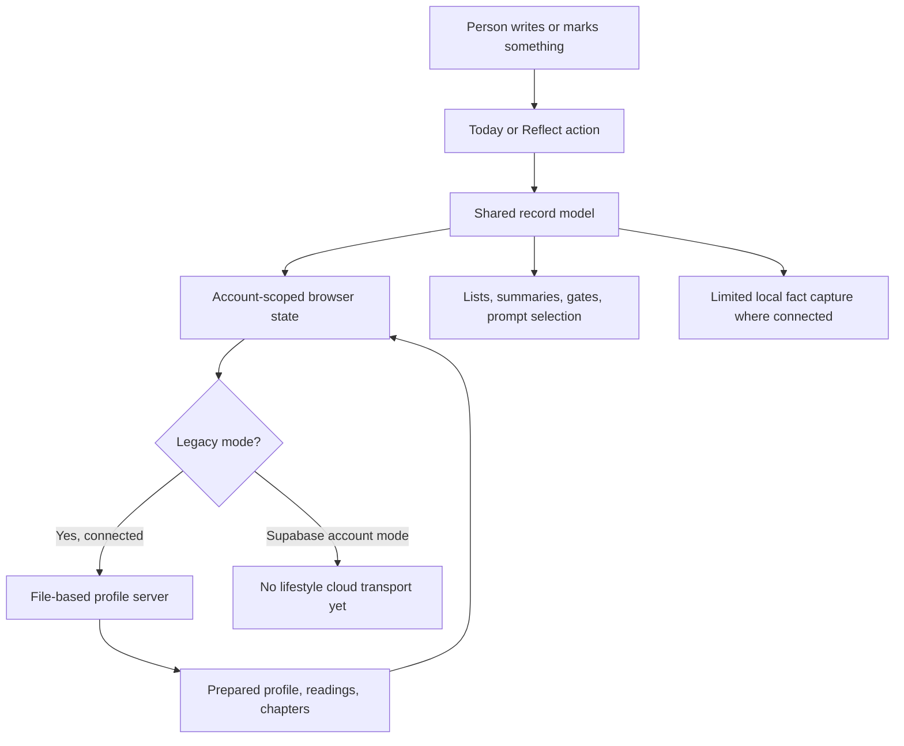

# Circle OS: features, personal data, and future direction

Date: 2026-11-01, Asia/Bangkok. Repository snapshot: `paing-branch`, commit `a0a96e6`.

This report explains the app as it exists in this repository: what a person can do, what is stored, how that information is used, what is hidden or incomplete, and what the agreed future direction adds. It also identifies choices worth settling before expanding Supabase integration.

The developer approved creating this report. This is an audit, not a new product decision, implementation approval, or replacement for the owning product and design documents. Application code, existing documents, configuration, personal records, and remote services were not changed for this audit.

## Contents

1. [The main findings](#1-the-main-findings)
2. [What counts as implemented](#2-what-counts-as-implemented)
3. [The product map](#3-the-product-map)
4. [Accounts and entry](#4-accounts-and-entry)
5. [A person's first days](#5-a-persons-first-days)
6. [Today: writing and light content](#6-today-writing-and-light-content)
7. [Today: Routine, habits, and tasks](#7-today-routine-habits-and-tasks)
8. [Today: Protocol and phases](#8-today-protocol-and-phases)
9. [Today: Log and Week](#9-today-log-and-week)
10. [Reflect: wanted life and Athena](#10-reflect-wanted-life-and-athena)
11. [Chapters, Quests, and content delivery](#11-chapters-quests-and-content-delivery)
12. [Admin and authoring](#12-admin-and-authoring)
13. [Hidden and older capabilities](#13-hidden-and-older-capabilities)
14. [Every major kind of personal data](#14-every-major-kind-of-personal-data)
15. [What Athena currently does with data](#15-what-athena-currently-does-with-data)
16. [Storage, sync, installation, and technical structure](#16-storage-sync-installation-and-technical-structure)
17. [The planned Supabase and Athena system](#17-the-planned-supabase-and-athena-system)
18. [UI and UX behavior](#18-ui-and-ux-behavior)
19. [Known failures, limits, and document conflicts](#19-known-failures-limits-and-document-conflicts)
20. [Decisions to make before changing the system](#20-decisions-to-make-before-changing-the-system)
21. [Verification for this audit](#21-verification-for-this-audit)
22. [Complete bundled chapter and Quest inventory](#22-complete-bundled-chapter-and-quest-inventory)
23. [Source guide](#23-source-guide)

## 1. The main findings

**Circle OS is already a substantial local-first reflection app. Its account login exists, but its Supabase lifestyle database and evidence sync do not.**

The app combines several different jobs:

- Capture a current Note, dated Thoughts, and hourly activity.
- Keep habits, one-time tasks, weekly goals, and finite commitments called Protocol phases.
- Help the person describe a wanted life through declarations and guided chapters.
- Show prepared Athena readings and selected observations.
- Deliver short content, guided questions, onboarding, and learning paths.
- Provide a protected authoring workshop for the developer.

Five distinctions are especially important for redesigning it:

1. **Saving is different from keeping history.** Note saves one replaceable value. Thoughts saves multiple entries. Declarations create versions. Chapters keep answers by run and version. These are different data models, even when the screens look alike.
2. **Stored history is different from readable history.** Thoughts accumulate without a general user history screen. Athena editions accumulate in a bounded archive without an archive browser in Reflect. Some day and completion records remain stored after leaving the visible surface.
3. **Login is different from cloud sync.** A Supabase user can sign in and use isolated local records. Signing in does not currently copy those records into Supabase or restore them on another device.
4. **Athena's current display is different from live AI.** The app consumes prepared material, runs selected local rules, and contains analysis utilities. It has no implemented general live-model request pipeline for the proposed paid beta.
5. **Having code is different from having a released feature.** Dreamline and The Four contain substantial code behind disabled flags. Several older analysis functions remain in the repository without a current user-facing route.

The Note discussion is therefore a real product-design issue. If the intended experience is daily journaling with past-day review, the current one-value Note model does not provide it. Syncing that model safely would not create a journal by itself.

Sources: [current task](CURRENT_TASK.md), [architecture](PRODUCTION_ARCHITECTURE.md), [Note plan](NOTE_SYNC_PLAN.md), [main state model](../app/os/circle-os-model.js), [Today and provider](../app/os/circle-os-shell.tsx), [Reflect](../app/os/mirror/page.tsx).

## 2. What counts as implemented

This report uses the following distinctions throughout.

| Label | Meaning |
| --- | --- |
| Current surface | A route or control is connected to implementation in the source. This does not certify it on every device. |
| Local capability | Works on browser records or pure functions without a production evidence backend. |
| Legacy integration | Uses the existing file-based profile server, not Supabase evidence storage. |
| Prepared-content capability | Can receive and display authored/prepared information; does not establish that an external scheduler is operating correctly. |
| Hidden capability | Source and models exist, but the ordinary UI is disabled or no general entry point was found. |
| Planned requirement | Confirmed product direction that still needs implementation and verification. |
| Proposal | A mechanism or design awaiting review; it is not an implemented guarantee. |
| Verification gap | The available evidence does not establish the claimed behavior in the relevant real environment. |

The audit inspected source and repository-owned documents. It did not inspect private vault records, secret environment values, the live hosted database, applied SMTP settings, production logs, or a real user's writing. It did not open archived handoffs because the current records and source supplied the necessary context.

No new browser, physical-phone, deployment, cloud-backup, or hosted-access certification is implied by this report. New local test evidence is listed in [section 21](#21-verification-for-this-audit).

## 3. The product map

### 3.1 Intended purpose

The owning product document calls Circle OS a lifestyle reflection system. Today receives evidence; Reflect helps the person see the life they want and the life they are living. Tasks and habits support that purpose rather than defining a person's worth.

Athena's intended role is to observe, ask, reflect, give grounded feedback, and motivate. The person chooses their own direction. A completion count is evidence, not proof that a life is good or bad.

### 3.2 Routes and surfaces

| Location | What it currently contains | Important boundary |
| --- | --- | --- |
| `/` | Public Circle website: purpose, values, principles, events, membership information, FAQ, external application link, theme control, and link to Circle OS | Public Circle community membership copy is separate from planned paid Athena access. |
| `/brand` | Brand guide, colors, typography, foundations, interaction examples, and downloadable brand assets | A reference surface, not a personal-data workspace. |
| `/os` | Today: Note/Thoughts, Routine/Protocol, Log/Week, chapters and full-screen chapter doors | This is the main input route. |
| `/os/mirror` | Reflect: wanted-life declarations, Athena's current reading, Quests, product suggestion input; legacy first-profile entry where applicable | The URL retains the older word `mirror`; the visible tab is Reflect. |
| `/os/connect` | Legacy profile-server address and connection check | It is not a Supabase connection settings page. |
| `/os/admin` | Protected Chapter Library, Workshop, and Button Studio | The existing authoring admin is not a beta membership or user-data administration console. |
| `/os/admin/unlock` | Server handler for the admin password and signed session cookie | Requires server configuration. Typing `admin` alone does not grant server authorization. |
| `/os/auth/confirm` | Entry for invitation/recovery links | Completes through the authentication boundary. |

The normal OS navigation exposes Today and Reflect. Account controls appear through the authentication boundary. Admin is deliberately absent from public navigation.

### 3.3 Capability snapshot

| Capability | Present status |
| --- | --- |
| Write/edit/clear the current Note | Implemented locally |
| Separate daily Note archive | Not implemented |
| Send multiple dated Thoughts | Implemented locally |
| Browse/search/edit all old Thoughts | No general user interface found |
| Answer Deep Thoughts | Implemented, with prepared and local prompt selection |
| Read quotes, jokes, facts and react | Implemented as Lines |
| Create/edit/tick habits and tasks | Implemented locally |
| Plan weekly goals and linked daily steps | Implemented locally |
| Start and keep finite Protocol phases | Implemented locally |
| Record hourly activities and small moments | Implemented locally |
| Review recent day evidence and complete weekly review | Implemented with limited navigation and defined chapter flows |
| Write/version wanted-life declarations | Implemented for the exposed declaration kinds |
| Store Character and six-month declarations | Model and setup outcomes exist; dedicated Reflect Pages remain pending |
| Read prepared Athena material | Implemented |
| Request a new live personalized reading/reply | Planned beta service, not implemented |
| Account login, alias, email recovery, logout | Implemented; hosted success partly developer-reported |
| Account-separated browser storage | Implemented and previously tested |
| Supabase lifestyle-record sync | Not implemented |
| Legacy file-based profile sync | Implemented for legacy mode |
| Paid access, payment collection, allowance enforcement | Planned; automated payment collection is outside beta scope |
| Home Screen web installation/offline shell | Implemented support; real-device coverage remains open |
| Native iOS/Android app | Long-term direction |
| Leaderboard/social sharing/reward economy | Not an implemented system |

## 4. Accounts and entry

### 4.1 Three runtime modes

| Mode | Entry | Storage and remote behavior |
| --- | --- | --- |
| `legacy` | Existing name/age/profile flow | Retains original browser keys and can use the file-based profile server. This remains the source default when no explicit mode is configured. |
| `supabase` | Email/password, confirmed email, password-link handling, alias | Selects account-scoped browser stores. Does not connect lifestyle evidence to Supabase tables. |
| `test` | Development-only onboarding without email, real name, or age | Uses synthetic account namespaces; reload resumes the same test; New test session creates a different empty test account. Production rejects this mode. |

The current handoff records local Supabase configuration and successful developer-reported sign-in. This audit did not read the ignored environment file or establish the configuration of a deployed build.

### 4.2 Supabase account capabilities

The existing implementation provides:

- Email/password sign-in.
- Online verification of the signed-in user and confirmed email.
- Invitation and recovery link consumption.
- Password entry before opening personal data after those links, including reload recovery of that step.
- A separate display alias. It is user metadata, not an authorization role.
- Alias selection and editing.
- Password-reset email requests.
- Persisted login and SDK token refresh support.
- Offline local entry after a previous successful online sign-in.
- Logout that closes the local account scope and removes local sign-in proof/credentials.
- Attempt guards so late asynchronous results cannot reopen an older account.
- Cross-tab/session-change handling and reconnect/foreground checks.

The UI does not provide an ordinary public sign-up journey. The recorded hosted settings recheck found public signup disabled, email login enabled, and confirmation required. Those settings are recorded evidence from the previous setup session, not a fresh remote check by this audit.

### 4.3 Offline authentication is deliberately limited

After online verification, the app retains a signed offline proof and public verification keys. Offline entry verifies the proof's signature and identity fields. Token expiry is deliberately tolerated for local entry only; it is not permission to write to a remote service with expired credentials.

Consequences:

- A known person can keep using their retained local records while disconnected.
- A remote revocation cannot be detected until the device reconnects.
- First sign-in and password-link completion need a connection.
- Offline logout can close this browser; it cannot contact the remote service to revoke a session while disconnected.
- Account separation is an application boundary, not encryption of browser storage against someone with device or script access.

### 4.4 What another device receives today

Signing into the same Supabase account on a new device authenticates the same account. It does not currently download the first device's lifestyle records, because that evidence-sync system has not been implemented.

The old profile server has its own recovery and device-attachment mechanisms. Those are legacy credentials and ownership rules, not a substitute for the target account sync. Legacy recovery rotates keys; the recovery code must be treated as sensitive. This report intentionally includes no personal profile codes or keys.

Sources: [authentication boundary](../app/os/auth/auth-boundary.tsx), [controller](../app/os/auth/auth-controller.js), [Supabase adapter](../app/os/auth/supabase-client.ts), [offline proof](../app/os/auth/offline-proof.js), [account scope](../app/os/account-scope.js), [development test session](../app/os/auth/development-test-session.js).

## 5. A person's first days

### 5.1 First entry and Day One

The current Day One is version 3, a five-Page journey containing a cover, two required questions, one optional action, and a completion Page.

It asks:

1. What matters most to you right now?
2. What would you like to be different?
3. Optionally, what is one small thing you would like to try?

These answers are stored as dated chapter evidence. Completing this version does not silently create an identity, habit, task, Protocol, or weekly goal from those answers. Its summary reads the person's supplied words.

That is different from older Day One versions, whose completion handlers could create commitments and declarations. The shared handler preserves those old outcomes for old runs. A started older run resumes its own chapter version. Previous completions still count toward access. The developer also explicitly allowed the current sole user to see version 3 after completing an older version.

### 5.2 Access and setup are separate

- Protocol access depends on completion of Day One, not merely on elapsed days.
- Week access depends on completion of Week Setup.
- Other Apps do not acquire these two access gates through this mechanism.
- Routine can show its usable empty state after short Day One without pretending the Habit Building chapter was completed.
- Protocol can begin through its existing Start a phase path when no phase exists.

The app may still offer setup content to teach a feature. That is different from locking the feature.

### 5.3 The next Circle day and Week Setup

Week Setup can be offered after a completed Day One is behind the person by at least one Circle day. The Circle day starts at 06:00; returning at 02:00 is still the previous day.

Week Setup is currently much longer than the new Day One. Its latest bundled definition has 15 Pages and collects:

- A six-month picture and why it matters.
- Character traits for mind, body, spirit, and social life.
- A weekly goal.
- A first step.
- A seven-day non-negotiable term.
- A recovery plan for a missed day.

On completion, its handler can create or update versioned declarations, a weekly goal, a linked task, and a seven-day Protocol phase. This is a substantial difference from the evidence-only Day One v3.

### 5.4 Daily and weekly doors

Full-screen chapter doors can offer Day One, Week Setup, Log Setup, Week Review, and a new-day chapter. The door model decides priority. A chapter explicitly opened from a Quest or Workshop can also be pinned into this shared path.

People can put a sheet down. Deferral is recorded rather than forcing completion. Setup-door deferral follows the Circle day, while scheduled content has its own return rules. These should not be described as one universal cooldown.

The new-day chapter records how the person is arriving and one thing for the day. Its current save handler stores the chapter run; it does not turn that answer into a new Routine task. Daily opening runs are keyed by day, so yesterday's answers do not occupy today's sheet.

Sources: [Day One handler](../app/os/day-one-model.js), [access gates](../app/os/phases.js), [door selection](../app/os/day-door.js), [Today](../app/os/circle-os-shell.tsx), [bundled chapters](../app/os/chapters/published/index.json).

## 6. Today: writing and light content

### 6.1 Note

**Current purpose:** one editable place to keep words in front of the person.

The Note has two editable pieces: the prominent title/caption and supporting note text. They use the legacy identifiers `checkin-idle-title` and `checkin-note` in the profile survey answers.

Current behavior:

- Tap and edit in place.
- The editor commits on blur; its draft is not the same thing as a completed durable save.
- Clear empties both written regions, commits explicit empty values, and keeps the writing interaction open.
- First-use copy and a small rotating pool provide words when appropriate.
- The Note label opens a Line on the back of the same App Box.
- It does not automatically become a new record at midnight or 06:00.

The answer model removes the earlier answer for that question ID before storing its replacement. It stores an edit time, but no chain of old Note versions. An empty Note is represented as a dated empty answer rather than simply removing the record.

#### Daily example

| Day | Action | Result in the current implementation |
| --- | --- | --- |
| Monday | Write a note | One current saved Note value. |
| Tuesday | Open the app without changing it | Monday's text remains. |
| Tuesday | Add words below it | The combined text replaces the current value. |
| Tuesday | Replace all the text | The new text replaces the old answer; no separate Monday entry is created. |
| Wednesday | Clear it | The current value becomes empty. There is no past-note browser to retrieve the previous text. |

**What it is not capable of today:** daily Note browsing, journal search, restoring previous Note revisions, or editing a distinct past-day Note.

The proposed Note sync contract would protect versions and conflicts at the storage layer. It still would not create a user-facing daily journal unless that product behavior is separately chosen.

### 6.2 Thoughts

**Current purpose:** quickly send a thought without maintaining a scratchpad.

- The person writes free text and sends it.
- The current Thoughts/Deep Thoughts textarea accepts up to 800 characters.
- Regular submissions get a new timestamp-based question ID, a captured question/prompt label, target, kind `thought`, and answer time.
- Different regular submissions therefore accumulate as separate entries.
- Sending queues evidence and performs immediate limited memory capture.
- A local departure animation clears the composer after sending.
- Regular and Deep Thoughts keep separate in-memory drafts while the route is mounted.
- An unsent draft is not a saved personal entry. No durable general draft recovery was established by this audit.

The placeholder can vary by day/hour and can mention a short existing identity or mission through a local template. It does not require a model call.

**History limitation:** stored entries are not accompanied by a general user-facing inbox, timeline, search, or edit/delete browser in the current routes. The source contains forgetting helpers, but those are not a complete exposed history-management experience.

The exact text `admin`, ignoring case and surrounding spaces, is intercepted before normal persistence. It opens the admin password interaction instead of saving a Thought.

### 6.3 Deep Thoughts

**Current purpose:** answer a question that reveals something about the person, without turning it into an interrogation.

The prompt selector can draw from:

1. A dated, unanswered prompt prepared by Athena.
2. A source-linked unanswered item from Athena's curiosity queue.
3. Local templates using an existing identity or mission.
4. A static pool of 24 questions covering talent, taste, oddity, memory, stance, and imagination.

The visit counter walks the available prompt choices. Leaving without answering does not mark that question as answered. The local selector avoids already answered question text until its pool has been used, then allows another cycle.

Deep answers record prompt ID, prompt text, target, source label, kind `deep-thought`, answer text, and timestamp. These records provide evidence and limited memory capture. Reusing the same prompt ID updates that answer rather than necessarily adding another independent entry.

There is a local interaction reward threshold: at least six words and five seconds of active writing for the Deep Thought reward. The model counts words with `Intl.Segmenter` when available. This is a button/feedback interaction, not a paid allowance, currency, public score, or persistent rewards economy. There is no automatic second question just because an answer is short.

### 6.4 Lines: quotes, jokes, and facts

Lines are different from Chapters. They provide content without an answer run, immutable chapter version, completion, or chapter cooldown.

The bundled pool currently contains 67 Lines:

| Kind | Count | Interaction |
| --- | --- | --- |
| Quote | 15 | One Page; optional Loved it / Not for me reaction. |
| Joke | 37 | May use setup and reveal Pages; Funny / Not really reaction. |
| Fact | 15 | May use two Pages; optional Loved it / Not for me reaction. |

The selector favors unseen material and varies kinds, then returns to less recently seen content. It keeps up to 240 recent IDs. This is local rotation memory, not a recommendation model trained on the person's history.

The last Page reveals a reaction footer after a forward swipe. Reacting or another forward exit returns to Note. Backward past the first Page also returns. A Line does not close itself after a timer. Two-Page facts/jokes may turn between their Pages through the shared idle rule.

Reaction state records a Line ID, reaction, and time. Repeating the same reaction can undo it. The current selector is driven by seen IDs and kind balance; no adaptive taste-ranking service based on reactions was found.

Sources: [Note and Thought UI](../app/os/circle-os-shell.tsx), [answer model](../app/os/circle-os-model.js), [regular prompts](../app/os/thought-prompt-model.js), [Deep Thoughts](../app/os/deep-thought-model.js), [Line selection](../app/os/lines/line-pool.js), [Line feedback](../app/os/lines/line-feedback.js).

## 7. Today: Routine, habits, and tasks

### 7.1 Routine identity

Routine has a short editable identity/focus, stored separately from habit definitions. It is limited to 60 characters in the model. Clearing it writes a dated empty value to prevent an older server copy from silently restoring the previous wording.

This is not the same record as Character. Character is the versioned statement of who the person is becoming. Routine identity can serve as a labelled fallback for some analysis when Character is absent.

### 7.2 Habits

The person can create habits, edit their wording, and mark them done for a Circle day. A habit can hold:

- Action: what to do.
- Cue: when/where or after what.
- Identity: who the action helps the person become.
- An optional dimension in the model.
- Active/archived status and timestamps.

The editable row exposes more detail when focused. The usual reading emphasizes action and cue; completing a habit can show the identity it supports.

The definition persists across days. Completion is a separate dated record keyed by habit and date. A new day does not duplicate the habit definition or erase earlier completion records. Unchecking writes a correction rather than meaning the habit never existed.

Habit Building is a guided nine-Page chapter with teaching and three main answers: action, time/place, and identity. Its completion projection creates a usable habit. Recovery logic repairs older completed setup runs where the projected habit was missing or wrong, while protecting a later manual edit.

Blank abandoned rows are cleaned up through the established model paths. Archiving is used where the record needs to remain present for merge/history. There is no general exposed multi-version editor for old habit wording.

### 7.3 Tasks

Tasks are one-time items with text, status, creation/update time, and completion time. They are not recreated each morning.

- Create and edit an open task.
- Complete it.
- Undo while it is still in its departure state, or reopen through applicable record controls.
- Completed rows leave the active list after a short delay, but completion evidence remains stored.

A task may also be the step under a goal. The Week Page and Routine then read the same task ID. There is no second copied checkbox that must be reconciled later.

Steps planned for a future day are not ordinary tasks due today. The UI filters planned steps by their date. A finished parent goal can hide still-open steps from the active list without deleting them; reopening the goal can make them relevant again.

### 7.4 Recent completion record

Routine has a record/back view with Today so far and Yesterday. Today's completed habits and tasks have undo controls. Yesterday's rows are displayed as text, without those undo controls in the inspected view. This is a limited evidence view rather than a general historical task manager.

The `dayRecord` read model uses current habit definitions and completion records. Renaming or archiving a habit can affect how an earlier day is presented. There is no immutable wording snapshot for every historical habit completion in that model.

### 7.5 How the information is used

- Habit/task records drive the active rows, completion state, and recent day summaries.
- Goal-linked tasks connect weekly plans to daily action.
- Chapter scheduling can inspect habit-related facts.
- Local analysis utilities can compare habits, goals, phases, and logged activity.
- Legacy sync can send these records to the profile server.
- Future Athena is intended to use relevant same-person habits and actions as evidence.

Sources: [habit/task models](../app/os/circle-os-model.js), [Habit Building projection](../app/os/habit-building-model.js), [goal links](../app/os/goal-model.js), [Routine UI](../app/os/circle-os-shell.tsx).

## 8. Today: Protocol and phases

### 8.1 What a Protocol is

A Protocol is a finite phase with explicit terms, rather than an open-ended habit. The model supports one current draft/active phase at a time.

The person can:

- Start a phase.
- Give it a name, or accept Monk Mode when beginning an unnamed phase.
- Choose 1, 3, 7, 14, or 21 days in the current model.
- Add non-negotiable and negotiable terms.
- Attach the phase to a goal.
- Record a recovery line describing what to do after a slip, where supplied by the relevant flow.
- Begin once at least one non-empty non-negotiable exists.

An abandoned draft can be discarded without creating a false lived phase.

### 8.2 Keeping a phase

- Each term has a stable ID.
- Completion is recorded separately by term and date.
- The current phase can be edited while active; its duration is fixed after beginning.
- All non-negotiables must be marked before the day can be sealed. Negotiables are optional.
- Sealing records the day, phase name, and kept terms. The final-day seal can complete the phase.
- Corrections can invalidate a seal rather than freezing an accidental checkbox forever.
- Missing a day does not reset the whole phase or create a failure state.
- Passing the duration and ending early are represented through the model and lifecycle; they are not interchangeable with a daily streak reset.

### 8.3 Home and history

The Protocol home/back shows the current phase where applicable, aggregate within-phase standing, and a folded Past phases list. Finished and early-ended phases retain dates, terms, kept-day counts, and outcome information.

Removing a past phase from that surface archives it. It does not erase the underlying record from every stored copy. A draft or active phase cannot be archived through that finished-record action.

The latest completed phase can retain correctable term records on its relevant surface. Sealed records preserve text snapshots, while other read models also consult current run/item records. This is not a universal immutable edit log for every active-term wording change.

### 8.4 Data use

Phases connect a finite commitment to a goal and give later reflection concrete evidence: what was agreed, what was ticked, what was sealed, whether it ended, and what the person planned to do after a slip. They do not automatically establish whether the goal itself was achieved.

Sources: [Protocol model](../app/os/circle-os-model.js), [Protocol UI](../app/os/protocol-page.tsx), [phase/access rules](../app/os/phases.js).

## 9. Today: Log and Week

### 9.1 Log setup and the daily timeline

Log Setup asks usual wake and sleep times. Those answers define an initial range for the hourly timeline. The person can extend the visible range, including late-night hours within the Circle day.

The Log supports:

- A title/name for the day.
- An hour-by-hour timeline.
- A current-hour marker.
- A Now action that extends the range when necessary and opens the current hour ready to write.
- A main activity with start/end times.
- Multiple small moments inside an hour.
- Editing an existing activity or moment.
- Clearing moment text to remove that moment.
- Removing an existing empty block when it has no activity or moments left.

Blocks store IDs, start/end, activity/title, moments, and timestamps. Older note fields remain supported for compatibility.

The model handles spans across midnight in Circle-day order. The person is reporting activities manually; no sensor tracking, screen-time collector, calendar import, location collection, or automatic background time tracking was found.

### 9.2 Week is the second Log Page

The outer Log session currently has two Pages: the daily timeline and Week. Week is a planning and reading surface inside Today.

- The Circle week is Monday through Sunday.
- The selection strip has eight days: the preceding Sunday plus the week being planned.
- On Sunday at 20:00, planning rolls forward to the next week while the actual current day and its Log remain unchanged.
- A person can choose days, including future days, for planning.
- Day names can be replaced with personal titles such as market day.
- Multiple weekly goals can be created and edited.
- Steps belong to a goal and a day, and are shared Routine tasks.
- Goal completion is an explicit separate action. Finishing every step does not automatically finish the goal.
- Completed goals leave the active list after the undo interval. Their records remain; a full completed-goal history surface was not established.
- The chosen day can expose its logged evidence without turning it into a full historical Log editor.

The visible strip is a bounded recent/planned view. There is no general unlimited calendar/history browser for all stored days in the inspected route.

### 9.3 Weekly review

The Week Review chapter can appear when due and can be opened through the Week Page's Sunday action. A future Sunday is not available for early review. The action disappears after the week has a saved review.

The current 13-Page chapter asks whether the week's goal happened, what moved it, what blocked it, which part of life it fed, what to keep, and how to set up next week.

The completion handler can:

1. Save a weekly reflection record with the person's own answers.
2. Close the current phase as completed or ended based on the relevant timing.
3. Create the next weekly goal.
4. Create a first linked task.
5. Begin a seven-day phase and save its recovery line.

The weekly review record is intentionally write-once per week in its current model. Re-running chapter answers is not a general promise that this immutable weekly record will be rewritten.

### 9.4 Limits of the counts

The code has several different measures. They should not be confused:

- Some Week summaries count time blocks; a field described as logged hours may therefore be a count of blocks rather than summed duration.
- Pricing utilities calculate duration from start/end times.
- Category matches can overlap.
- A habit ratio may use definitions active now, rather than a historical snapshot of what was available that day.
- No entry means no recorded evidence. It does not prove that the person did nothing.

Sources: [Log/Week UI and handlers](../app/os/circle-os-shell.tsx), [Week read model](../app/os/week-app-model.js), [goals](../app/os/goal-model.js), [day/time models](../app/os/circle-os-model.js).

## 10. Reflect: wanted life and Athena

### 10.1 The wanted-life declaration surface

The current visible declaration deck contains:

| Page | Meaning | Saved content |
| --- | --- | --- |
| Vision | The life worth wanting | Life description and why it matters. |
| Mission statement | How the person intends to live | Statement. |
| Typical Tuesday | An ordinary day in that life | Wake, morning, daytime, people, evening, feeling. |

An empty declaration can start its guided chapter. Existing declarations can be edited. Saving creates a new dated declaration with a link to the earlier record; it does not rewrite the older declaration in place. The declaration surface provides history access for earlier versions.

Character and the six-month picture also have model support and setup outcomes. They are not yet added as dedicated Pages in this visible deck. Their data authority does not imply their UI is complete.

### 10.2 Which identity is authoritative

The intended chain is:

1. Latest unsuperseded Character declaration.
2. Routine identity as a labelled fallback when Character is missing.
3. Mission statement as a labelled fallback when both are missing.

A habit's identity belongs to that habit. It should not overwrite the person's whole Character. Vision, Character, Mission, Typical Tuesday, and the six-month picture remain distinct records.

### 10.3 Current Athena reading

Reflect currently displays a cover and up to three reading Pages:

- Your days: recent rhythm and current-life material.
- What makes you alive: what matters, interests, remembered facts, and related material.
- Your shape: tentative personality/portrait material.

Authored prose wins when present. Source-linked derived observations can stand in for a Page with no authored prose. Older profile-session text can provide additional fallback display.

An empty profile stays in a learning/waiting state rather than pretending to have a personal reading. Freshness presentation considers preparation/content times and the evidence revision that was prepared.

The cover deliberately avoids presenting yesterday's authored cover as if it were written this morning. An older reading can still be present even when the current cover says Athena has not written this morning.

### 10.4 Reading replies today

On Your shape, the UI can detect a question ending a reading paragraph and offer Reply. Sending saves text as kind `athena-reading`, linked to the reading/edition and Page prompt identity. The selector reads the supplied Page sections; it does not itself establish that every supplied section came from a live model or newly authored prose.

This is a saved reflection input. It is not an implemented live conversational response from Athena. Reopening the control can replace the answer to the same prompt ID; it is not an unbounded message thread. The proposed beta distinguishes saving a reflection from separately requesting an AI reply, but that future generation action has not been wired.

### 10.5 Editions and history

The memory model publishes dated immutable editions from authored words. Identical words do not mint another edition simply because another morning passed. Derived fallback observations do not become authored editions.

The browser model retains up to 60 editions, newest first. Merge unions editions by identity before applying the bound. The current Reflect session displays the current four-Page reading. It has no general archive browser for choosing older editions.

Therefore, saying readings accumulate is accurate for the bounded model; saying the user can currently browse their full reading history is not.

### 10.6 Corrections and editable fallbacks

Older profile-session text can be edited on its fallback surface. A `userEdited` flag protects it from certain incoming generated-session replacements.

The memory model also contains source forgetting and observation suppression/correction helpers. A complete user-facing control for inspecting and correcting every inferred memory was not found. Those helpers do not establish provider deletion, operational deletion, or correction of all old immutable readings.

### 10.7 Suggestions

Reflect includes a suggestion textarea, capped at 800 characters in the UI. Submitting queues a `suggestion` outbox item and shows local saved feedback. The legacy server can collect suggestions into its shared operator record.

In Supabase account mode, no evidence/suggestion transport to the future backend is connected. The visible Send/Saved interaction should not be interpreted as proof that the developer received the suggestion remotely.

Sources: [Reflect route](../app/os/mirror/page.tsx), [declarations and answer models](../app/os/circle-os-model.js), [memory/edition model](../app/os/athena-memory-model.js), [suggestion server handling](../local-ai/server.mjs).

## 11. Chapters, Quests, and content delivery

### 11.1 Chapter engine

A Chapter is a versioned guided journey, not just text in a card. The current engine supports 12 Page types:

`cover`, `info`, `single-choice`, `multi-choice`, `yes-no`, `slider`, `short-text`, `long-text`, `time`, `confirm`, `result`, and `idle`.

Definitions can specify title, purpose, session, theme, estimated minutes, answer keys, options, defaults, required fields, teaching copy, scheduling conditions, and completion behavior.

A run records:

- Chapter ID and immutable version.
- Current and furthest Page.
- Not-started, in-progress, or completed status.
- Started, updated, completed, deferred, and dismissed times where applicable.
- Answers with Page ID, answer key, value, question/display snapshots, first answer time, and change time.

The answer is associated with the question that was actually shown. It is not safe to replace published chapter content in place and assume old answers still mean the same thing.

The ordinary run identity is `id@version`. Periodic paths add a date/week identity: the new-day sheet has separate daily runs, and Week Review has a run for the week being reviewed. The version remains fixed even when the run is specific to a period.

### 11.2 Completion and editing

Answered Pages can be revisited during the journey. A terminal Result/Confirm Page has a 1.2-second forward guard before a deliberate completion swipe becomes available. Backward travel remains available. Historical completion declarations remain validated for compatibility, but do not imply unrestricted automatic completion.

Normal answer edits update the answer record in the run; they are not a full event log of every keystroke or earlier answer. Reopening a completed Quest chapter is possible, but completion projections often run only on the transition from incomplete to complete. Editing old chapter text is therefore not a universal way to edit the resulting habit, declaration, weekly record, or phase.

### 11.3 Content supply

The runtime registry merges:

- The compiled main chapter bundle.
- A hand-authored evergreen spark bundle.
- Applicable cached/local publications.
- Legacy profile-server publications where that transport is available.

Built-in content remains available on an empty device and does not require a fresh nightly server deck. A fixed historical built-in publish time prevents every reload from looking like a new publication.

The current bundled inventory is **47 unique chapter IDs across 56 versions**: 27 IDs/36 versions in the main bundle and 20 IDs/20 versions in the spark bundle. This is larger than the older product-document count. All IDs are listed in [section 22](#22-complete-bundled-chapter-and-quest-inventory).

### 11.4 Scheduling

The device scheduler uses declared conditions and counts, not live model judgment. Its available facts include logged evidence, wanted-life presence, habit-related state, and calendar/time conditions.

Current scheduling constants include:

- Three newly started scheduled chapters per hour.
- One probe per Circle day.
- A four-hour dismissed-content return interval.

The scheduler prefers unfinished eligible work, then uses weights, least recent touch, kind ordering, and stable IDs. It checks earliest/expiry/cooldown and other requirements. These budgets govern the scheduled chapter path; they should not be described as a universal throttle on every manual Quest or setup entry point.

The newer Note/Line rule says tapping Note opens unrationed Lines. Some older comments still describe Note as opening chapters. The connected handlers and current decision are the relevant behavior.

### 11.5 Quests

Reflect has a swipeable Quest catalogue with title, topic, explanation, progress, estimated time, and expandable steps. Clicking a step opens that Chapter through the shared full-screen Today path.

Progress comes from actual chapter runs, including completions made before the Quest existed. There is no second independent Quest completion store that must be ticked separately.

The three bundled Quests are Getting started, The life you want, and Knowing yourself. Their full steps are in [section 22](#22-complete-bundled-chapter-and-quest-inventory).

Sources: [types](../app/os/chapters/chapter-types.ts), [run model](../app/os/chapters/chapter-model.js), [player](../app/os/chapters/chapter-player.tsx), [scheduler](../app/os/chapters/chapter-scheduler.js), [supply](../app/os/chapters/chapter-supply.ts), [Quest model](../app/os/quests.js).

## 12. Admin and authoring

### 12.1 Access

Entering `admin` in Thoughts opens a password prompt. A server-configured password is checked by the unlock route, which issues a signed HTTP-only cookie. The token has an eight-hour validation lifetime; production uses a secure cookie and same-site restriction. An unauthorized direct admin visit redirects to Today.

The password must be configured; the implementation refuses to treat a missing/too-short configured password as an unlocked admin. The audit did not inspect a configured password.

This mechanism protects the existing authoring route. It is not a complete Supabase administrator role system, membership ledger, or user-data permission model.

### 12.2 Chapter Library and Workshop

The authoring tools can:

- Browse bundled published definitions, local drafts, and starter templates.
- Search/filter library entries.
- Start first-use and other supported chapter drafts.
- Edit chapter metadata, themes, destination App, Pages, questions, and options.
- Preview through the production Page/player system.
- Add, reorder, and remove Pages subject to validation.
- Save local drafts.
- Duplicate a draft or create a next-version draft.
- Export authored Markdown.
- Publish privately to this device/account's chapter cache.
- Attempt public publication through the legacy connected server.
- Rerun a chapter in the shared splash/door path for testing.

Private publishing is local delivery, not a hosted publication to every user. Public publishing depends on legacy transport and publisher authorization. Account-mode requests to that legacy transport are rejected. The future beta's general live admin content service remains deferred until after beta.

Workshop drafts use a fixed local authoring database, separate from the account-scoped lifestyle store. They are not automatically account-separated through the same helper. This distinction matters if future admin drafts contain personal material or the browser is shared; the lifestyle-storage isolation checks should not be described as covering every authoring store.

Rerun tools are developer tools. They can reset a run while preserving existing derived commitments; they are not a promise of a clean end-user reset or rollback of everything a chapter previously created.

### 12.3 Button Studio

Button Studio previews supported button designs, label and surface choices, and lifecycle/motion inside the production App Box. It can export a design draft for implementation work.

This is a craft/development tool. It does not let an ordinary user redesign their app or execute arbitrary uploaded code.

### 12.4 What this admin cannot yet do as the planned beta admin

No complete implementation was found for granting paid Athena days, enforcing live-model allowances, reading all Supabase users' writing, deleting accounts with verified backup suppression, viewing a production access audit, or managing payment confirmation. These remain separate planned systems.

Sources: [admin access](../app/os/admin/admin-access.ts), [unlock route](../app/os/admin/unlock/route.ts), [Workshop](../app/os/admin/chapter-editor.tsx), [authoring model](../app/os/admin/chapter-authoring.js), [draft storage](../app/os/admin/chapter-draft-store.ts).

## 13. Hidden and older capabilities

### 13.1 Finite Dreamline app

The Today source has `SHOW_DREAMLINE = false`. The repository nonetheless contains substantial Dreamline behavior:

- Finite dated records and a target horizon.
- Having, being, and doing items.
- Conversion of an aspiration into an actionable doing statement.
- Costs and monthly/one-time cadence.
- Monthly expenses and currency support for USD, MMK, and THB.
- A limit of four starred priorities.
- Income calculations.
- Now/tomorrow/day-after steps and additional steps.
- Step completion, reached items, progress/strategy views, expiry/conclusion, and past records.

That finite app is separate from the older `declare-dreamline` chapter. The old declaration can also create a current immediate task when completed. The existence of that Quest step does not make the disabled finite Dreamline app visible.

### 13.2 The Four

Reflect has `SHOW_THE_FOUR = false`. Its model can show mind, body, spirit, and social across a 26-week window, based on explicit weekly fed-dimension answers. It can identify a dimension with a prolonged gap and show related traits/habits.

This is hidden. It is also distinct from automatically estimating dimensions from activity keywords. A weekly answer that says a dimension was fed is personal testimony, not the same evidence as a category calculation.

### 13.3 Older analysis and profile shapes

The state retains older daily mission, check-in, personality/session, and profile-question structures. The main model also contains seven-day claims, yesterday-review prose, weekly review prose, activity grouping, and vision-comparison helpers.

Some are tested utilities or compatibility paths rather than current visible Pages. A utility's presence does not mean the app runs it on every save or presents its output now.

### 13.4 Oscar and the room

Oscar exists as a supported content voice and in two bundled spark chapters. That is not a built conversational Oscar service. A future-room background element and historical 3D Room ideas are not an implemented interactive room.

Courses, native apps, social leaderboards, and broader Circle membership experiences are not established release requirements simply because older records mention them.

Sources: [Today flags](../app/os/circle-os-shell.tsx), [Reflect flags](../app/os/mirror/page.tsx), [Dreamline Pages](../app/os/dreamline-pages.tsx), [dimension record](../app/os/dimension-record.js), [open decisions](DECISION_LOG.md).

## 14. Every major kind of personal data

### 14.1 Current record catalogue

Most lifestyle records live in one browser state envelope. The table distinguishes the structure from the screen that happens to display it.

| Record | Current storage shape | Present use | History/edit consequence |
| --- | --- | --- | --- |
| Auth account | Supabase identity/session; scoped browser auth keys | Sign-in and ownership boundary | Not the lifestyle profile; password handling belongs to auth. |
| Alias | Supabase user metadata | Display name and entry requirement | Not a permission or payment role. |
| Legacy name and age | `profile.name`, `profile.age` | Old first-profile entry and legacy profile creation | Supabase mode bypasses the old name/age requirement. |
| Current Note title | Survey answer `checkin-idle-title`, kind `note` | Prominent editable Note text | Replaced by same ID; no revision browser. |
| Current Note body | Survey answer `checkin-note`, kind `note` | Supporting editable Note text | Replaced by same ID; explicit empty clear. |
| Regular Thought | Survey answer with new `thought-...` ID | Dated evidence and limited local memory capture | Multiple entries retained; no general history editor. |
| Deep Thought | Survey answer linked to selected prompt | Answered-question selection, evidence, limited memory capture | Same prompt ID can be replaced; includes source/prompt metadata. |
| Reading answer | Survey answer linked to edition/Page prompt | Personal response to a reading question | Current control can update that answer; no full conversation thread. |
| Setup/profile answers | Survey entries and/or chapter-run answers | Setup, compatibility, prepared context | Different IDs and entry points have different projection rules. |
| Chapter run | `chapters.runs` | Resume, completion, Quest progress, access, content evidence | Bound to `id@version`; individual answer edits replace fields. |
| Chapter session | `chapters.sessions` | Which run belongs to a session | Navigation/progress state, not a new life fact. |
| App Page position | `appSessions` | Remember selected Page with a session version | Can reset when the session version changes. |
| Routine identity | `habits.identity` | Daily focus and labelled analysis fallback | Mutable dated value; not a Character version. |
| Habit definition | `habits.definitions` | Recurring action/cue/identity and optional dimension | Mutable/archivable; historical views can read current wording. |
| Habit completion | `habits.completions` | Date-specific completion/correction | Separate from definition; supports unchecking. |
| Task | `tasks.items` | One-time work and goal steps | Completion timestamp retained after active-list departure. |
| Goal | `goals.items` | Day/week purpose and explicit completion | Own completion is separate from steps. |
| Goal-step link | `goals.steps` | Connect goal, planned day, and Routine task | Task text/completion is shared by ID. |
| Day | `days[dateKey]` | Day title, Log, older check-ins/missions, visible range | Dated records retained; UI navigation is limited. |
| Time block | Day's `timeBlocks` | Main activity, duration, moments | Mutable; clearing can remove a block rather than preserve a revision. |
| Week reflection | `weeks[weekKey]` | Explicit kept/fed/moved/blocked/keep answers | Current model refuses overwrite of an existing week record. |
| Declaration | `declarations.records` | Vision, Character, Mission, Tuesday, six-month picture, legacy Dreamline | Dated versions linked by supersession. |
| Finite Dreamline | `dreamlines.records` | Hidden costed goals/steps and progress | Separate from legacy declaration; concluded records retained. |
| Protocol run and terms | `protocol.runs` | Phase name, duration, terms, goal link, recovery line | Draft/active edits; finished runs can be archived. |
| Protocol completion | `protocol.completions` | Term and date completion | Correctable; not just one counter. |
| Protocol seal | `protocol.seals` | Kept-day record and text snapshots | Corrections can unseal it. |
| Seen Line IDs | `seenLines` | Content rotation | Bounded to 240 IDs, no chapter run. |
| Line reaction | `lineFeedback` | Optional content feedback | Latest dated choice per Line, including undo behavior. |
| Evidence bookkeeping | `evidence` | Local and acknowledged revision numbers/times | Current legacy revision is not the proposed Note operation protocol. |
| Pending work/suggestion | `outbox` | Legacy sync reasons, chapter progress, suggestions | Not a general immutable change ledger. |
| Prepared profile sessions | `profile.profileCase.sessions` | Fallback reading text and confidence | User-edited flag protects certain replacements. |
| Memory and reading | `athenaMemory` | Facts, observations, curiosity, corrections, readings/editions | Mixture of derived/prepared objects; not the original evidence itself. |
| Cached chapter definitions | Separate scoped IndexedDB database | Offline private/public publication supply | Immutable-content checks on relevant publication paths. |
| Authoring drafts | Separate local authoring storage | Workshop state | Developer material, not automatically user evidence or cloud content. |

### 14.2 A plain-language data flow



Supabase Auth sits in front of the account-scoped local branch. It does not currently add the missing evidence-sync arrow.

### 14.3 What is retained versus exposed

| Question | Current answer |
| --- | --- |
| Can I recover yesterday's replaced Note? | No built-in revision or past-note browser. |
| Are sent Thoughts kept? | Yes as saved entries, but no general review/search surface was found. |
| Can I read earlier declarations? | Yes through the declaration history surface. |
| Can I edit an earlier declaration in place? | Saving an edit creates a later declaration; the older record remains. |
| Can I browse all old Log days? | Records remain, but the visible Week strip is bounded; no unlimited archive route was found. |
| Does completing a task delete it? | No; it leaves the active view and retains status/timestamps. |
| Does removing a past Protocol phase erase it? | It archives the record. |
| Are old Athena editions kept? | Up to 60 in the current browser model; no general archive picker in Reflect. |
| Does logout delete my lifestyle records? | It closes access and retains the records under the original account. |
| Does signing in back up my records? | Not in current Supabase account mode. |
| Is there an ordinary user export? | No; planned beta explicitly excludes a personal download/export feature. Admin content exports are a different tool. |

### 14.4 Clearing is not consistent across every record type

Note and Routine identity preserve explicit empty dated edits. Habits/Protocol use archiving where needed. A Log block can be removed from its array. Some model helpers remove links or draft records. A memory-forget helper removes selected raw answers and source references while keeping a correction record.

These are not all equivalent under a distributed merge. The proposed backend must define deletion/clearing for each record type instead of assuming that the Note protocol automatically makes every other feature safe.

### 14.5 Stored data is not the same as AI training

The current code's memory extraction and summary calculations are not model training. No pipeline was found that trains a custom model on a person's records. Future AI processing may send selected evidence to a provider under a reviewed integration, but provider, retention/training terms, and processing location have not been established by this repository audit.

Sources: [state envelope and mutations](../app/os/circle-os-model.js), [provider/types](../app/os/circle-os-shell.tsx), [storage](../app/os/circle-os-store.ts), [memory](../app/os/athena-memory-model.js), [goals](../app/os/goal-model.js), [Week](../app/os/week-app-model.js).

## 15. What Athena currently does with data

### 15.1 Three layers that must stay separate

| Layer | What exists | What it does not prove |
| --- | --- | --- |
| Direct local behavior | Prompt selection, answered-question avoidance, completion summaries, gates, limited fact extraction | General language understanding or a personalized model conversation. |
| Analysis utilities and prepared memory | Duration/category calculations, alignment helpers, source-linked observations, authored reading fields, edition storage | That every utility runs after each save, or that an external author/scheduler is operating. |
| Planned live Athena | Confirmed requested-reading and requested-reply product contract | An implemented provider integration, working quotas, or authorized database evidence access. |

The filename `circle-os-ai.ts` can be misleading: it is the current legacy profile-server transport. It does not call a general AI model to answer each Thought.

### 15.2 Immediate memory capture

`answerSurveyQuestion` invokes `captureAthenaThought` for non-empty `thought`, `deep-thought`, and `athena-reading` answers. It does not invoke that immediate capture path for every Note edit or every habit checkbox.

The capture helper:

1. Checks the source ID to avoid processing the same evidence ID repeatedly.
2. Stores evidence timing and the processed ID.
3. Marks low-signal text for exclusion from confident extraction.
4. Extracts a small set of clearly stated facts using patterns.
5. Attaches source references rather than treating the extracted statement as an unsourced personal truth.

Recognized fact forms include a named film watched, a book read/started, music listened to, and a place visited. For example, a synthetic sentence like “I watched Arrival” can yield a watched-film ledger fact. This is a narrow text-pattern capability. It does not mean the app understands the person's reaction to the film, their personality, or the meaning of their day.

Repeated source-linked facts can accumulate references and stability labels such as moment, emerging, recurring, and enduring. Those labels are code/preparation bookkeeping, not clinical or scientific certainty.

### 15.3 Memory objects

The memory structure supports:

- Ledger: explicit facts with source references.
- Tastes: what seems to matter or be preferred.
- Rhythms: recurring patterns.
- Portrait: tentative personal observations.
- Curiosity: sourced questions worth asking.
- Corrections and suppression/forget records.
- Low-signal evidence markers.
- Authored reading sections and dated editions.
- Pricing and alignment objects supplied/computed through the relevant paths.
- Last preparation time, last evidence time, and prepared evidence revision.

Most of the richer interpretation is prepared material. The phone does not infer all of these objects from arbitrary writing through a live model. An empty memory will not become a rich portrait merely because these fields exist.

### 15.4 Time pricing is arithmetic

“Pricing” in this code means how recorded time was spent. It is not a price charged to a user.

The pricing model can:

- Sum block durations, including cross-midnight spans.
- Match activity, moments, and older notes against categories.
- Compare a current window with an earlier window.
- Calculate hours, presence across days, shares, and change per recorded day.
- Roll categories into mind, body, spirit, and social.
- Distinguish directed activity from sleep, meals, and upkeep in specified calculations.
- Respect supplied person-specific category/dimension mappings in place of defaults.

Categories include walking/outdoors, smoking, making/project work, training, eating, people, reading, practice/study, stillness/journaling, entertainment, rest, and upkeep.

The categories overlap. A block mentioning a walk and smoking can count toward both categories, so category shares need not total 100%. Within one dimension, the code avoids counting the same block twice simply because two matching categories map to that dimension.

These are rule-based English keyword matches over self-reported evidence. They are not a universal understanding of arbitrary activity descriptions or all supported future languages. A block with several moments can attach multiple categories to its whole span; the model does not know exactly how many minutes each small moment consumed.

### 15.5 Alignment is a structural comparison

The alignment utilities read a chain of Character, habits, Protocol, goals, steps, and daily tasks. They can identify:

- No named Character or fallback.
- Habits without a named identity.
- A running phase without a goal link.
- A weekly goal without steps.
- Open tasks not linked to a goal.
- Logged categories not claimed by the stated chain.

Sleep, meals, and upkeep are protected from being treated as unclaimed activity in this analysis. Negated terms are handled so “do not smoke” does not claim smoking hours as success.

These findings are gaps in recorded structure. They do not establish that the person wasted their time, chose the wrong goal, or needs every task to serve a declared purpose.

### 15.6 Which analysis is actually connected

Source search found pricing/alignment functions exported and covered by local tests, but did not find calls from the inspected current app routes or profile server that automatically recompute these utilities on every input. They can be part of external preparation, but that external execution was not inspected.

The app does directly use stored memory, prepared reading data, declaration/Quest state, and Week/day read models. Several older prose-summary helpers remain model code rather than current rendered Apps.

This distinction matters: “the repository can calculate this” is a narrower claim than “every user's screen is currently receiving this calculation.”

### 15.7 Language and correction concerns

The local low-signal detector counts Latin letters and uses English-oriented word checks. Much of the fact extraction and activity categorization is also English-oriented. It can therefore treat meaningful Myanmar-language or other non-Latin writing as low signal or fail to categorize it.

Raw writing still has its saved evidence record; failure to extract a fact is not deletion of that original answer. However, language support must be tested before interpreting the absence of derived memory as the absence of meaningful input.

Processed evidence is deduplicated by source ID. Updating the same reading-answer/prompt ID does not automatically establish that all previous derived observations have been rebuilt. Source forgetting and suppression helpers exist, but a complete end-to-end correction propagation policy remains open.

### 15.8 External preparation today

The legacy README describes an external scheduled preparation process, including morning authorship, richer interpretation, profile-specific freshness checks, rules, and chapter sources outside the repository. The profile server reports itself as storage/sync with an external analysis owner.

This audit read that integration's repository code and README. It did not read the unavailable external instructions, inspect personal files, confirm the scheduler is running, or verify a particular morning's evidence selection. Server health is not proof that a person's analysis is fresh.

Sources: [memory model](../app/os/athena-memory-model.js), [pricing](../app/os/athena-pricing-model.js), [alignment](../app/os/athena-alignment-model.js), [answer capture](../app/os/circle-os-model.js), [server README](../local-ai/README.md), [server](../local-ai/server.mjs).

## 16. Storage, sync, installation, and technical structure

### 16.1 Current local storage

The normalized application state has version 7. The main legacy storage key remains `circle-os-state-v2`, with migration support for the older key. These version numbers describe different things; they do not need to match.

Main state is saved in IndexedDB, with a localStorage copy. Stored copies carry a `savedAt` time, and loading chooses the newer readable copy. The store serializes its own IndexedDB saves in the current JavaScript context.

Account scope changes the key/database namespace. Chapter publication caches and relevant pins use the shared ownership boundary. Changing account scope remounts the app subtree and invalidates old callbacks/transactions so one account's late result cannot become another account's displayed state.

Existing legacy records remain where they were. A signed-in account does not silently claim them.

### 16.2 Current limits of saving

- A React state change is not proof of a completed durable write.
- localStorage and IndexedDB writes can fail.
- The store can attempt its second local copy when one path is unavailable, but the current provider mainly logs save failure rather than exposing a complete per-edit durable-save status.
- Same-page serialization is not a complete same-account multi-tab transaction protocol.
- Whole-state snapshots can conflict with another tab's changes; the proposed Note protocol addresses this as explicit work.
- Browser storage can be evicted or cleared. Local persistence alone is not a replacement-device backup.
- No at-rest encryption of lifestyle records was found in these stores.

The header's Saved/Synced/Waiting to sync labels come from current legacy profile/revision state. In account mode, Saved must not be read as “this is confirmed in Supabase.”

### 16.3 Legacy profile-server sync

In legacy mode, the provider can:

1. Open local state first.
2. Read a connected profile from the file-based server.
3. Merge evidence and chapter publications.
4. Upload changed state, including a reason-grouped outbox and local revision.
5. Apply acknowledged revision/outbox IDs.
6. Retry after connectivity changes and poll for prepared updates while the app is open.

The source has a short debounce for urgent/new-profile uploads, a retry tick, and a 30-second remote-read interval. These timers depend on a running browser and valid legacy connection. They do not prove background delivery after the browser is closed.

In the connected legacy startup path, the provider loads local state and then awaits its remote read before marking the provider ready. Local data existing therefore does not mean that particular startup path always displays immediately without waiting on the network. Account mode currently has no such lifestyle remote read.

The legacy server stores structured state and readable profile/day/memory projections in files. It supports profile creation, reading, sync, freshness, recovery, authorized attachment, chapter retrieval, and public chapter publishing with its publisher checks. It writes profile access information separately from the personal vault records.

Transport removes its own base URL/token fields from the state payload. The payload is still broad lifestyle state, not the future minimal same-person AI request context. In legacy mode, relevant personal records can leave the browser for this server.

### 16.4 Why the old merge is not the new sync protocol

Survey answers are merged by question ID and `answeredAt`. Many other records are merged by IDs and update times. The outbox can group changes by reason.

This supports the current prototype but does not provide the proposed per-operation server-version contract. Incorrect device clocks, concurrent writes, clearing, removed rows, and delayed acknowledgements need explicit handling. A timestamp winner is not the confirmed product rule that the person chooses between competing edits.

### 16.5 Supabase evidence sync status

There is no implemented Supabase lifestyle schema or authenticated Note transport in the inspected source. `db/schema.ts` is empty scaffolding, and `db/index.ts` is a Cloudflare D1 adapter. They are not evidence that Supabase records already exist.

The reviewed Note plan proposes durable local operations, server versions, exact receipts, conflict revisions, account access tests, and recovery. That plan remains a proposal for implementation. The concrete proposal discussed in this session has not been implemented or approved by the later request for this audit.

### 16.6 Home Screen installation and offline support

The repository includes a web manifest, icons, standalone display settings, and a service worker. The worker:

- Caches the OS shell routes.
- Primes eligible same-origin static resources loaded before installation.
- Uses network-first behavior for navigations and code, with cached fallback when unavailable.
- Uses caching for eligible images/fonts.
- Claims the controlled client and removes old cache versions.

Auth and lifestyle evidence requests are not turned into a general service-worker response cache. Browser-state persistence and the cached app shell are separate pieces of offline use.

Offline use depends on a prior successful load, retained assets, local records, and the relevant entry mode. There is no guarantee of first-ever offline entry. This is a web app with Home Screen support, not a native iOS/Android package.

### 16.7 Technical map

| Area | Implementation |
| --- | --- |
| Main UI | React 19, TypeScript/JavaScript components and models, shared CSS. |
| Web targets | Vinext development/build path and separate Next.js/Vercel build path. |
| Runtime requirement | Package specifies Node at least 22.13.0. |
| Main state and actions | Large shared model plus provider/Today shell; several focused domain models. |
| Authentication | Supabase browser SDK, controller, offline proof, account scope. |
| Current backend | Node file-based profile server for legacy integration. |
| Chapter pipeline | Markdown compiler, JSON schema/registry, immutable published bundles, runtime cache/player/scheduler. |
| Styling | Shared brand tokens, OS CSS, local font assets, production App Box/Page primitives. |
| Tests | Node tests plus isolated Playwright/Vite/production browser harnesses for selected journeys. |
| Database scaffold | Empty Drizzle schema and D1 adapter; not an active lifestyle database. |

The repository has meaningful shared infrastructure, but much behavior still meets in the large `circle-os-shell.tsx` and `circle-os-model.js` files. A UI change that looks local may affect persistence, chapter outcomes, and another App through those shared paths. This is an architectural observation, not approval for a broad refactor.

The separate `chatgpt-auth.ts` helper reads platform-provided headers. It is not the general Supabase user-login implementation and should not be counted as a second complete end-user account system.

Sources: [main store](../app/os/circle-os-store.ts), [account scope](../app/os/account-scope.js), [provider/client](../app/os/circle-os-shell.tsx), [legacy transport](../app/os/circle-os-ai.ts), [server](../local-ai/server.mjs), [service worker](../public/os-sw.js), [manifest](../public/circle-os.webmanifest), [package](../package.json).

## 17. The planned Supabase and Athena system

### 17.1 Delivery destination

The agreed immediate destination is a web/Home Screen beta for 10–20 invited people, mainly in Myanmar and Thailand. Accounts, safe sync, manually granted paid Athena access, and personalized readings belong in that beta. Native iOS/Android delivery is the longer-term direction.

The later beta decision superseded the older plan to test only the core before adding personalized Athena. It did not certify the unfinished core or remove critical data-safety and blocked-journey release gates.

### 17.2 Planned evidence use

| Input | Intended future use | Boundary still needed |
| --- | --- | --- |
| Notes and Thoughts | Understand relevant events, concerns, interests, and changes over time | Decide Note identity/history and language support; keep original words separate from interpretations. |
| Reflections and reading answers | Help Athena understand the person's response and later requested follow-ups | Saving must stay separate from requesting a reply. |
| Vision/Character/Mission/Tuesday/six-month picture | Ground readings in what the person says they want | Keep different horizons and identity records distinct; preserve versions. |
| Habits and completion/correction | Reflect on chosen actions and repeated behavior | Self-report is evidence, not certainty or a moral grade. |
| Tasks/goals/steps | Compare stated direction with concrete efforts | Respect links and explicit goal completion; do not infer success from task counts alone. |
| Protocol terms, seals, phases, recovery lines | Understand finite commitments, keeping, ending, and recovery | Preserve dates, corrections, and the person's reasons. |
| Log activities and moments | Ground accounts of lived time and recurring patterns | Partial logs and language/category errors must not become invented evidence. |
| Past readings and corrections | Preserve continuity and avoid repeating a disproved claim | Review correction propagation and access to old immutable editions. |
| Login/payment information | Authenticate and authorize requests, grants, and limits | Keep these details out of model context. |
| Suggestions/content reactions | Product feedback or possible content improvement | No automatic broader personal inference or taste service is established by the current contract. |

Athena may use relevant evidence from the requesting person's whole history. That does not mean every raw record must be sent on every model call. The service must select useful evidence and verify ownership before the model sees it.

### 17.3 Requested readings and replies

Confirmed behavior for future implementation:

1. The person requests a reading in Reflect.
2. The service checks account, membership, usage, and spending limits.
3. It selects authorized relevant evidence belonging to that person.
4. A model prepares a short, direct, calm, advisory reading with one optional reflection question.
5. The result is validated and stored separately from the original evidence.
6. The requested result appears automatically when ready; there is no second reveal request.
7. Answering the optional question saves a reflection without triggering a model reply.
8. The person can separately request a reply. There is no fixed follow-up count beyond the usage allowance.

This does not authorize automatic preparation of unrequested readings. It also does not select a provider, model, queue, notification system, exact Page layout, or open-ended chat design.

Athena receives constrained evidence/tools. Database administrator credentials and unrestricted database access are not intended model capabilities. User writing is evidence, not authority to change service permissions.

### 17.4 Free and paid behavior

The planned free tier includes core tools, personal records, and sync. Paid access enables new personalized Athena generation. Received readings remain readable after expiry. Expiry stops new generation rather than disabling personal records.

The developer manually confirms payment and grants 30, 90, 180, or 365 days. These are explicit day counts. Active renewals add from the existing expiry; expired renewals add from the grant time. Expiry is shown in the person's local timezone.

Planned controls include grants, revocation, audit history, automatic expiry, per-user usage, and global spending limits. No automatic payment collection is in beta scope.

Daily allowance resets use Myanmar time. Unused daily allowance can carry within the person's membership cycle and disappears at its monthly reset; monthly allowance does not carry. Failed requests consume no user allowance. Exact amounts, reset hour, monthly-cycle math, renewal effects, and retry/no-change accounting remain undecided.

This timezone rule is separate from the 06:00 Circle day following the person's timezone.

### 17.5 Privacy, operator access, and deletion

The agreed future contract includes:

- Same-person evidence access, denied access for other ordinary users.
- Singapore as the chosen database region, with real connection tests from Myanmar and Thailand still required.
- Always-available read-only admin access to writing; it is not conditioned on a support case.
- Admin-only error logs that may include personal writing.
- Separate manual account/data deletion on request.
- Deleted data remaining in backups for at most 30 days.
- No personal user download/export during beta.
- A manually published explanation of data use on the website/social pages and a warning against sensitive input.
- No separate AI opt-in dialog before the person requests a reading.

These are planned requirements, not verified properties of a completed production backend. Admin read auditing, log retention, deletion turnaround/coverage, restore suppression, retained-device copies, manual lost-email recovery, and provider copies remain to be designed and tested.

The developer accepted provider processing flexibility at planning time. That is not evidence of the actual retention, training use, or processing location of an unselected provider. There is no implemented end-to-end encryption promise against the backend or a model provider reading the supplied context.

### 17.6 Delivery sequence and current progress

| Stage | Current position |
| --- | --- |
| Launch contract | Many choices are recorded; open operating and allowance details remain. |
| Accounts/local isolation | Implemented local foundation and login; hosted checks partly recorded/developer-reported; wider session/device verification open. |
| Records/sync | Planned, beginning with a bounded Note proposal; product behavior review is now relevant before proceeding. |
| Membership admin | Planned. |
| Live personalized Athena | Planned; provider/model deferred to integration. |
| Beta readiness | Not certified: devices, critical bugs, recovery, backup/restore, deletion, operations, and release checks remain. |
| Release | Requires explicit deployment authorization and post-release verification. |

Broad optimization, further chapter simplification, compact Log changes, timers, leaderboards, and native delivery are paused/deferred under the recorded beta route. The developer can revise that route, but this audit does not silently revise it.

Sources: [launch plan](WEB_BETA_LAUNCH_PLAN.md), [product](PRODUCT.md), [architecture](PRODUCTION_ARCHITECTURE.md), [decisions](DECISION_LOG.md), [roadmap](ROADMAP.md), [Note plan](NOTE_SYNC_PLAN.md).

## 18. UI and UX behavior

### 18.1 Shared App Box and Page anatomy

The shared frame is an App Box. Its Pages move inside it. The frame owns radius, surface, clipping, and sizing; individual Pages should not introduce nested replacement frames.

Shared anatomy is Header, Heading, Main Body, Sub Body, and Footer. The design aims for one main action per Page, stable placement, comfortable mobile gutters, and at least 44px touch targets.

The same default minimum size applies to empty and short Apps. Real content can grow the frame downward. Main text starts at the shared label-to-content anchor rather than recentering every time it gains a line. On short Note/Thought/Cover Pages, an empty optional region should cost no reserved height.

Routine and Protocol are intended to show real rows in a continuous growing body. The evidence timeline can use a bounded internal body scroll. These are different content needs, not permission to add nested scroll panels everywhere.

### 18.2 Navigation and motion

- Horizontal swipe sessions move between available Pages.
- The Page position is stored for library-like Apps where the surface uses the shared session persistence.
- App-back flips are shared for Note/Line, Thoughts/Deep Thoughts, Routine/record, Protocol/home, and relevant hidden surfaces.
- Only a genuinely new cover receives the staged reveal; ordinary travel stays quick.
- Today and Reflect use a shared route transition path, including browser view transitions where supported.
- Textareas grow to fit where appropriate.
- Reduced-motion paths exist in the motion and button/back helpers.

These are source capabilities. The audit did not remeasure rendered App Box heights, label gaps, gesture accuracy, focus behavior, or screen-reader output.

### 18.3 Idle rotation

The shared dwell constant is 30 seconds. The intended rotating session is Today Note/Thoughts, with eligible two-Page Lines able to turn as well.

Rotation restarts on interaction, waits while focus/drafts require it, and pauses in the background. Routine, Protocol, Log, Vision, and Athena should stay where the person chose. Journeys and pending publications do not become rotating reading decks.

### 18.4 Buttons and feedback

The button engine handles press, success, departure, latch/toggle behavior, and preview variations. Tasks/goals/habits use it for completion/undo feedback. Thought sending has its own coordinated composer departure.

A positive animation is not independent proof of a durable local or cloud save. The proposed sync-status work needs to distinguish visual completion from storage confirmation.

### 18.5 Brand

- Functional app text uses Geist.
- Cormorant Garamond belongs to outer editorial headings.
- Bone: `#F1EFE8`.
- Ink: `#191813`.
- Orange: `#E36B37`.
- Charcoal: `#403E35`.
- The identity is Whole. Human. Alive.

The app is intended to read as calm and human. These references do not certify every current contrast, target size, wrap, or animation. Visual-language changes belong to developer/design review rather than being incidental side effects of a backend task.

Sources: [design](../DESIGN.md), [Page standard](../app/os/APP_SESSION_STANDARD.md), [brand tokens](../app/brand-system.ts), [session engine](../app/os/app-session.tsx), [App back](../app/os/app-back.ts), [buttons](../app/os/button-engine.tsx).

## 19. Known failures, limits, and document conflicts

### 19.1 Original bug inventory

The following preserves the recorded status instead of treating source presence as proof of a fix.

| Bug | Report | Status retained for this audit |
| --- | --- | --- |
| 1 | Today briefly bypasses first-use entry | Open/unverified; old entry flow context matters after newer auth changes. |
| 2 | Glitch after Begin | Open/unverified. |
| 3 | Left swipe appears to skip onboarding | Open/unverified in its reported context. |
| 4 | ResizeObserver development overlay error | Open/unverified across the reported path; later geometry code is not a fresh reproduction check. |
| 5 | Today and Reflect overlap during route switch | Open/unverified. |
| 6 | Note inspiration becomes saved/editable text | Still recorded unresolved. Current code distinguishes title/caption and note body; this needs a focused behavior review. |
| 7 | Admin password prompt clipped | Open/unverified. |
| 8 | Thoughts turns back to Note while idle | Later decision explicitly permits limited Note/Thought rotation; exact pause/interaction behavior still needs runtime verification. |
| 9 | Habit returns to first Page while idle | Current rule forbids Routine auto-rotation; broader runtime verification remains open. |
| 10 | First Habit Continue needs two presses | Not reproduced in the recorded focused check; not a universal disproof. |
| 11 | Habit swipe direction/inconsistent advance | Forward-swipe failure not reproduced in focused checks; backward travel occurred and the developer retained it. |
| 12 | Habit output uses onboarding answers | Fixed and verified in recorded completion, recovery, reload, and later-edit-protection checks. |
| 13 | Habit/task control and first-row appearance inconsistent | Open/unverified. |
| 14 | Nonfunctional Monk Mode arrow | Open/unverified. |
| 15 | Negotiables/non-negotiables lack separation | Open/unverified. |
| 16 | Finished phases unclear/easy to alter | Open/unverified report; later phase UI and intentional correction behavior require a specific recheck. |
| 17 | Log setup repeats older versions | Fixed and verified in recorded chapter-selection/completion/reload checks. |
| 18 | Log time-picker gaps/overflow | Open/unverified. |
| 19 | Continue often needs two presses | Broader report remains open; two focused one-press checks do not verify every action. |

### 19.2 Additional retained verification gaps

- Reflect browser checks have unresolved fixture-reference and first-swipe failures. A 360px authored-reading swipe failure was also reproduced on a reconstructed pre-storage-change baseline; the cause was not established.
- Developer-reported offline Note survival establishes local persistence, not Supabase evidence sync or cloud backup.
- Hosted refresh/revocation and cross-device account cases remain open.
- Physical phones, other browsers, Home Screen update behavior, and actual Myanmar/Thailand connections are not certified by the current isolated Chromium evidence.
- Broader lint/suite and prior dependency-audit gaps remain. This audit did not refresh a dependency vulnerability assessment.
- Standalone TypeScript has a recorded `cloudflare:workers` declaration/resolution gap in the D1 scaffold. The separate Vercel TypeScript configuration passed in a later scoped verification; those are different commands/configurations.
- Shell lint has a recorded pre-existing nine errors and one warning. No fresh full lint was run for this document.
- Real sync acknowledgements/retries, backup restore, account deletion, and backup expiry remain release work.
- Phase 1 and the invited beta are not certified complete.

### 19.3 Product/document/source disagreements

| Difference | How to read it now |
| --- | --- |
| Product inventory says Supabase accounts are not implemented | The later account-entry source, current task, architecture subsection, and journey evidence establish implemented login/local isolation. The old inventory wording is stale. |
| Older product count says 27 chapter IDs/35 versions | The current main bundle has 27/36, and runtime also includes 20 spark IDs/versions: 47/56 combined. |
| Older infrastructure text says no Supabase project exists | Later hosted-connection records say the developer created and connected one. The earlier planning sentence is stale. |
| Some design text still places Dreamline behind Log as a multi-Page sequence | Current source puts disabled Dreamline material elsewhere and Log has daily/Week Pages. It is not an enabled promised sequence. |
| Page standard mentions four Protocol duration choices | Current model offers five: 1, 3, 7, 14, 21. This is a recorded discrepancy for review, not resolved by this report. |
| Some source comments say pressing Note gets more chapters | Current Note/Line decision and connected handler open Lines; scheduled chapters are a different path. |
| Some comments describe older identity-heavy Day One | Current v3 asks priority/direction/optional action and stores evidence without those automatic commitments. |
| Editions described as accumulating | True within the model's 60-edition bound; current Reflect does not expose a full archive browser. |
| Saved/Send labels suggest remote completion | Their current state paths do not establish Supabase evidence upload or delivery to an operator. |
| Core-first/Athena-later release wording in earlier records | Later invited-beta decision supersedes that sequence while retaining critical verification gates. |

These differences are included so a redesign does not accidentally implement an outdated description. This approved audit did not edit the owning documents to reconcile them.

Sources: [bugs](../bugs.md), [journey evidence](USER_JOURNEY_TESTING.md), [current task](CURRENT_TASK.md), [handoff](SESSION_HANDOFF.md), [decisions](DECISION_LOG.md), [Page standard](../app/os/APP_SESSION_STANDARD.md).

## 20. Decisions to make before changing the system

The following are audit recommendations for review, not approved product choices. They explain which questions would materially change the backend and UI work.

### 20.1 Decide what each writing App means

| Question | Why it matters |
| --- | --- |
| Is Note one ongoing scratchpad, one record per day, or many separately created notes? | Changes identity, date rules, archive navigation, migration, and sync conflicts. |
| Does a Note reset at 06:00? If so, where does yesterday's text go? | A reset without an archive can lose visible writing; timezone/travel rules become important. |
| Can past Notes be edited, and should their original text remain recoverable? | Requires a revision/correction policy, not just a current-value table. |
| Should sent Thoughts be reviewable/searchable/editable/deletable? | Existing stored entries need a real navigation and correction/deletion flow. |
| Are Thoughts and Notes separate jobs, or overlapping entry points to one record type? | Determines whether the current split stays useful or creates duplicate evidence. |
| Should unsent drafts survive reload or account changes? | Requires explicit scoped draft persistence and rules about what is evidence. |

### 20.2 Decide the review and correction experience

- How far back can someone browse activities and completions?
- Can they correct a past day's Log, and does the app show when it was corrected?
- Does a habit completion keep the habit wording from that day or use current wording?
- Can a weekly review be corrected after its write-once record is saved?
- Should a completed goal have a visible archive and reopening action?
- Can old reading editions be browsed, and what happens when the 60-edition local bound is reached?
- How does the person reject an Athena inference, and which future outputs must stop using it?
- What does deletion mean for raw text, derived memory, old readings, server revisions, logs, and backups?

### 20.3 Decide how the commitments fit together

The current system has Routine identity, habit identity, Character, daily tasks, day goals, weekly goals, Protocol, six-month picture, Vision, Mission, Typical Tuesday, and hidden Dreamline.

These have distinct reasons for existing, but the number of concepts can exceed what a new person understands. Decide which are essential, which are optional depth, and which should be reached only when needed. The data structure should follow that reviewed experience.

In particular, the short Day One now avoids creating commitments, while Week Setup still creates several. It is worth reviewing that handoff before treating the existing second-day flow as final.

### 20.4 Decide what the interface promises about saving

The intended states need to be understandable:

1. Still typing / unsaved draft.
2. Saved on this device.
3. Waiting to upload.
4. Confirmed in the account's cloud storage.
5. A write failed.
6. Two versions need the person's choice.

The exact words and placement need interaction review. A successful animation or generic Saved header should not promise a stronger storage state than the app has verified.

### 20.5 What can safely wait until after storage integration

Purely presentational refinements can often come later: final icon/illustration choices, decorative motion, copy polish that does not change meaning, and visual spacing within the shared contract.

Record identity, daily rollover, review/edit/delete behavior, correction semantics, cross-feature links, and conflict resolution should be settled first. They shape both the UI and the storage contract.

### 20.6 Suggested next review

Review the writing lifecycle first using a simple week-long example: write, return tomorrow, revisit last week, correct a past entry, clear/delete, and open the same account on another phone.

Then review Routine/Protocol/Week and the path into Reflect. After those choices are explicit, revise the bounded Note/backend proposal with exact migration rules and tests. The existing account/login foundation can remain useful throughout.

No functional redesign, visual-language change, database setup, personal migration, deployment, or further file edit is authorized merely by accepting this report.

## 21. Verification for this audit

### 21.1 New evidence from this pass

- Read the session authorities, current task and current handoff; applied relevant product, architecture, decision, roadmap, design, Page, bug, and journey references.
- Inspected connected routes, central models/actions, focused domain models, account/auth boundaries, browser stores, chapter registry/player/scheduler, admin, legacy transport/server, service worker, public surfaces, and test evidence.
- Counted actual bundled JSON rather than repeating the older product inventory: main bundle 27 IDs/36 versions; spark bundle 20 IDs/20 versions; three Quests; 67 Lines; five Note placeholders.
- Did not inspect personal records or secrets. No external AI request, hosted write, profile sync, migration, build, or browser run was initiated for this audit.

The following existing local tests were run together:

```powershell
node --test --test-reporter=tap tests/circle-os-model.test.mjs tests/athena-memory.test.mjs tests/athena-pricing.test.mjs tests/athena-alignment.test.mjs tests/athena-dimensions.test.mjs tests/day-one-simplification.test.mjs tests/goal-model.test.mjs tests/week-app.test.mjs tests/deep-thought-model.test.mjs tests/line-pool.test.mjs tests/line-feedback.test.mjs tests/chapter-engine.test.mjs tests/chapter-scheduler.test.mjs tests/first-use.test.mjs tests/phases.test.mjs tests/habit-identity.test.mjs
```

Result: **256 tests, 255 passed, one failed, none skipped.**

The failure is `a Page's text is placed before the Page is painted` in `tests/week-app.test.mjs:256`. Its source-string assertion expects `commit();` immediately followed by an LF newline and the font-ready call. The working-tree source has CRLF. A read-only regex comparison returned `RawMatch: false`, `NormalizedMatch: true` after normalizing line endings in memory.

This establishes a line-ending sensitivity in that failed source assertion. It does not verify rendered text placement or justify calling the full command passing. No test or source was changed to remove the failure.

The initial run used the default reporter and produced a large failure dump; the same selection was repeated with TAP filtering to capture the exact result and location. This was an evidence-capture rerun, not a code-fix verification.

### 21.2 Important prior evidence, not rerun here

| Earlier scope | Recorded evidence | Limit |
| --- | --- | --- |
| Short Day One | 85 focused tests and nine isolated mobile Chromium cases; both build targets | Does not certify all features or real sync. |
| Account-separated storage | 91 focused tests, 11 storage browser cases, build/type checks | Broader Reflect checks retained failures. |
| Supabase account entry | 101 focused tests, 12 auth browser cases including production cases, storage/legacy regression checks | Synthetic auth/browser proof is not final hosted SMTP/device certification. |
| Development onboarding mode | 103 focused cases; two mobile cases on each dev target; production rejection; storage/auth checks | Test mode does not verify real-account cloud records. |
| Hosted setup | Public settings/JWKS checks, 10 focused auth tests; developer-reported sign-in/reset/logout/offline survival | No agent-observed full hosted lifecycle or evidence-sync proof. |

Detailed commands, attempts, and qualifications remain in [the journey record](USER_JOURNEY_TESTING.md). Counts from separate earlier scopes overlap; they must not be added together as a unique total.

### 21.3 Report checks and handoff limits

The report was reviewed against the source paths cited throughout. All 179 local file/section links passed the read-only link check. `git diff --check` returned zero. A separate scan found zero trailing-whitespace matches and zero conflict markers in the new file. The new-file `git diff --no-index --check` reported no whitespace diagnostics, only Git's LF-to-CRLF conversion warning; it returned one for the new-file difference, so it is not represented as a zero-exit check. Documentation checks do not supply new runtime verification.

This audit creates only this Markdown file. It does not update the current task, handoff, roadmap, product decisions, bug statuses, or source. Those existing records still describe the preceding Note-sync planning task unless the developer separately approves a continuity update.

Remaining uncertainty includes real hosted behavior, applied environment settings, external preparation, actual backup coverage, full user history requirements, correction/deletion policy, language support, physical-device behavior, and the open failures listed above.

## 22. Complete bundled chapter and Quest inventory

Counts below come from the committed JSON loaded by the runtime registry at this snapshot. A bundled chapter is available content; its existence does not guarantee that every scheduling condition currently offers it to every person.

### 22.1 Main compiled bundle

| Chapter ID | Versions | Latest Pages | What it asks or provides |
| --- | --- | --- | --- |
| `athena-checkin-color` | 1, 2 | 5 | Color of the day and why. |
| `athena-checkin-happy` | 1, 2 | 5 | How today feels and why. |
| `athena-checkin-hard` | 1, 2 | 5 | Where today was hard and what happened. |
| `athena-checkin-miss` | 1, 2 | 5 | What the person cares about or misses. |
| `athena-checkin-time` | 1, 2 | 5 | What the person wants from today and what that would look like. |
| `day-one` | 1, 2, 3 | 5 | Current priority, desired difference, optional small action. Older versions retain their own outcomes. |
| `day-open` | 1 | 5 | Arrival state and one thing for today. |
| `declare-dreamline` | 1 | 7 | A six-month dream and now/tomorrow/day-after actions. |
| `declare-mission-statement` | 1 | 4 | How the person intends to live. |
| `declare-typical-tuesday` | 1 | 9 | Wake, morning, day, people, evening, feeling in an ordinary wanted day. |
| `declare-vision` | 1 | 5 | Wanted life and why it matters. |
| `habit-building` | 1 | 9 | Habit teaching, action, time/place, identity. |
| `log-setup` | 1, 2, 3 | 5 | Usual wake and sleep times. |
| `profile-spark-01` | 1 | 6 | Natural rhythm, energy giver, recovery of energy. |
| `profile-spark-02` | 1 | 6 | Losing track of time, attention breakers, focus setting. |
| `profile-spark-03` | 1 | 6 | Social energy, honest people, useful support. |
| `profile-spark-04` | 1 | 6 | Settling spaces, environmental friction, feeling awake. |
| `profile-spark-05` | 1 | 6 | Plan/freedom preference, pending choice, knowing a choice feels right. |
| `profile-spark-06` | 1 | 6 | Real rest, missed fun, guilt about rest. |
| `profile-spark-07` | 1 | 6 | Worthwhile moments, private pride, what to protect. |
| `profile-spark-08` | 1 | 6 | Curiosity, desired change, early signs of change. |
| `profile-spark-09` | 1 | 6 | Gratitude, aliveness, a kinder remainder of the day. |
| `profile-spark-10` | 1 | 6 | Surprise, unexpected energy cost, what to remember. |
| `profile-spark-11` | 1 | 6 | Helpful people, bodily needs, kindness toward oneself. |
| `profile-spark-12` | 1 | 6 | What to repeat, release, and hope for tomorrow. |
| `week-review` | 1 | 13 | Goal outcome, movement/blockers, fed dimension, what to keep, next week's goal/step/term/recovery. |
| `week-setup` | 1 | 15 | Six-month picture, four Character dimensions, weekly goal/step/term/recovery. |

Main-bundle total: **27 IDs, 36 versions**. Latest Page counts include covers and terminal Pages, not just input questions.

### 22.2 Evergreen spark bundle

| Chapter ID | What it provides or asks |
| --- | --- |
| `spark-joke-atoms` | Two atoms joke. |
| `spark-joke-later` | A joke about doing it later. |
| `spark-joke-tracker` | A joke about habits. |
| `spark-joke-sleep` | A short sleep joke. |
| `spark-gift-noticed` | A short gift of content without an answer. |
| `spark-animal-today` | What animal today was. |
| `spark-brain-noise` | What noise the person's head is making. |
| `spark-villain-plan` | A playful villain scenario. |
| `spark-weather-inside` | The weather inside. |
| `spark-slider-person` | A playful personhood slider. |
| `spark-slider-nap` | Desire for a nap. |
| `spark-defend-opinion` | A small opinion worth defending. |
| `spark-petty-annoyance` | A petty annoyance. |
| `spark-intrusive-thought` | An unedited thought. |
| `spark-good-thing` | One good thing. |
| `spark-yesterday-you` | Whether yesterday's self would be pleased, and why. |
| `spark-would-notice` | Whether someone would notice a change and who. |
| `spark-oscar-hello` | Oscar-voiced content and response. |
| `spark-oscar-two-doors` | An Oscar-voiced choice game. |
| `spark-this-or-that-life` | Quick pace/company/risk choices. |

Spark-bundle total: **20 IDs, 20 versions**. These are chapter definitions and must not be confused with the separate 67-item Line pool. Some gift-only chapter definitions are legacy content shapes; the standing direction is that content which only gives should not acquire answer-like rationing. Any reconciliation needs review rather than silently changing immutable versions.

### 22.3 Quests

| Quest | Topic | Steps in manifest order |
| --- | --- | --- |
| Getting started | Foundation | `day-one`, `habit-building`, `log-setup`, `week-setup`, `week-review`. |
| The life you want | Direction | `declare-vision`, `declare-typical-tuesday`, `declare-mission-statement`, `declare-dreamline`. |
| Knowing yourself | Personal growth | `profile-spark-01`, `profile-spark-02`, `profile-spark-03`, `profile-spark-04`, `profile-spark-05`, `profile-spark-06`, `profile-spark-07`, `profile-spark-08`, `profile-spark-09`, `profile-spark-10`, `profile-spark-11`, `profile-spark-12`. |

Quest copy/estimates can retain older onboarding assumptions. They should be reviewed if the developer changes the conceptual path; this inventory does not declare that wording current merely because it is bundled.

Sources: [main bundle](../app/os/chapters/published/index.json), [spark bundle](../app/os/chapters/published/sparks.json), [Quest manifest](../app/os/chapters/published/quests.json), [runtime registry](../app/os/chapters/registry.ts), [Lines](../app/os/lines/lines.json), [Note placeholders](../app/os/note-placeholders/note-placeholders.json).

## 23. Source guide

### 23.1 Owning direction and verification

| Source | Role in this audit |
| --- | --- |
| [AGENTS.md](../AGENTS.md) | Approval, invariants, product boundaries, and source authority. |
| [Development workflow](DEVELOPMENT_WORKFLOW.md) | Preflight, verification, and evidence rules. |
| [Current task](CURRENT_TASK.md) | Latest Note-sync planning state and unresolved warnings. |
| [Session handoff](SESSION_HANDOFF.md) | Current continuity evidence and preceding scopes. |
| [Product](PRODUCT.md) | Product purpose and confirmed experience; stale implementation claims flagged above. |
| [Roadmap](ROADMAP.md) | Delivery order and release gates. |
| [Decision log](DECISION_LOG.md) | Confirmed choices, reasons, and open conflicts. |
| [Architecture](PRODUCTION_ARCHITECTURE.md) | Current/target systems and account/privacy/AI boundaries. |
| [Launch plan](WEB_BETA_LAUNCH_PLAN.md) | Invited-beta sequence and contract. |
| [Note plan](NOTE_SYNC_PLAN.md) | Proposed first evidence-sync scope, not implemented behavior. |
| [Chapter simplification plan](CHAPTER_SIMPLIFICATION_PLAN.md) | Earlier simplification proposals and Day One context; not blanket implementation approval. |
| [Design](../DESIGN.md) and [Page standard](../app/os/APP_SESSION_STANDARD.md) | Intended interaction/visual contract. |
| [Bugs](../bugs.md) and [journey record](USER_JOURNEY_TESTING.md) | Recorded verification, failures, and qualifications. |

### 23.2 Code navigation

| Source | Main responsibility |
| --- | --- |
| [Main model](../app/os/circle-os-model.js) | State creation/migration, Note answers, declarations, habits/tasks, days, legacy merge, Protocol, Dreamline, older analysis. |
| [Shell/provider](../app/os/circle-os-shell.tsx) | Storage lifecycle, legacy sync, Today, shared chapter outcomes, Log/Week, writing actions. |
| [Reflect](../app/os/mirror/page.tsx) | Declarations/history, current Athena reading, reply input, Quests, suggestions. |
| [Main store](../app/os/circle-os-store.ts) | IndexedDB and localStorage copies. |
| [Account scope](../app/os/account-scope.js) | Namespaces, scope lifecycle, guarded transactions. |
| [Auth boundary](../app/os/auth/auth-boundary.tsx), [controller](../app/os/auth/auth-controller.js), [adapter](../app/os/auth/supabase-client.ts) | Account entry and session lifecycle. |
| [Day One](../app/os/day-one-model.js), [Habit Building](../app/os/habit-building-model.js) | Shared completion projections and compatibility. |
| [Goals](../app/os/goal-model.js), [Week](../app/os/week-app-model.js), [Protocol](../app/os/protocol-page.tsx) | Plans, shared task links, weekly records, and phase UI. |
| [Thought prompts](../app/os/thought-prompt-model.js), [Deep Thoughts](../app/os/deep-thought-model.js) | Local/prepared question selection and feedback eligibility. |
| [Memory](../app/os/athena-memory-model.js), [pricing](../app/os/athena-pricing-model.js), [alignment](../app/os/athena-alignment-model.js) | Fact capture, prepared observations/readings, and deterministic analysis utilities. |
| [Chapter model](../app/os/chapters/chapter-model.js), [player](../app/os/chapters/chapter-player.tsx), [scheduler](../app/os/chapters/chapter-scheduler.js) | Versioned answers, journey interaction, and eligibility. |
| [Publications](../app/os/chapters/chapter-publication-store.ts), [supply](../app/os/chapters/chapter-supply.ts) | Cached delivery and built-in content. |
| [Workshop](../app/os/admin/chapter-editor.tsx), [authoring](../app/os/admin/chapter-authoring.js), [compiler](../scripts/chapter-compiler.mjs) | Local authoring, validation, exports, publication, and compilation. |
| [Session](../app/os/app-session.tsx), [back](../app/os/app-back.ts), [buttons](../app/os/button-engine.tsx), [CSS](../app/os/os-app.css) | Shared UI infrastructure. |
| [Legacy client](../app/os/circle-os-ai.ts), [server](../local-ai/server.mjs), [README](../local-ai/README.md) | Existing file-backed remote integration and preparation boundary. |
| [PWA registration](../app/os/pwa-register.tsx), [worker](../public/os-sw.js), [manifest](../public/circle-os.webmanifest) | Installation and offline assets. |
| [Public site](../app/page.tsx), [brand](../app/brand/page.tsx), [tokens](../app/brand-system.ts) | Circle's public identity and brand references. |

This report preserves the distinction between evidence, inference, and plans. Its next use is a developer-led functionality review, beginning with the writing/history lifecycle, before committing to a database shape that assumes the current behavior is final.
