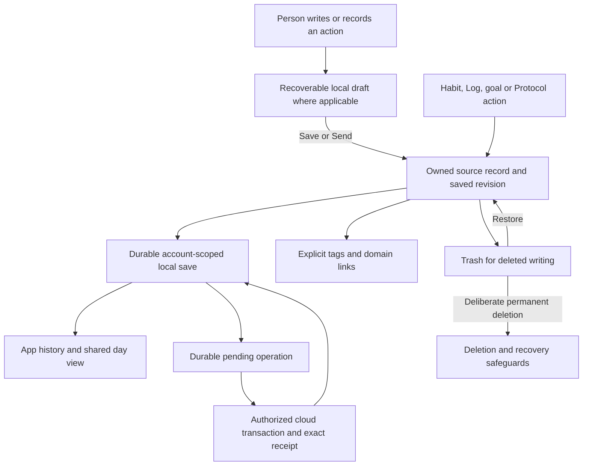
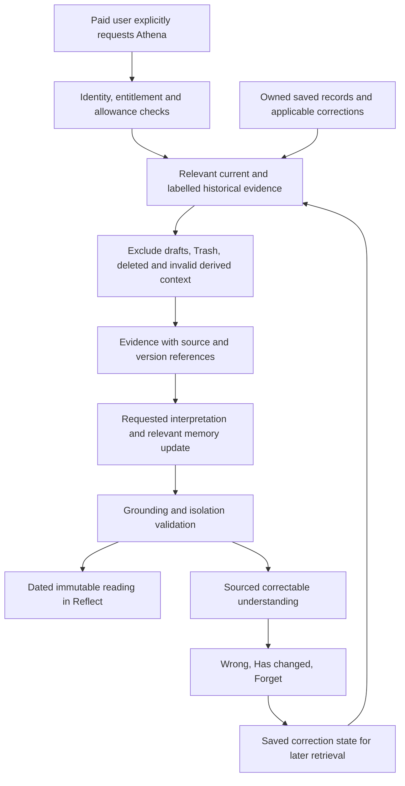

# Personal records, history, and Athena plan

Scope update approved 2026-11-05: completed Week reviews stay read only;
Week-review corrections are removed from current scope. Past Habit completion
corrections and the shared day view are deferred. These supersede their earlier
requirements below and are not gates for moving to safe sync. App histories and
prospective wording preservation remain. The account-bound local queue and the
later approved account-writing SQL/access/transport slice are implemented and
locally verified, including initial saved-writing inventory and conflict/deletion
safety. Hosted application/activation, conflict/status UI, other domains,
migration and operational recovery remain later work. See
[the account-writing contract](ACCOUNT_WRITING_SYNC.md).

Date: 2026-11-02, Asia/Bangkok.
Latest approved flow: [Note, Deep Thoughts and managed quotes](#1412-note-deep-thoughts-and-quotes---2026-11-03)
(2026-11-03). This supersedes ordinary Thoughts as a new-writing surface and
its former separate History/Trash controls. Historical records retain their kinds.
Note-only updates: 2026-11-03. The developer approved pause/departure autosave,
then direct HISTORY aligned with NOTE, silent borderless writing, orange History
row trash-bin buttons and removal of Versions/Undo. Restore from the retained
Trash page. The later approved refinement puts New Note in the Note editor Footer
and caps Note/History/Trash at 480px (60% of a short viewport, never below the
shared minimum), with Body scrolling and header/actions in place. Trashing is
silent. Note has no Save/Clear/Discard/Drafts controls or draft messages.
Internal recovery/revisions remain for save safety; Thoughts and reading answers
keep their existing Send/draft/version/Undo controls. This supersedes earlier Note
control requirements, including dated snapshots/proposals in section 14; see
section 5, section 14.11 and the
[current decision](DECISION_LOG.md#2026-11-03---bounded-note-pages-and-editor-new-note).
Status: developer-confirmed product decisions; local engine A and read-only
compatibility/evidence adapter B1 and account-bound provider B2 verified with
synthetic data. The separately approved account writing/history UI C is now
connected and locally verified; lived acceptance and personal migration remain.

The developer reviewed the decision questions and approved creating this plan
and aligning eight owning/continuity documents. This approval covers documents
only. Each implementation slice still needs an exact file list, behavior and
test proposal, manual review, and explicit approval. No application, database,
personal-data migration, provider integration, or deployment is authorized here.

On 2026-11-02 the developer also confirmed the writing interactions below and
approved updating this plan, the decision log, current task and handoff only.
Sections 5 and 7 record those choices. Section 14 contains a proposed local
implementation and checks for the next review; that review approved no code.

Later in the same session the developer reviewed and explicitly approved A's
five code/test files and updates to this plan, current task, handoff and journey
record. A's delivered contract and limits are in section 14.5. B/C, personal
import, cloud work and deployment remain outside that approval.

The developer subsequently approved B1's five adapter/type/memory/test files and
eight record updates. Its read-only delivered contract is in section 14.6.
The developer later explicitly approved B2's provider/store/consumer/tests and
nine record updates. Its delivered contract is in section 14.7. Live UI (C),
personal import and cloud work remain separately reviewed. Confirmed choices
below include launch languages and answered-question status after removal.

## 1. Outcome and boundaries

People can write, revisit, and correct their own records whether or not they
pay for Athena. The records remain useful on their own. Paid Athena interprets
relevant saved evidence when the person requests help.

The system must distinguish:

1. What the person actually entered or marked.
2. How the app organizes and links those records.
3. What Athena calculates or infers from them.
4. The authored readings Athena has already given the person.

The scope covers existing writing, habits/tasks, daily and weekly records,
goals/steps, Protocol, declarations, chapter-answer evidence, reading history,
and basic Athena memory controls. It does not enable hidden Dreamline/The Four
interfaces, redesign the brand, create a leaderboard, select a native framework,
or add unrelated features. Existing hidden/legacy data must still be preserved.

This plan supersedes the one-ongoing-Note product assumption in
[NOTE_SYNC_PLAN.md](NOTE_SYNC_PLAN.md). Its durable-write, acknowledgement,
retry, ownership, clearing, and conflict requirements remain useful inputs to
the later reviewed sync design. They are not an implemented backend.

## 2. Confirmed decisions

| ID | Decision | Practical result |
| --- | --- | --- |
| D01 | Multiple Notes, grouped by Circle day | A new entry does not overwrite another Note. |
| D02 | Note receives new free writing; Deep Thoughts starts from a question | Retire ordinary Thoughts from the visible composer; preserve old entries and optional Note titles. |
| D03 | Note autosaves after a short pause and when leaving; Deep Thoughts keeps Send | Deep answers retain question/source links and recovery without becoming evidence before Send. |
| D04 | Recovery buffers stay outside saved evidence until committed | Older Note recovery text remains reachable in History without becoming evidence before a successful save. |
| D05 | History inside each App; shared day view deferred 2026-11-05 | Read existing App histories without another combined day surface. |
| D06 | Past writing is editable; Note and Deep Thoughts expose the current saved entry | Internal revisions preserve save safety; embedded reading answers retain their existing controls. |
| D07 | Deleted Notes/Thoughts move to Trash; restore or permanently delete | Trash is a separate recoverable state, excluded from Athena. |
| D08 | Trash has no automatic expiry | It remains until restoration or deliberate permanent deletion. |
| D09 | Habit and active Protocol changes apply going forward | Earlier records keep the applicable wording and terms. |
| D10 | Completed Week reviews stay read only, updated 2026-11-05 | Correct the underlying records in their own tools where editing exists; no Week-review correction workflow. |
| D11 | Past writing/Log corrections remain; Habit completion corrections deferred 2026-11-05 | Retain attributed day and actual correction time for supported corrections. |
| D12 | Old records retain their assigned day/timezone; new records use current local time | Preserve the 06:00 Circle day without silently moving history during travel. |
| D13 | Tags are optional; Athena can suggest correctable topics/feelings when used | Writing does not require a classification exercise. |
| D14 | Show Athena observations with sources and Wrong / Has changed / Forget controls | The person can inspect and correct understanding. |
| D15 | AI interpretation runs when a paid user requests Athena | No model interpretation on every save or background profiling of free users. |
| D16 | Core writing, reading, history, corrections, and sync are free | Payment gates new personalized generation, not personal records. |
| D17 | Beta requires essential history/corrections across existing tools, safe sync, and basic memory controls | Advanced search/filtering follows later; essential review is a release gate. |
| D18 | A Note without a user-entered title is called Untitled | The generated label and placeholder are not user-authored evidence. |
| D19 | Autosave keeps the Note visible; New Note is in the Note editor Footer | Save current text successfully before starting a separate entry. |
| D20 | Note recovers automatically without a draft-management workflow | Deep Thoughts retains recovery/discard where offered, without automatic draft expiry or evidence before Send. |
| D21 | History groups writing by Circle day, newest first; open entries in the same App Box | Note and Deep Thoughts omit Versions UI while retaining immutable internal revisions. |
| D22 | New saved entries require user writing; an existing Note can save an empty correction | Generated labels never count as writing; unchanged content creates no extra version. |
| D23 | New writing keeps the Circle day when writing began, with actual save time recorded separately | Starting at 05:50 and saving at 06:10 does not silently move the entry to the new Circle day. |
| D24 | Each saved local entry in Note/Deep Thoughts History has an orange trash-bin button; neither surface has Undo | Keep the Trash page for Restore and confirmed Delete forever. |
| D25 | Deep Thoughts shares Note's History/Trash while retaining Send and Save changes | Keep draft/evidence separation, attribution, source links and original outcome rules; ordinary Thoughts survives as a historical kind. |
| D26 | Note autosaves silently; Deep Thoughts retains accepted Send/correction feedback in its editor | Failed saves keep text with retry; Note shows no routine Saving/Saved on this device text. |
| D27 | Launch UI and Athena responses use simple English; users can write in Burmese, English or mixed language | Athena must understand that writing and answer in English. Burmese/English UI and Athena responses follow after web launch; Thai support is not required. |
| D28 | A trashed or permanently deleted Deep Thought keeps its question marked answered; first-use greetings do not restart | Retain minimal question/app-use metadata without deleted answer/version/draft text. Older missing metadata remains unknown; wider deletion coverage stays separate. |

The developer selected these choices after reviewing their tradeoffs. Earlier
one-Note-per-day and single-ongoing-Note recommendations are not the chosen
product. The reasons are flexible capture, reviewable personal history, accurate
corrections, deliberate AI use, and a paid boundary that preserves core access.

## 3. Current implementation versus target

| Area | Current evidence | Target in this plan |
| --- | --- | --- |
| Note | One replaceable title/body in `checkin-idle-title` / `checkin-note` | Multiple dated entries and saved revisions. |
| Thoughts | Dated answers accumulate; no general history editor | Reviewable entries, corrections, revisions, Trash. |
| Drafts | Relevant composers use in-memory drafts | Verified account-separated local recovery. |
| Habits | Separate definitions and completions; older views can use current wording | Historical wording and deliberate dated corrections. |
| Log | Dated blocks; limited recent-day review | Essential all-recorded-day navigation and corrections. |
| Weekly review | Model refuses overwriting an existing weekly record | Versioned current review and accessible earlier versions. |
| Protocol | Run/item records and seals; active editing exists | Preserve effective terms and earlier-day meaning through edits. |
| Declarations | Dated versions and visible history for exposed kinds | Preserve and connect to the shared review model. |
| Chapters | Immutable definitions, versioned runs, answer snapshots | Essential answer review; no silent chapter-content or outcome rewrite. |
| Athena readings | Current reading visible; bounded 60-edition browser model | Reviewable reading history; storage/retention contract reviewed before expansion. |
| Athena memory | Local fact helpers, prepared memory and corrections; no complete user control surface | Sourced observations with basic user controls and safe correction propagation. |
| Accounts | Supabase entry and account-separated local stores exist | Preserve these boundaries through every record/history path. |
| Supabase evidence | Not connected | Verified owner-scoped record/revision sync and recovery. |

See [the capability audit](APP_CAPABILITY_AUDIT_2026-11-01.md) for source links.
This plan does not fix or certify those current gaps by documenting the target.

The later A implementation supplies an isolated local record engine. The live
composers still use their existing paths above; A does not make multi-entry
writing/history or honest save feedback available in the app yet.

## 4. Free and paid experience

| Experience | Free | Paid |
| --- | --- | --- |
| Notes, Thoughts, drafts, tags, history and corrections | Available | Same |
| Existing habits/tasks, Log/Week, goals, Protocol and declarations | Available | Same |
| Essential App history and shared day review | Available | Same |
| Chapters, Quests and Lines | Existing core access preserved | Same |
| Local saves, account sync and recovery | Available once implemented and verified | Same |
| Earlier saved versions and Trash | Available | Same |
| Previously received readings | Remain readable after paid expiry | Available |
| New personalized Athena readings/replies | Unavailable | Explicit requests within the enforced allowance |
| Existing understanding and correction controls | Previously available observations remain reviewable; correction does not require buying generation | Same, with requested interpretation updates |

The last row is an implementation proposal consistent with free reading and
correction. Control semantics and exact UI still need review. Recording a
correction must not secretly start a paid model call.

Existing membership decisions stay in force: manual grants of 30/90/180/365
days, renewal preserves unused active time, expiry stops new generation, and
received readings remain readable. Allowance quantities, reset details, prices,
and provider/model remain separate open decisions. No automated billing is added.

## 5. Writing journeys

### 5.1 Several Notes in a day

1. The person opens Note and writes a title, a body, or both. A missing title
   saves as **Untitled**. The automatic label and placeholder do not count as
   writing; an empty new composer creates no saved entry.
2. The app recovers unfinished writing under the correct account internally.
   Note has no Save, Clear, Discard, Drafts or draft messages.
3. A short typing pause (one second) and leaving the editor automatically save
   the Note. Finish text composition first. Only a successful durable local write
   becomes accepted evidence. Note saves silently; failure retains text and
   offers **Try again**. Do not show Saving/Saved on this device for Note.
4. The saved Note stays visible with **New Note** in the editor Footer. Save
   current text successfully before opening the blank Note. Another Note is a
   separate entry, even on the same Circle day or with identical text.
5. The next day starts no automatic replacement or clearing of saved entries.
6. **History** groups saved Notes by Circle day, newest first. Opening an entry
   opens it directly for editing in the same App Box. Show Today/Yesterday or a
   date and the entry's time. Trash is in History's header. The later shared day
   view reads the same source. Older recovery copies remain reachable as Note
   rows, without a separate Drafts screen; they save when opened.
7. Selecting and deleting all text in an existing Note saves an empty version.
   Keep internal revisions for save/conflict safety. Note has no version-review
   feature. Clearing text is not Move to Trash or permanent deletion.

These Note controls were explicitly approved on 2026-11-03 using the supplied
reference. Note labels/navigation/text actions use `#E36B37`; authored text stays
Ink. NOTE and HISTORY share typography and a measured equal header baseline.
HISTORY opens the list directly. Focused writing keeps the caret without an
orange outline/box. Each local History row has an orange trash-bin button on its
right; there is no Note menu, Versions or Undo. Restore from the Trash page.
Preserve the Note label's existing Line action and the shared App Box engines.

### 5.2 Deep Thoughts and historical Thoughts

Deep Thoughts replaces ordinary Thoughts in the visible Today flow. Each newly
sent answer becomes an entry, retaining its question, question source and related
metadata. Keep the accepted answer visible and offer Next question. A quote visit
does not choose another question or submit text. Reading answers retain their
reading/question connections.

History/Trash uses Note's navigation, controls, dated rows and bounded scrolling.
Saved entries open for correction, with question above answer where known.
There is no Versions UI or Undo on this surface; immutable revisions remain
internally. Unsent recovery rows are marked Unsent. Historical ordinary Thoughts
remain editable without acquiring a question or a new kind. A new answer uses
**Send**; a correction uses **Save changes** and keeps its entry identity.
**Sent** follows a successful local write.
Deep Thoughts and reading answers retain their original question/source links.
Opening or correcting an old answer must not send another entry, replay a
chapter outcome, or request an Athena reply.

### 5.3 Editing and saved versions

A saved entry has one stable identity and a current saved version. Note edits
autosave; Thought/reading-answer corrections retain explicit Save changes.
Internal recovery stays separate from committed evidence. Saving creates a
new internal revision. Note removes Versions controls/screens; other writing
retains version review. Existing revision records are not deleted by UI removal.
Saving without changes creates no extra version. Recovery must not turn every
keystroke into a user-facing permanent version.

Recovery has no automatic expiry. Thoughts keep draft recovery/discard controls;
Note removes that user-facing workflow. If saving fails, keep the text open, explain the failure,
and allow retry without duplicate entries. If local recovery storage fails,
show a warning rather than promising recovery after reload. These are target
requirements; exact verified coverage belongs to the dated journey evidence.

Do not merge two Notes merely because their text matches. Do not count five
versions of one corrected sentence as five independent pieces of evidence.

### 5.4 Trash

Deleting a saved Note or Thought removes it from ordinary history and Athena
retrieval and places it in Trash. Trash remains until restored or permanently
deleted. Restoration keeps the identity/history. A stale device cannot silently
restore a trashed or permanently deleted entry through sync.

Note History places **Move to Trash** in an orange bin button beside each local
entry. The button moves only that row's Note, without opening its editor. Note
has no Undo action. **Trash** stays accessible from History and offers **Restore**
and confirmed **Delete forever**. A recovery row saves its exact stored snapshot
before moving to Trash; failure/conflict retains recoverable text and stops the
move. Read-only older sources remain read only. Other writing keeps its existing
Trash/Undo controls. Restoration retains the entry's identity and internal revisions.

Before implementing permanent deletion, review exact confirmation wording,
complete revision coverage, derived-memory removal/suppression, connected-device
handling, backup suppression and retry receipts. Choosing the confirmation step
does not settle complete deletion coverage or prove current implementation.

### 5.5 One-week walkthrough for implementation review

| When | Action | Expected target result |
| --- | --- | --- |
| Monday | Write body text without a title; leave and return | Note autosaves and reopens; accepted writing is in history/evidence. Recovery is internal and there are no draft controls. |
| Monday | Choose New Note from the Note editor and write another | The first displays Untitled and stays visible after autosave; two distinct saved Notes belong to Monday. |
| Tuesday before 06:00 | Start at 05:50, then save at 06:10 | Keep Monday's Circle day; retain the actual Tuesday save time separately. |
| Wednesday | Find Monday in History, edit an entry, then select/delete all its text | Autosave saves the current value, including an empty correction; internal revisions remain without Note Versions UI. Unchanged autosaves add nothing. |
| Thursday | Use a History row's bin, then restore from Trash | Remove only that Note from ordinary history/context. No Undo shortcut; restoration keeps identity/revisions. Delete forever asks first. |
| Friday | Send a quick Thought; correct an older question answer | New Thought uses Send; correction uses Save changes, retains source/question links, and triggers no new entry/outcome/AI reply. |
| Weekend | Reload offline, simulate failed writes and switch synthetic accounts | Recover only the correct account's drafts/saves; show failures honestly and retry without duplicates. No cloud backup is implied. |

This is a specification for synthetic checks. No week-long use or browser
verification was performed in this documentation pass.

## 6. History and correction across existing tools

| Record family | Essential review behavior | Correction boundary |
| --- | --- | --- |
| Notes/Thoughts/Deep Thoughts/reading answers | Dated list, entry detail, saved versions, source/question where relevant | Preserve current versus earlier wording; Trash applies to Notes/Thoughts. |
| Habit definitions/completions | View dated action/cue/identity and completion state | Ordinary changes are prospective; past completion corrections deferred 2026-11-05. |
| Tasks/goals/steps | Read open and completed records, dates and links | A shared task stays one record across Routine and Week; goal completion stays explicit. |
| Daily Log | Open any recorded day and its activities/moments | Edit attributed records without pretending they were entered at the occurrence time. |
| Week plans/reviews | Open prior goals, steps and reviews | Completed reviews stay read only; correction workflow removed from current scope 2026-11-05. |
| Protocol | Read phases, applicable terms, completions/seals, outcome and dates | Preserve earlier terms; don't silently retick a day or rewrite a seal during an edit. |
| Declarations | Read current and superseded statements with dates | Preserve existing version semantics and distinct horizons. |
| Chapter answers | Read the answered questions and saved responses in context | Published `id@version` content remains immutable; correction/outcome application needs separate review. |
| Athena readings | Read received editions and their dates | Authored editions stay immutable; later qualifications are separate. |

App-specific history and shared day review read the same underlying records.
They must not create second editable copies. A goal step remains the Routine
task it already references. Reading history must not replay completion handlers.

Basic date navigation and source links are essential history. Advanced keyword
search, compound filters, saved searches, and richer discovery can follow beta.
Optional user tags are part of the agreed record experience; they do not require
advanced tag-search interfaces before beta.

This scope does not silently grant a new universal deletion action for goals,
habits, phases, declarations, chapters or readings. Their archive/delete and
correction interactions need record-specific review. Existing archived records
remain preserved; an archive is different from writing in Trash.

## 7. Time, backdating and travel

The Circle day starts at 06:00 in the person's current local timezone. Record
the attributed day/timezone when the entry is made. Later travel must not
recalculate all old day assignments from the current device timezone.

The developer confirmed that new Notes and Thoughts keep the Circle day when
writing began, even if the first Save/Send crosses 06:00. Record the actual
save time separately. For example, Tuesday 05:50 belongs to Monday's Circle day;
saving at Tuesday 06:10 preserves Monday attribution. Editing saved writing
keeps its assigned day unless the person deliberately corrects it.

A proposed common contract distinguishes:

- Attributed event day and timezone.
- Occurrence time when actually known or supplied by the person.
- First recording/saving time.
- Later correction time and version.
- Server receipt/version information used for sync, not to redefine when life happened.

Backdated entries are permitted. A Monday habit recorded Tuesday belongs to
Monday with Tuesday recorded as its entry time. Do not fabricate an exact
Monday completion clock time when only the day is known.

A deliberate date/timezone correction is a saved revision. Concurrent date
and text changes need the same conflict protection as text-only changes.
Exact timestamp serialization, timezone acquisition, DST handling and interface
must be reviewed and tested. These mechanisms are proposals, not database choices.

The Myanmar-time Athena allowance reset is a separate existing rule. It must
not replace the person's local Circle-day rule.

## 8. Proposed record architecture

Use shared ownership, revision, persistence and sync conventions while keeping
domain records meaningful. This is not a proposal to turn every habit, Log block
and declaration into an undifferentiated text blob.

| Layer | Content | Rule |
| --- | --- | --- |
| Recovery buffers | Uncommitted text and editor context | Account-separated, excluded from saved evidence/AI; older Note copies are reachable through History. Thoughts retain Drafts UI. |
| Source records | Saved writing, actions, commitments, answers | Stable identity, owner, type, dates, source links. |
| Saved revisions | Accepted wording/status/date corrections | Earlier saved versions reviewable; current version clearly identified. |
| Current read views | App lists, day view, completion summaries | Derived from source records; no duplicate ownership of the same fact. |
| Categorization | Optional tags, domain links, inferred labels | Separate explicit labels from inferred ones. |
| Athena memory | Facts, patterns, questions, corrections | Source/version references and validity state; rebuildable where appropriate. |
| Readings | Authored published editions | Dated and immutable, with controlled history access. |
| Sync bookkeeping | Pending operations, exact receipts and versions | Durable, idempotent and guarded by account/session. |

Candidate shared fields are owner, record ID/type, domain relationships,
attributed day/timezone, occurrence/recorded/updated times, current revision,
status and origin. A's new-writing local schema is now implemented in section
14.5. SQL, indexes, ownership/import mapping and integration remain reviewed
follow-up work, not database decisions hidden inside this document.

Automatic local recovery and reopening are required. Recovery has no automatic
expiry; a successful Note autosave or Thought Save/Send closes its committed
revision. Thoughts retain deliberate discard; Note removes that action.
Cross-device draft sync, technical cleanup of completed/discarded drafts,
revision compaction and receipt retention still need review. No cleanup may
make an old retry become a new write or erase reviewable saved history.

## 9. Categories and meaning

The app knows type, owner, time and explicit links without a model. Users may
add tags but need not categorize every sentence. Athena may derive additional
topics and feelings during a requested paid interpretation.

Proposed categorization separates:

- Record type: Note, Thought, activity, habit completion, goal or other domain.
- Explicit topic/tag and links to goals, habits, phases or declarations.
- A feeling the person actually stated.
- A preference or intention the person actually stated.
- A calculated observation over recorded evidence.
- An inferred topic, feeling, preference or pattern with supporting sources.

Mind/Body/Spirit/Social remain useful lenses, not the only taxonomy. A record
may concern several topics or dimensions. No category is mandatory merely to
make a database simpler. English regex matches cannot establish universal
language understanding; Burmese, English and mixed-language cases need checks.
The audience is Burmese people, mostly with basic English. UI and Athena
responses are English-only at web launch; understanding Burmese input is still
required. Dual Burmese/English UI and responses follow after web launch. Text
preservation tests do not certify a future provider's language understanding.

Examples:

- Reading a book is not evidence that the person liked it.
- Missing a checkmark is not proof that the habit was not done.
- One sad day is not a permanent personality trait.
- Quoted, fictional or hypothetical text is not automatically autobiographical.
- No activity record means no recorded evidence, not no life lived.

## 10. Athena evidence and user controls

All intentional saved lifestyle input can contribute relevant evidence: writing,
reflections, goals, declarations, habits/tasks, activity, phases and answers.
That is not a requirement to send every record on every request or treat every
sentence as a durable personal fact. Passwords, login/payment details, admin
codes, unsaved drafts and trashed writing are outside the personal AI context.

The current version of a corrected source is authoritative for present claims.
Earlier saved versions can provide explicitly labelled historical context when
relevant. They must not become duplicate votes for a pattern or contradict a
correction without explanation. Original records and AI output stay separate.

### Request path

1. Authenticate the person and check the paid entitlement and allowance.
2. Select relevant same-owner saved evidence across permitted history.
3. Exclude drafts, Trash, deleted sources and invalid/suppressed derived context.
4. Include applicable corrections and version references.
5. Update relevant memory and generate the explicitly requested reading/reply.
6. Validate grounding, source isolation and output structure.
7. Store the dated reading and make the requested result appear when ready.

No AI interpretation runs automatically on every save, for free users in the
background, or as unrequested background preparation for paid users. Ordinary
storage, local organization and recording corrections do not require a model
call. This does not prohibit deterministic calculations in the free core.
Existing prepared-content integrations remain distinct until deliberately migrated.

The model never receives database administrator credentials. A constrained
service owns evidence authorization. Failure or exhausted allowance must not
disable writing, history, local recovery or sync. Existing failure-accounting
and requested-reply rules remain in force.

### Basic understanding controls

The confirmed controls are observations with source links, Wrong, Has changed,
and Forget. The following exact semantics are proposals for interaction review:

| Control | Proposed meaning |
| --- | --- |
| Wrong | Reject this interpretation and retain a correction so the same unsupported claim is not silently reinstated. |
| Has changed | Qualify when it stopped being current; do not erase an accurate earlier period. |
| Forget | Suppress this item from active memory/context; review how recurrence from the same sources is prevented. |

These actions are not automatic deletion of the person's original entries.
Trash/permanent deletion is a separate source-record action. The exact scope of
Forget, undo behavior, propagation timing and wording needs review before code.

Trashing/deleting a source must also exclude context derived solely from it.
Source/version dependencies must cover summaries and any future retrieval index,
not just visible ledger facts. If derived context cannot be safely refreshed,
exclude it instead of using known stale interpretation.

Old authored readings stay dated and immutable. How their display is qualified
when a source is corrected/deleted, and when a user may delete a reading itself,
requires review. Do not silently rewrite an old edition or feed its superseded
claims back as new personal evidence.

## 11. Data flow

The following is the target, not current implemented behavior.

Free users use the record/history path. Previously received readings remain
readable after expiry. Writing a new reflection does not itself request a reply.

## 12. Local-first sync and deletion requirements

Carry forward the useful contract from the earlier Note plan:

- Commit a local saved change and its retryable operation together.
- Confirm durable local save separately from confirmed cloud acceptance.
- Use stable operation IDs and server versions; device clocks do not pick a winner.
- Accept revision and receipt atomically; retry returns the original result.
- Reject reuse of an operation ID with different content.
- Persist exact acknowledgements before retiring only those named operations.
- Preserve edits made while an earlier upload is in flight.
- Preserve both competing versions until the person chooses/resolves them.
- Coordinate same-account tabs without overwriting unrelated records.
- Reject late reads/writes/acknowledgements after logout or account change.
- Never use an offline-entry proof as remote authorization.
- Represent clearing/deletion explicitly so stale copies cannot restore them.

The protocol must be reviewed per domain; writing in Trash, an archived habit,
a cleared field and a discarded draft are different lifecycle events. The
existing reason-grouped outbox is not assumed sufficient for this contract.

No automatic Trash expiry was chosen. The existing maximum 30-day retention of
permanently deleted data in backups remains a separate release requirement.
Review live revisions, receipts, memory, logs, retained devices and restore
suppression before claiming complete deletion. Manual account deletion and
admin read-only access remain the existing approved direction. No user export
is added to beta by this plan.

## 13. Migration and compatibility

1. Use isolated synthetic records before any personal migration.
2. Preserve the existing local/profile-server copies and their ownership.
3. Review an explicit owner mapping; never silently claim legacy data for a login.
4. Preserve `checkin-note`, `checkin-idle-title` and other legacy identifiers
   until the mapping/migration is approved and verified.
5. Import the current Note as one preserved legacy source with provenance.
   Its last edit time is not proof of its original creation day. Do not invent
   missing old Notes or split text into fictitious historical entries.
6. Preserve existing Thoughts, question IDs/text, answers, tasks, goal links,
   habit/completion records, phases/seals, declarations, chapters and readings.
7. Preserve published chapter versions and the definitions old runs used.
   A reading/history migration must not rerun completion side effects.
8. Preserve uncertainty where old habit/Protocol wording snapshots or precise
   timestamps do not exist. Do not label reconstructed data as original evidence.
9. Make repeated import idempotent and compare counts/content/references.
10. Verify backup, rollback, recovery and cloud/local conflicts before real use.

The 60-edition browser bound is not a promise of unlimited current reading
history. Review cloud archive/retention and local paging before removing a bound;
do not discard existing received readings to make the new design easier.

No generated profile or day state is to be edited by hand. External runtime
files remain integrations until a separately reviewed migration replaces them.

## 14. Implementation sequence

Each stage follows code, focused tests, bug fixes, runtime verification,
evidence-based optimization only when justified, then re-verification.

| Stage | Bounded purpose | Required evidence before moving on |
| --- | --- | --- |
| 1. Contracts and interaction review | Shared source/revision/draft/status/time contracts; Note/Thought/history/Trash flows; next exact file scope | Reviewed user journeys and synthetic contract cases; unresolved choices explicitly bounded. |
| 2. Writing locally | Notes, Thoughts, draft recovery, saved versions, optional tags, Trash, App history | Mobile writing/reload/correction/restore paths; quota/write-failure and account-isolation checks. |
| 3. Existing-tool history | Habit/Protocol historical meaning, Log/Week corrections, task/goal links, declaration/chapter/reading review, shared day view | Representative all-recorded-day journeys and no replay/duplication; geometry measurements if affected. |
| 4. Safe account sync | Reviewed ownership schema, local operations, receipts, conflicts, synthetic restore and later owner migration | Real database allow/deny tests; two tabs/devices; offline/retry/clear/Trash/recovery; safe migration approval. |
| 5. Membership | Existing grant/renewal/expiry and usage contract | Server enforcement, concurrent requests, failure accounting, free-core access after expiry. |
| 6. Requested Athena and controls | Provider integration, relevant evidence selection, sourced memory and Wrong/Has changed/Forget | Grounded multi-language synthetic cases, correction/deletion exclusion, source links, current-paid request checks. |
| 7. Beta readiness | Essential histories, corrections, safe sync, basic memory controls, operating/recovery checks | Critical bug gates, real-phone/Home Screen and region checks, backup/restore/deletion evidence, explicit release approval. |

Candidate code areas include the existing shared model/provider/store,
account/auth boundary, focused domain models, chapter/read models, Reflect,
App Box/Page/gesture/edit engines, legacy transport boundary and proposed
Supabase migrations/tests. These are areas to inspect, not an approved code list.
Reuse them rather than building a disconnected replacement.

Stage boundaries may be split further for review. A locally verified component
is not automatically safe to use with real cloud data. No new performance
budget, fixed schedule, geometry ratio or AI allowance is chosen here.

### 14.1 Proposed local contracts

The following table was the engineering proposal reviewed before A. Its local
engine subset is now implemented as described in section 14.5. It does not
approve B/C, a Supabase schema, or additional product decisions:

| Part | Proposed local contract |
| --- | --- |
| Source | Stable owner/entry ID and kind: Note, Thought, Deep Thought or reading answer. Keep question text/ID/source and reading/edition links where known. Identical text does not merge distinct entries. |
| Content version | Immutable saved content with a version ID and base version; one current version. Compare user content, tags and deliberate attribution edits for a meaningful change. Separate lifecycle events from user-facing wording versions. |
| Title | Retain whether a title was entered. Display Untitled for an absent Note title without representing the generated label as the person's words. A user-entered title alone or body alone can make a nonempty Note. |
| Draft | Separate account-owned draft ID, optional entry/base-version link, editor/question context, text/tags and start attribution. Draft writes do not enter saved history, derived memory, legacy payloads or an upload queue. |
| Time | Capture starting Circle day and timezone at the first user edit rather than opening an untouched composer. Use UTC instants for start/first save/later corrections, retain an IANA timezone and attributed day, and leave unknown occurrence times unknown. Serialization/DST and timezone fallback require review/tests. |
| Local commit | In one scoped IndexedDB transaction, save the accepted version/current pointer, retry operation/receipt and completion of its draft. Publish success after transaction completion, preserving edits typed while an earlier save is in flight. |
| Retry/conflict | Stable operation ID; repeating the same operation returns its existing result. Reject ID reuse with changed content. Check the base version inside the transaction; retain competing text for person-chosen resolution rather than selecting a device-clock winner. |
| Lifecycle | Active and trashed writing have explicit state. Permanent local deletion covers source text, versions and associated drafts; content-free deletion/operation metadata prevents stale retry resurrection. Wider memory/device/server/log/backup coverage needs its own verified contract. |
| Read views | History/Versions/Trash and later shared day review select the same source. Active evidence uses only the current saved version of active writing; exclude drafts, Trash and deletion, and suppress context derived solely from excluded or corrected versions. |

Reuse [account-scope.js](../app/os/account-scope.js)'s account names and scoped
transaction/abort checks. A proposed dedicated local writing store separates
recoverable drafts from the whole-state legacy transport. This is an extension
of existing ownership/persistence engines, not another profile or login system.
IndexedDB failure/recovery behavior must be reviewed before claiming a durable
fallback; a memory-only editor or successful localStorage copy is not a committed
IndexedDB save.

### 14.2 Source findings that shape the proposal

- [The shell](../app/os/circle-os-shell.tsx) currently keeps Note/Thought drafts
  in React state. Its Note blur commit falls back to placeholder text when the
  title is empty; bug 6 still needs browser reproduction. Thought submission
  sets Sent after the state update, before the provider's async persistence
  effect completes. These are source findings, not fresh runtime reproductions.
- [The model](../app/os/circle-os-model.js)'s `answerSurveyQuestion` replaces an
  answer by question ID. Normalization and legacy merge do not supply the new
  writing-version/Trash contract. Existing IDs and their uncertainty must survive
  the separately reviewed compatibility mapping.
- [The store](../app/os/circle-os-store.ts) persists a whole-state copy using
  account scope; [the transport](../app/os/circle-os-ai.ts)'s `buildServerPayload`
  spreads that state. Adding recoverable drafts to that payload would breach the
  draft/evidence boundary. Account mode already rejects this legacy transport;
  it has no implemented Supabase writing sync.
- [Reflect](../app/os/mirror/page.tsx) currently saves a reading answer through
  the survey-answer path. Its original prompt/edition relationship and existing
  prepared readings must survive the future integration without replaying outcomes.

### 14.3 Proposed files and bounded order

A's exact five-file code scope and four evidence/continuity documents were
reviewed and explicitly approved after the documentation review. A is verified
for its synthetic local-engine scope. The developer then approved a smaller
read-only adapter portion of B (B1), now delivered. B2 was subsequently reviewed,
explicitly approved and delivered as recorded in section 14.7. C still requires
exact control/routing/file review and approval before code.

| Slice | Exact proposed paths | Purpose and boundary |
| --- | --- | --- |
| A: local record engine | New `app/os/writing-model.js`, `app/os/writing-model.d.ts`, `app/os/writing-store.ts`, `tests/writing-model.test.mjs`, `tests/writing-storage.browser.mjs` | Implement/test the local contracts, lifecycle, selectors, atomic commits, drafts, retry/conflict handling and account guards using the existing scoped transaction helper. No live editor or personal import. |
| B1: read-only compatibility/evidence adapter, delivered | New `app/os/writing-compatibility-model.js`, `.d.ts`, `tests/writing-compatibility.test.mjs`; existing `app/os/athena-memory-model.js`, `tests/athena-memory.test.mjs` | Read explicitly scoped snapshots, preserve unknown existing dates, rehearse supplied links without import, select active saved versions and gate writing-derived memory by exact dependencies. Preserve received editions and Burmese text; no provider activation. |
| B2: account-bound provider, delivered | Exact approved provider/store/contract/consumer/test files are listed in section 14.7; `circle-os-model.js` and `circle-os-ai.ts` required no edits | Captured account sessions, fresh current-state reads, cross-tab refresh, late-result rejection, independent load/write status and shared read consumers. No model call on save. |
| C: writing/history UI | New `app/os/writing-pages.tsx`, `tests/writing.browser.mjs`; existing `app/os/circle-os-shell.tsx`, `app/os/mirror/page.tsx`, `app/os/os-app.css` | Reuse InfoPage, shared App Box, App-back, editing, gesture and button engines for the agreed Note/Thought/history/version/Trash flows and honest status. Includes bounded sign-off on control placement; no new brand language. |

Proposed action placement for C: Save or Save changes is the editor's main
action; New Note is available on the saved Note. Keep History and entry actions
secondary, preserve the Note label's Line action and Thoughts/Deep Thoughts
entry, and use the same App Box for history details. Exact layout remains review
work rather than a silent replacement of the current Page standard. Each code
slice also needs approved continuity/evidence updates; this table is not blanket
permission to edit these paths or add others discovered later.

B must not silently assign legacy profile-server writing to an account or
invent old creation dates. Review backup, ownership, idempotent mapping and
rollback before any personal import/activation. Local permanent deletion is
not a claim about existing remote copies or backups. Shared day review across
other tools, SQL/cloud sync, membership, requested Athena and Day One remain
in their later stages; sign-in/loading polish remains a separate bounded slice.

### 14.4 Proposed synthetic checks

| Area | Checks required before the affected slice is considered verified |
| --- | --- |
| Model | Two Notes/day with distinct IDs; absent title displays Untitled; generated label/placeholder alone cannot save; user title-only/body-only can save; changed save creates a version and unchanged save does not. |
| Draft/time | Reload recovers the correct editor/context; Save removes only the committed draft revision, later typing survives; discard preserves saved content; 05:50-to-06:10 retains starting day; travel/DST and deliberate backdating retain actual save/correction times and unknown legacy dates. |
| Real local storage | Actual IndexedDB commit/abort, quota/unavailable-store cases and draft-write failure. Success cannot appear before commit; failed text stays open; reload after acknowledged save reads the accepted version. |
| Retry/concurrency | Same-operation retry creates no duplicate; changed payload with reused ID is rejected; two tabs preserve unrelated entries and competing same-entry edits; logout/account change rejects queued and late work. |
| Lifecycle/evidence | Trash leaves ordinary history/evidence, Undo/Restore retain IDs/versions, confirmed Delete forever covers local content and stale retries cannot recreate it. Drafts/Trash/deletion and invalid derived context stay excluded from legacy payloads and active evidence. |
| Questions/compatibility | Deep Thought/reading answers keep prompt and edition sources; correction updates the same entry with Save changes, no resend/outcome replay/AI request. Repeated synthetic compatibility import preserves counts/text and records unknown dates honestly. |
| App/browser | Run the week-long walkthrough in isolated mobile Chromium at 390x844 and 360x844, including actual offline reload, history navigation, failure/retry, confirmed deletion and account switching; block external backend effects. Reproduce the placeholder report before changing that path. |
| Geometry/regression | After UI geometry/type/gap changes, measure rendered Note, Thoughts, Habit and Protocol minimum heights and forehead gaps, short/empty equality and downward growth. Preserve focus, swipe/button/keyboard paths, Line exits, limited idle rotation and immutable chapters/readings. |

For A, proposed commands are
`node --test tests/writing-model.test.mjs tests/account-scope.test.mjs` and
`node --test --test-reporter=tap tests/writing-storage.browser.mjs`.
For B2, run affected model/memory tests and the existing account-storage browser
harness. B1's actual checks are recorded with section 14.6. For C, add
`node --test --test-reporter=tap tests/writing.browser.mjs`
against the app and run affected account/reading/chapter regressions. Use focused
lint and the relevant build targets (`npm run build:vercel` and `npm run build`)
when integration changes reach the app, distinguishing recorded baseline failures.
Repeat affected checks after fixes or any measured optimization. A's test files
are now delivered and its commands passed as recorded below. B2/C tests and live
app journeys remain proposed and unrun. The preceding writing-
interaction documentation pass itself ran no implementation checks.

### 14.5 Local engine A delivered - 2026-11-02

Approved and implemented: [writing-model.js](../app/os/writing-model.js), its
[type contract](../app/os/writing-model.d.ts), [writing-store.ts](../app/os/writing-store.ts),
[model tests](../tests/writing-model.test.mjs) and the
[browser storage harness](../tests/writing-storage.browser.mjs).
This plan, current task, handoff and journey record are the four approved record
updates. Pre-existing decision-log work is preserved without additional edits.

The model owns schema version 1 with owner, entries, drafts, receipts and
tombstones. Commands are write-draft, save, discard-draft, trash, restore and
confirmed delete. Sources keep stable entry IDs/kinds and original question/
reading links; saved content versions are immutable. History/Versions/evidence
selectors return copies. Untitled is a display label, not authored evidence.
Drafts and inactive sources do not enter the active saved-evidence selector.

The store reuses the existing account-scope/transaction helper. It reads and
updates one dedicated `circle-os-writing-v1` ledger inside the same IndexedDB
transaction, with the existing account-name suffix for signed-in scopes.
Legacy mode has a separate new writing database; no old profile/state store is
read, claimed or imported. There is no localStorage fallback. Failures reject
the operation, and success resolves only after transaction completion.

`prepareWritingOperation` copies/normalizes the command, computes its SHA-256
fingerprint before the transaction, and freezes the prepared request. The store
checks the captured owner/session again after that await. Receipts retain retry
identity and result metadata without retaining command text. A repeated operation
returns its original receipt; changed content with that ID is refused. These are
local receipts, not cloud acknowledgements or a completed sync outbox.

Base versions/generations and draft counters protect competing writes. A
conflicting candidate remains a draft without creating duplicate recovery copies
when that candidate is already stored. Explicit rebasing can accept a chosen
candidate; the person-facing resolution controls remain B/C work. Edits made
during an earlier Save stay recoverable in either commit order and can follow
their own accepted version. Discard closes stale draft writes. Trash hides
associated edit drafts from ordinary recovery without erasing them; Restore
reveals them again. Saved/discarded draft markers contain no title/body/tags.

New-write APIs require canonical UTC ISO instants and an explicit supported
named timezone. Starting attribution uses local wall-clock 06:00, including DST;
actual first-save/correction times stay separate and unknown occurrence time is
null. The future UI must capture the first user edit and retain its day/zone.
Unknown legacy creation dates still need B's provenance/compatibility design;
the new-write API must not fabricate them for an import.

Confirmed deletion requires Trash and the current generation. It removes the
entry, all saved versions and associated drafts/markers from this ledger, while
retaining content-free deletion/receipt metadata. An exact old retry may return
its original receipt, but the returned current state stays deleted: consumers
must render current state, not reconstruct an entry from a receipt. This does
not delete existing profile-server data, prepared memory, logs or backups.

Final checks: 33/33 model/account tests and 18/18 isolated Chromium storage cases
passed; focused lint and the standalone strict TypeScript check for the new store
passed. Full commands, fault injection, initial failures/fixes and coverage limits:
[journey evidence](USER_JOURNEY_TESTING.md#local-writing-engine-2026-11-02).
No full build, application UI/browser journey, hosted/device, cloud sync, backup
or migration result is claimed. The existing UI placeholder/Sent issues remain.
No performance optimization was justified; large-history footprint and live
startup/rendering were not measured. Geometry, budgets and immutable published
chapter/reading content are unchanged.

### 14.6 Compatibility and evidence adapter delivered - 2026-11-02

Approved files: new [adapter](../app/os/writing-compatibility-model.js),
[types](../app/os/writing-compatibility-model.d.ts) and
[behavioral tests](../tests/writing-compatibility.test.mjs), plus the existing
[memory model](../app/os/athena-memory-model.js) and its tests. The eight approved
records are this plan, Decision Log, Product, beta plan, Work Plan, Current Task,
Session Handoff and journey evidence. Provider/UI activation is outside this slice.

`buildWritingCompatibilityView` accepts an explicitly owned local ledger and an
optional same-owner existing-answer snapshot. It never reads a real profile,
claims an account, writes storage or imports records. The two existing Note
fields form one source; Thoughts and reading answers keep their original IDs,
question text/source and exact writing. Missing creation day, start time and
timezone stay null. A known canonical field edit time is labelled separately;
ambiguous original timestamp text stays in provenance, not guessed attribution.
Existing source fingerprints detect changes; they are comparison markers, not
reconstructed authored versions or a claim to recover overwritten writing.

Explicit supplied links prevent duplicate evidence, including fallback from an
old snapshot when its mapped ledger entry is in Trash or deleted. Owner conflicts,
competing existing answers, collapsed unrelated entries and kind mismatches fail
without changing input. Links are only a synthetic read-view rehearsal: no real
owner map, persistent migration, backup or rollback is implemented here.

The view selects current saved active versions only. Separate question metadata
keeps a trashed Deep Thought answered without carrying its answer text. Restore
retains identity/version. Provider use of this metadata and retention after
permanent deletion remain review work; missing metadata must not be assumed to
authorize a new question/reward or reset first-use state.

`selectWritingMemory` checks the explicitly owned memory snapshot against the
view. Every required source must match owner, namespace, type, ID and current
saved version. Drafts, Trash, deletion, unversioned/unknown sources and stale or
forgotten dependencies withhold the whole interpretation. This is a writing-
derived context view, not authorization of other tools' evidence or server data.
Received reading prose/editions are copied separately and remain unchanged;
selection never normalizes them into new editions or sends them as current facts.

Memory merging now retains exact scoped dependencies, including distinct versions
and invalid/incomplete references. Removing one dependency from a versioned
composite withholds it rather than leaving its wording attached only to the
remaining citation. Existing unversioned memory behavior stays on its legacy
path; the new gate must be used by the later provider. No model runs on Save.

The immutable view captures its inputs before asynchronous hashing. It is a
snapshot, not a live account reader. B2 must reject old-epoch results, rebuild
after writes/cross-tab changes and render current stored state rather than old
receipts. Preserve the separate ledger/draft transport boundary. B1 does not
repair the live Note placeholder/Sent path or activate a personalized AI service.

Checks and attempts are in [the adapter evidence](USER_JOURNEY_TESTING.md#writing-compatibility-and-evidence-adapter-2026-11-02).
No geometry, cadence/budget, immutable chapter or authored reading content changed.
Real import, hosted/device, cloud sync, backup/deletion coverage and AI language
quality remain unverified. No measured performance problem justified optimization.

### 14.7 Account-bound provider delivered - 2026-11-02

The developer explicitly approved this scope after a read-only review and the
permanent-deletion metadata choice. New files: `app/os/writing-provider.tsx` and
`tests/writing-provider.browser.mjs`. Updated `app/os/writing-store.ts`, writing
model/types, compatibility model/types, `circle-os-shell.tsx`, Deep Thought
model/types, first-use model/types and `mirror/page.tsx`; tests for writing,
storage, compatibility, Deep Thought and first use. Nine approved records:
this plan, Product, Architecture, Decision Log, beta plan, Work Plan, Current
Task, Session Handoff and journey evidence. Prior uncommitted B1 work is preserved.

The provider mounts inside the existing account epoch, with no legacy/profile
claim or personal import. Commands retain their captured scope. Read guards
also track input snapshots and refresh requests through store reads and hashing;
old results cannot publish over new input/commits or the next account. Current
history/Trash/drafts/versions/evidence read the ledger after commits, never an
old receipt. The provider separates loading/refresh errors, pending/accepted
writes and conflicts. Commit success with failed refresh remains locally
accepted. Failed writes retain recovery text and duplicate-safe retry.

Store commits announce only a scoped change token through local events,
BroadcastChannel and storage events, with foreground/visibility rechecks.
Notification-channel failure cannot turn an accepted commit into a failed save.
If both cross-tab channels fail, background freshness waits for foreground
refresh. Existing Circle-state storage events refresh the old-answer read
snapshot without importing it or replacing global editable state. This does
not redesign the older whole-state store's concurrent-write behavior.

Deep Thought and first-use consumers read question/use metadata directly.
Permanent deletion keeps only kind, original question ID/text where known and
the original saved-use time; no answer, saved version or draft survives in the
new ledger. Older markers lack this information and stay explicitly unknown;
questions/first-use are withheld rather than reset. Account question selection
also excludes already-answered personalized questions. Existing pool exhaustion
still cycles through its static floor; no new reward or budget is introduced.

Reflect uses current writing-dependent context. Missing/stale/forgotten/mixed
dependencies are withheld. Independent unscoped day/tool context retains its
existing path; this does not authorize other domains' evidence. Received prose
and editions remain separate and unchanged. The ledger/drafts never enter
CircleState, its outbox or legacy payloads. No model runs on a save or correction.

Actual checks and attempts: [provider evidence](USER_JOURNEY_TESTING.md#account-bound-writing-provider-2026-11-02).
The current Note/Thought/reading-answer writers retain their old paths until C.
This is not a verified editor/history journey, real import, hosted auth/device,
Supabase evidence sync, backup or complete deletion result. No geometry/type/gap,
immutable chapter/reading or delivery budget changed. UI placement/routing,
personal migration, cloud work and deployment retain separate review boundaries.

## 15. Acceptance checks

| Journey or risk | Required result |
| --- | --- |
| Two Notes on one Circle day | Separate entries; both readable next day. |
| Draft interruption | Correct account/editor recovers; draft is absent from history and AI context. |
| Save/Send | Durable local result is distinguishable from typing, failure and cloud acknowledgement. |
| Untitled/empty save | A missing title displays Untitled; only actual user writing permits Save, and placeholder/generated words are not personal evidence. |
| Saved Note and return | Successful Save leaves the Note visible with New Note available; returning to unfinished writing reopens its recovered draft. |
| Saved correction | Stable entry identity, new current version, readable earlier versions. |
| Unchanged save | No additional saved version or duplicate entry. |
| Multiple history views | Same source record appears consistently; no copied editable record or double evidence count. |
| Today rolls at 06:00 | New attribution follows the boundary; earlier writing remains. |
| Draft crosses 06:00 | Save/Send keeps the Circle day when writing began and records actual save time separately. |
| Backdated habit/log/writing | Attributed day is distinct from actual entry/correction time; no fabricated clock time. |
| Travel or DST | Old day/timezone is retained; new attribution/corrections follow reviewed rules. |
| Habit/Protocol edit | Historical action/terms remain accurate, including earlier activity on the same day where relevant. |
| Weekly correction | Earlier weekly version remains readable; goals/phases are not duplicated by replay. |
| Completed task/goal review | Links and completion dates remain consistent across Routine and Week. |
| Chapter answer review | Original definition/version and prompt snapshots remain; no side effects from reading history. |
| Trash and restoration | Excluded from active history/context while trashed; restoration preserves identity/revisions. |
| Permanent deletion | Required copies/context are covered; stale devices/retries/restore cannot silently revive data. |
| Offline edit and retry | Local evidence survives; eventual cloud outcome acknowledged exactly. |
| Lost committed response | Same operation retry creates no duplicate revision. |
| Edit during upload | Earlier acknowledgement leaves later work pending. |
| Concurrent devices or wrong clocks | Competing values survive and the person resolves them. |
| Same-account tabs | No erased operations, writing, or unrelated records. |
| Other account/signed-out requests | Browser, tables, functions, server jobs and AI paths deny unauthorized access. |
| Free or expired account | Core writing/history/corrections/sync and received readings remain usable; new AI generation denied. |
| Optional tags | Saving needs no mandatory category; user and inferred labels stay distinguishable. |
| AI evidence selection | Relevant same-owner saved evidence only; latest corrections apply; no draft/Trash/login/payment leakage. |
| AI interpretation | Explicit statement/calculation/inference distinguished; no missing-data or temporary-feeling personality invention. |
| Memory correction | Wrong/Has changed/Forget persist without an unintended model call; later retrieval respects them. |
| Source edit/Trash/delete | Dependent stale memory/summaries/index entries are excluded or safely refreshed. |
| Requested result/failure | Requested reading appears when ready; errors retain user records and obey failure-allowance rules. |
| Repeated migration | Ownership, counts, content, links and immutable versions preserved; repeat does not duplicate. |
| Geometry/interaction changes | Measure Note, Thoughts, Habit and Protocol heights/forehead; preserve mobile targets and stable frame. |

Use focused behavioral tests, isolated mobile browser journeys and hosted
synthetic-user checks appropriate to each slice. Build/lint complements those
checks. Physical devices, production deployment and backup restoration each
need their own actual evidence; source assertions alone do not verify them.

## 16. Open implementation details and retained warnings

The following are not reopened confirmed decisions; they are details still
needed for concrete implementation:

- Exact visual placement of the confirmed writing controls, remaining failure/
  conflict/status wording, shared day view and memory-control layout. Untitled,
  saved-Note visibility/New Note, reopening/discard, History/Versions/Trash and
  Save/Send/Save changes choices are settled in section 5; do not ask them again.
  Preserve Circle identity and obtain the appropriate UI review before visuals.
- Local schema, SQL, grants/functions, indexes, operation order, transaction
  fallback, revision/receipt retention, paging and resource limits.
- Cross-device draft behavior, per-editor routing/multiple unfinished drafts,
  technical cleanup after Save/Send/discard and comparison rules for content,
  tags and attribution. Draft automatic expiry is rejected and unchanged saves
  create no extra version; those are no longer open choices.
- Record-specific deletion for non-writing types; Forget semantics/undo and
  qualifications of old readings after source correction/deletion.
- Source attribution for imported records with unknown historical dates/wording.
- Provider/model, language instructions/quality within the confirmed English-only
  launch response and Burmese-input scope, allowances, remaining
  reset math, spending controls, payment/prices and real region connectivity.
- Manual lost-email recovery proof, admin audit/log retention, deletion coverage,
  restore suppression, operating/rollback instructions, beta devices/duration/success.

Supabase login/local isolation exists; lifestyle sync and operational backup do
not become implemented through this plan. Hosted refresh/revocation, physical
phones/other browsers, prior Reflect fixture/swipe failures and broader release
checks remain open. Sign-in/loading polish is an early separate proposal under
the later [work queue](WORK_PLAN.md), not part of this writing scope. Phase 1
is not certified.

The preceding audit ran 256 selected local tests: 255 passed and one source
assertion failed because of CRLF-sensitive matching; normalizing in memory
matched. No fix or new runtime test is claimed in this planning pass. Earlier
standalone TypeScript, shell lint, broad-suite and dependency-audit gaps remain
qualified by their dated evidence in [the journey record](USER_JOURNEY_TESTING.md).

## 17. Document delivery and next action

Approved document scope: this plan, product, architecture, decision log, roadmap,
web beta launch plan, the supersession notice on the old Note plan, current task
and handoff. Preserve the existing untracked capability audit and all prior
unique handoff/task evidence. No staging, commit, push or deployment is requested.

Check agreement between decisions and owning documents, local links/fragments,
and whitespace. Documentation checks are not runtime verification.

Delivery checks: consistency review completed; 95 local links including 20
heading fragments passed across all nine approved documents. Tracked whitespace
checks passed with existing LF/CRLF warnings; the new plan's whitespace and code
fences were checked separately. No runtime checks were run for this document task.

The later writing review approved recording D18-D26 and the concrete proposal
in section 14, plus the decision log/current task/handoff updates. This four-file
pass is documentation only. Its checks are recorded in the latest handoff;
the initial 95-link audit above remains dated evidence, not a result for new text.

This update's consistency/format review and read-only link audit passed: 75
local links, including 24 heading fragments, across the four approved documents.
Prior task/handoff/decision entries remain unchanged after newline normalization.
The 242-file baseline comparison found exactly the four intended changes and
238 unchanged files, with no additions/removals. `git diff --check` passed with
the existing LF/CRLF warnings. No runtime or implementation check is claimed.

Next: try the working account writing/history UI, then separately review any
personal migration or cloud slice. C's local UI checks are recorded in section
14.8; the week-long lived walkthrough is still pending. Permanent-deletion
question/use metadata is settled for this ledger; broader deletion coverage
remains separate.
Personal import/activation, cloud work and deployment remain separately reviewed.
A/B1 are verified only for their delivered scopes; the earlier single-Note sync
proposal is not the next unchanged step.

### 14.8 Account writing UI delivered - 2026-11-02

The developer explicitly approved the concrete C scope: new `writing-pages.tsx`
and `writing.browser.mjs`; shell, Reflect and CSS updates; Page standard, bug
record and the nine owning/evidence records. Existing older writing stays read
only pending separate migration review. No personal data/import, cloud work,
AI invocation, deployment, stage or commit was performed.

Note has explicit Save/Save changes and New Note; a saved Note stays visible.
Thoughts and reading answers Send new writing and Save changes for corrections.
First edits capture attribution; prompts never become values. Draft writes and
save snapshots are queued per editor. A failed write keeps the buffer; newer
typing survives an earlier Save. A competing copy opens a review of both, with
an explicit choice before rebasing. Original questions and edition links stay
on the entry. Only locally accepted sends may show Sent or depart.

More opens History, Drafts and Trash inside the shared App Box. Saved entries
are grouped by attributed day; drafts are separate. Versions are read only.
Trash supports Undo and Restore; Delete forever requires a second confirmation
and uses the existing ledger deletion contract. Older compatibility sources
show their known date or Date unknown and remain read only. Reading replies
are embedded in the existing reading Page. No new frame, brand or motion engine
was introduced. Note/Line and Thoughts/Deep label navigation remains.

The [journey record](USER_JOURNEY_TESTING.md#account-writing-ui-2026-11-02) owns
commands, measurements, outcomes and limitations. This is local synthetic
verification, not hosted authentication, cross-device/cloud sync, a personal
migration, native phone/keyboard certification or the week-long lived review.

### 14.9 Note autosave refinement - 2026-11-03

The developer approved the Note-only implementation and owning records after
confirming pause/departure autosave and keeping Send elsewhere. This supersedes
Note controls in the dated C snapshot and earlier engineering proposals above.

Note has no Save, Clear, Discard, Drafts or draft messages. A one-second pause
or editor departure saves an accepted version, with composition deferred until
input finishes. Automatic internal per-input recovery remains. Pagehide and
hidden-page events request a save; route unmount attempts a flush while the
account provider remains open. Browser/account closure may interrupt it, so
recovery reopens on the next visit. Empty new writing creates no saved entry;
clearing an existing Note saves a dated empty version with earlier wording kept.
Newer typing receives a later save; conflicts stop for review and failed writes
keep text with Try again. Nothing calls Athena or promises cloud backup.

History groups Note rows by Circle day with times and opens them directly for
editing. Older recovery copies remain reachable without a Drafts screen; they
save when opened and remain outside saved evidence until accepted. New Note
starts separately from History. Trash is in History's header; saved Note menus
retain Versions and Move to Trash. Undo, Restore and confirmed Delete forever
use the existing engine. Circle Orange `#E36B37` applies to labels/navigation/
text actions, while authored title/body stay Ink. Shared geometry, font and
gesture/button engines remain. Thoughts/reading answers retain their controls.

The [journey evidence](USER_JOURNEY_TESTING.md#note-autosave-refinement-2026-11-03)
owns exact final commands, measurements, screenshots, attempts and limits.
Legacy/personal migration, hosted auth, cloud sync, real mobile keyboards and
week-long lived acceptance remain separate. No staging, commit or deployment
is part of this refinement.

### 14.10 Note History controls - 2026-11-03

The developer approved the concrete Note controls/test/record proposal with one
correction: remove Undo as well, using the retained Trash page for restoration.
This supersedes the earlier Note UI snapshots in sections 14.8/14.9.

Direct HISTORY replaces the ellipsis and shares NOTE's typography, baseline and
44px target. Note's title/body keep the caret without an outline or box. Routine
Saving/Saved on this device messages are removed, while actual failures remain
visible. Note has no Versions controls or screens; internal revision records,
schema and save/conflict guards remain unchanged. Other writing is unchanged.

Each editable local History row has a separate 44px Circle Orange trash-bin
button beside its open action. Saved Notes use the existing generation-checked
Trash command. Older recovery rows first save their exact stored snapshot;
failure/conflict preserves text and stops the move. The row does not open when
its bin is clicked. Note exposes no Undo; keep Trash, Restore and confirmed
Delete forever. Older read-only sources are not imported or made editable.

The [journey evidence](USER_JOURNEY_TESTING.md#note-history-controls-2026-11-03)
owns final checks, alignment/geometry measurements, screenshots and limits.
No personal data, schema, provider/store, cloud service or deployment changes
are included. Delivery order, shared geometry tokens and other App controls stay.

### 14.11 Bounded Note pages - 2026-11-03

The developer explicitly approved moving New Note from History to the Note editor
Footer, limiting the three Note surfaces, and removing Moved to Trash text.
Account Note, History, Trash and opened Trash detail grow from the shared default
minimum to a 480px App Box ceiling, reduced to 60% of the dynamic viewport on short
phones, never below the shared minimum. Body alone scrolls beyond that limit;
Header, Heading and Footer stay in place. There is no writing-length limit.
This is a scoped exception; Habit/Protocol retain continuous downward growth.

New Note finishes local saving before opening a blank Note, including newer
typing during an in-flight save. Unfinished composition, failure or conflict must
not clear text. It remains usable after repeated creation or a failed attempt.
New writing and navigation begin at the top of their content. History retains
its row bins and Trash header action. Moving a Note to Trash is silent, with no
Undo; Restore and confirmed Delete forever remain in Trash. Actual errors stay.
Autosave, internal recovery/revisions, account separation, original attribution,
legacy read-only sources and other writing's Send controls remain.

The [journey evidence](USER_JOURNEY_TESTING.md#bounded-note-pages-2026-11-03)
owns measured ceilings, resting geometry, scroll/caret/action checks, screenshots,
final commands and verification gaps. Runtime scope is the existing writing Page
and scoped CSS, with browser tests and owning records. No store/schema/provider,
personal-data, cloud-service or deployment change is included. Dated 14.8-14.10
snapshots retain their original evidence; this contract owns current placement
and Note sizing. The delivery order stays the same.

### 14.12 Note, Deep Thoughts and Quotes - 2026-11-03

The developer approved the full implementation scope after selecting an
Admin-managed shared quote database and keeping an accepted answer visible with
Next question. This supersedes the ordinary Thoughts composer and its separate
History/Trash/Versions controls in earlier dated sections.

- Note stays first, handles free writing with an optional title and autosave,
  and retains its existing Line back.
- Deep Thoughts opens directly as the other Today Page. Send accepts an answer
  locally, keeping it and its question visible. Only Next question chooses a new
  prompt. Corrections retain entry identity/source and use Save changes.
- Deep Thoughts recovers unfinished answers silently, with no routine saving/sent
  or recovered/discarded messages and no Discard draft control. Removing the answer
  writes empty recovery text; actual save/conflict errors stay visible.
- Both account writing surfaces use the shared bounded Page, direct HISTORY,
  Circle Orange navigation, dated groups/times and saved-row trash bins. Trashing
  is silent; restoration and confirmed permanent deletion are in Trash. Questions
  remain attached to their answers. There is no Versions UI or Undo; immutable
  internal revisions, original Circle day/timezone and account isolation remain.
- Unsent recovery remains outside evidence. Older buffers are reachable as
  Unsent rows, without silently submitting them or marking a question answered.
  Historical ordinary Thoughts remain correctable under their original kind;
  missing question links remain missing. Read-only legacy sources are not imported.
- The label opens one managed quote using the shared App-back controller and
  existing Line exits/reactions. The account editor stays mounted, so a quote
  return restores the same source, saved correction or unfinished answer.
- The existing hidden Admin gains Quotes add/remove controls using its styles
  and 44px targets. The public Supabase catalog, SQL, server-only key, permission
  checks, full-pool rotation, pagination and offline behavior are in [Quotes](QUOTES.md).
  No authored content is seeded; Note's mixed Line shelf remains separate.

The prototype's `thoughts` destination and old record IDs remain stable, including
chapter deliveries and first-use metadata. Trash/deletion still keeps a question
answered without retaining deleted answer text. Quotes add no run/version/budget,
and no writing action or quote visit invokes Athena. Shared minimum size and
80px forehead remain; bounded content uses the existing 480px/60dvh ceiling.

The developer applied/configured the hosted quote setup. Live public read,
denied public add/delete, server add/remove and cleanup passed. Local browser,
type/lint/build results and current gaps belong in [the journey evidence](USER_JOURNEY_TESTING.md#deep-thoughts-and-managed-quotes-2026-11-03).
This slice does not migrate personal writing, implement safe lifestyle sync,
change chapter/reading versions or deploy the app.

## References

- [Product direction](PRODUCT.md)
- [Architecture](PRODUCTION_ARCHITECTURE.md)
- [Decisions](DECISION_LOG.md)
- [Delivery roadmap](ROADMAP.md)
- [Web beta plan](WEB_BETA_LAUNCH_PLAN.md)
- [Earlier Note sync mechanisms](NOTE_SYNC_PLAN.md)
- [Capability audit and source guide](APP_CAPABILITY_AUDIT_2026-11-01.md)
- [Design](../DESIGN.md) and [Page standard](../app/os/APP_SESSION_STANDARD.md)
- [Development workflow](DEVELOPMENT_WORKFLOW.md)
- [Journey evidence](USER_JOURNEY_TESTING.md)
- [Bugs](../bugs.md)
- [Current task](CURRENT_TASK.md) and [handoff](SESSION_HANDOFF.md)
