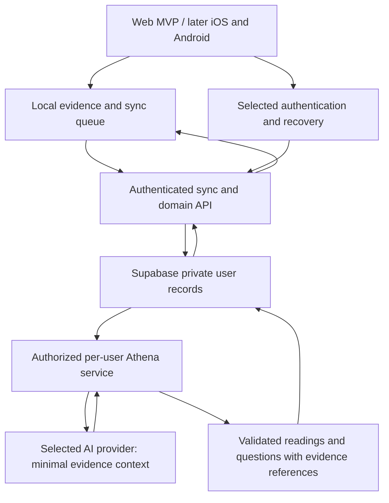

# Circle OS architecture

Updated: 2026-11-05. Read [product](PRODUCT.md), [roadmap](ROADMAP.md), and
[decisions](DECISION_LOG.md) alongside this document. Target designs below need
reviewed implementation and verification under the current web beta sequence.

## Current prototype

### Writing sync status and conflict resolution - 2026-11-06

Saved-copy presentation now derives Current note and its history from the live
writing ledger, separately from immutable `cloud.resolved` snapshots. The bounded
writing Body selector hides scrollbar chrome for Note/History/Trash/Sync without
changing overflow or frame rules. No persistence/model/RPC/schema change.

Latest UI-only refinement exposes `WritingSyncProvider.hasWork` from pending
saved references, choices/conflicts, initial saved-record inventory and recoverable
errors, with activation guarding upload work. History conditionally renders Sync.
Retry clears the error presentation while scheduling recovery. Saved copies on
the owning History row opens the retained archive without requiring Sync to be
visible. Persistent ledger/queue/cloud schemas and SQL remain unchanged.

Later presentation refinement reuses the default Note CreativeButton and shared
App-back for list/comparison/history. Histories are read-only, dates appear only
inside them, and a confirmed choice returns silently to the list. A deletion
received while viewing history hides the captured text. No persistence, RPC,
SQL or activation contract changes.

`WritingSyncProvider` observes account-scoped cloud transactions and runner state.
History opens `WritingSyncPage`; the Note editor and global header retain silent
save behavior. `writing-conflict-model` captures reviewed saved snapshots and
exact pending references into durable `cloud-v1.choices`. `resolved` retains both
original histories; body-free `settled` records operations covered by a resolution
without inventing normal upload receipts. Existing cloud-v1 stores remain valid.
Provider/runner scope checks reject late account responses and fail closed.

The follow-up migration `202611060001_writing_resolution.sql` is prepared locally,
not applied remotely. `circle_writing_resolve` uses the existing confirmed-user
check and account lock, exact reviewed server-version/snapshot comparison, stable
retry hashes and immutable shared-version checks. It appends a new chosen revision
to the current cloud history while private owner-scoped `writing_resolutions`
preserves both original histories and the result. `circle_writing_resolution_history`
paginates same-owner archives for recovery. Direct client writes and public/anon/
service-role function calls are denied. A writing-head deletion trigger scrubs
archived request/result bodies; replay after deletion returns the terminal head.

Pending choices recover before normal sync. Newer local work remains a conflict;
deletions scrub local choice/archive bodies. Archived branches are not additional
writing evidence or answered questions. No legacy import, other-domain sync,
remote configuration or activation is implied. Current details and limits:
[contract](ACCOUNT_WRITING_SYNC.md#writing-status-and-conflict-resolution---2026-11-06).
This supersedes earlier no-resolver/UI descriptions for repository capability.

### Account header and alias greeting - 2026-11-06

Follow-up: the trigger shows three dots, while the greeting retains the alias.
The action dropdown fits its content with equal side padding; the editing
form retains a 192px width without reducing the 44px touch target.

`SupabaseAuthBoundary` supplies the verified alias and existing edit/sign-out
actions through `auth/account-context.tsx`. Its consumer checks the selected
account ID before exposing identity. `auth/account-menu.tsx` renders in the
existing `OSFrame` header, keyed by account ID; full-screen chapter dialogs
retain an account control while hiding the covered header control. Edit alias
uses the existing auth controller/adapter and proof refresh. No profile data is
written to make the greeting work. Today reads the scoped alias, falling back
to `profile.name` only in legacy mode. The separate auth bar and header
Saved/Waiting to sync/Synced label are removed; saving and error handling remain.

### Direct entry after Day One - 2026-11-06

`day-door.js` now selects only unfinished Day One for automatic entry. The full
door identifier list remains for explicit Quest/Workshop entry. The shell
recognizes any completed Day One version and removes automatic Week/Log setup,
weekly review and daily-greeting offers. Week review resolves its saved week
only from a manual selection or explicit Workshop pin. Quest pins for setup and
review use those same seeded players and domain save handlers, so chosen Week
setup still creates its goal/step/phase instead of only saving answers.
Chapter content, access
gates, saved answers and domain outcomes are unchanged. The exact reported
midweek prompt has not been reproduced; this is the approved entry-policy change.

Account Habit/setup state is still browser-local. A private window starts with
separate local storage; signing in does not yet restore these domains. The
writing migration below covers writing only and remains off by default.

### Account writing storage and authenticated transport - 2026-11-05

The approved repository slice adds a migration for private writing heads with
saved versions/tombstones, body-free receipts and saved conflict candidates.
Owner SELECT policies and denied direct mutations accompany narrowly granted
public RPCs. Functions derive a confirmed account from authenticated claims,
pin search paths, serialize same-account writes, check base server versions and
commit exact receipts with the head. Anonymous/service-role transport calls
are denied. Saved versions/source identity cannot be rewritten. Permanent
deletion scrubs head/conflict text and blocks stale resurrection.

`writing-cloud-model.js`, `writing-cloud-sync.js` and `writing-transport.ts`
extend the existing account store/provider. `cloud-v1` stores body-free
version/lifecycle baselines, remote conflict copies and deletion suppression.
Receipt recovery precedes remote inventory and prior saved-writing inventory.
Uploads contain saved snapshots and ordered operation references, never drafts.
Conflicts preserve both saved copies and pause that entry; deletion remains
terminal. Local deletion scrubs its stored remote conflict in the same save
transaction. Exact upload acknowledgement preserves newer local work.

Transport verifies the captured token's confirmed user against the local scope,
then sends that same token to Supabase RPC. Scope aborts and checks protect every
asynchronous boundary. `SupabaseConnection` supplies the existing client;
`WritingCloudRunner` is mounted inside the account writing provider. The runner
defaults to off unless `NEXT_PUBLIC_CIRCLE_WRITING_SYNC=enabled` is explicitly
configured in a separately reviewed build. No hosted SQL/configuration changed.

SQL access tests run in PGlite PostgreSQL; browser tests use real IndexedDB and
HTTP with synthetic Auth. This is locally verified repository implementation,
not hosted JWT validation, physical-device recovery, multi-connection contention
or complete backup/deletion proof. No conflict resolver/status UI, privileged
admin reader, other-domain sync or personal import was added. See
[the contract, limits and activation steps](ACCOUNT_WRITING_SYNC.md) and
[verification](USER_JOURNEY_TESTING.md#account-writing-storage-and-transport-2026-11-05).
The earlier local-only snapshot below remains historical for its first slice.

### Durable local writing sync queue - 2026-11-05

The approved first sync slice adds `writing-sync-model.js`/types and the
`sync-v1` key in the existing account-scoped writing IndexedDB store. The
writing ledger and queue are committed by the same readwrite transaction.
Legacy commits keep their prior path. A corrupt or wrong-owner queue fails
closed; it is never silently reset to permit a save.

Only new accepted saved/lifecycle changes enqueue. Draft writes/discards,
conflicts, no-op saves, redundant lifecycle actions and local receipt retries
do not enqueue. Each record retains operation ID, command fingerprint, entry,
generation, saved-version reference, lifecycle kind, local sequence, predecessor
and recording time. No writing/draft body is copied into the queue. Permanent
deletion removes saved text in the existing ledger while leaving minimal
pending references and an explicit deletion marker. A later transport must
honor the tombstone rather than attempting to recover/upload removed content.

Acknowledgements name exact owner, operation/hash, entry/generation, server
receipt and server version. They are validated and stored atomically with
retirement of only those named operations. Retries must match the first receipt;
unknown/mismatched receipts, reused receipt IDs and inconsistent per-entry server
version ordering fail. Newer queued changes and the writing ledger are untouched
by an older acknowledgement. Scope guards reject in-flight or late callbacks
after account switching/logout. Same-account tabs share IndexedDB serialization.

These local acknowledgement APIs make no requests and do not authenticate a
remote receipt. Browser checks inject synthetic receipts only. No Supabase
schema, transport, session-token integration, conflict UI, automatic initial
inventory, personal migration or operational backup is added. Prior locally
saved entries are not retroactively queued by replaying their receipts; review
initial inventory before enabling uploads. Drafts remain device-local. Technical
queue receipts have no automatic expiry; server/deletion/backup retention needs
its own reviewed design. See [checks and limits](USER_JOURNEY_TESTING.md#durable-local-writing-sync-queue-2026-11-05).

The developer removed Week-review corrections from current scope (completed
reviews stay read only), deferred past Habit completion corrections and deferred
the shared day view. Those earlier requirements no longer block this sync slice;
existing App histories and prospective wording remain.

### Chapter History and Quest setup status - 2026-11-05

`chapter-history.js` is a pure read model over `chapters.runs` and authorized
local chapter publications (including bundled supply). The selector retains
completed answer-bearing runs with distinct run IDs and chapter versions.
Question snapshots take precedence; fallback resolves only the same chapter ID
and version. Conflicting definitions supply no guessed wording. Display snapshots
remain preferred over stored values; blank, false and zero remain meaningful.
No player, completion handler, normalization or new record store is involved.

Reflect hosts `ChapterHistoryPage` in the existing Quest slot using shared
App-back. Only finished steps and completed Quests' View history open the reader;
the standalone header control is removed. Visible version labels are removed;
original run/version references remain internal for exact definition resolution.
A broader all-chapter archive is deferred. Completed steps resolve their actual
completed run where
available. Existing setup without chapter answers is a UI status/message,
without a fabricated run, version, completion date or answers. History locks
outer swiping, grows downward and returns to the same catalogue position.

`questStepStatus` in `quests.js` reads actual completed runs plus explicit setup
evidence. A named active Habit or both saved routine-wake/routine-sleep values
can satisfy Habit/Log setup; a nonempty matching declaration satisfies only its
own declaration step. Replacement first-use completion must match the original
publication version and target App, with audience checks. Draft/empty Habits,
partial Log answers and an unlocked App are insufficient. Other reflection,
Day One and Week steps still need their own completed runs. No data is backfilled.

The same status check guards Habit/Log first-use and ordinary setup deliveries,
the compiled Habit/Log surface and stale Quest pins in Today. It preserves
existing access gates, legitimate unfinished chapters and non-Quest named doors.
View/Hide uses CreativeButton's existing keepMountedOnSuccess setting rather
than changing the shared engine. Complete Quests offer View history; finished
steps no longer reopen a player. Historical corrections and outcome replay
remain separate reviewed work. See
[checks and limits](USER_JOURNEY_TESTING.md#chapter-history-and-quest-setup-review-2026-11-05).

### Read-only Athena Reading History - 2026-11-05

Reflect's Athena cover opens `AthenaHistoryPage` through the shared App-back
controller in its existing cover slot. Its source is `buildAthenaReading(...).
editions` from the same account-bound writing-consumer memory used by the live
reading (or existing Circle memory in legacy mode). The list/detail creates no
new store or normalizer. The current four swipe Pages remain; History locks
outer travel to the cover and returns through the list to the current cover.
Account remount closes selected history.

The archive renders only each edition's own cover, dated publication instant
and days/alive/shape sections. It never calls the live-profile/derived fallback,
reply editor, chapter handlers or a provider. Empty sections and unknown dates
are stated honestly. Dates display locally while retaining their exact time
attribute. The existing content-derived IDs, immutability, merge and 60-edition
bound are unchanged. This exposes locally retained prepared content, not a
new requested AI service or full server archive. Older-edition paging,
source-correction qualifications and safe sync remain separately reviewed.
See [verification](USER_JOURNEY_TESTING.md#read-only-athena-reading-history-2026-11-05).

### Read-only Week History - 2026-11-05

`week-history.js` selects earlier Monday-based calendar weeks from existing
`state.weeks` and weekly `state.goals.items`. Blank goals without steps, invalid
week keys, the current calendar week and future weeks do not create entries.
Goals-only and review-only weeks remain readable. This uses assigned dates,
not a new attribution calculation from timestamps.

Each view reads goal state and goal-step links directly, resolving words/status
from `tasks.items`, including archived tasks. Missing tasks remain unavailable;
their recorded step/date link stays visible. These are current saved goal/task
words, not historical wording snapshots. Review values come directly from the
saved weekly record; its actual recording instant displays as local date/time.
No new store, migration, normalization, outbox operation or correction writer
is introduced. The existing first-review-wins writer/merge remains unchanged.

`WeekHistoryPage` uses PageLayout and the shell's separate shared App-back
controller. History occupies Week's existing SwipeSession slot, disables outer
travel while open, grows downward and returns through History to current Week.
Account remounts close it. Reading never invokes chapter completion handlers,
so it cannot create goals/tasks or alter Protocol runs. Original chapter answer
review, historical wording versions, weekly corrections, shared day review and
safe account sync remain separate work. See
[verification](USER_JOURNEY_TESTING.md#read-only-week-history-2026-11-05).

### Log history and text corrections - 2026-11-05

The Log label opens past recorded days using the shared App-back engine and
existing daily SwipeSession slot. History reads `state.days`; it owns no second
record store. It preserves assigned date keys and saved time ranges, including
legacy activities/notes, without applying today's wake/sleep suggestions.
History list/day/editor content grows downward through the existing frame.

Text-only corrections target one existing past `timeBlocks` ID. The editor
captures a signature of the entire saved block, retains the draft locally in
memory and requires Save changes. Cancel writes nothing. Reload or an account
epoch change closes the editor; this is not a new durable draft engine.
The domain action rechecks the signature inside the scoped state update,
rejects missing/current/future/stale targets and non-increasing correction
timestamps, and preserves date, range, ID, createdAt and unknown metadata.
Unknown legacy first-recorded times stay unknown. No-change/replayed saves do
not create another evidence revision.

Each accepted change adds `days[dateKey].logCorrections[id]`: immutable receipt
ID, dateKey, blockId, correctedAt and exact before/after block snapshots.
The updated block retains its ID and uses actual correction time as updatedAt.
Receipts accumulate by ID during the existing merge, independently of the
current block winner. This is internal correction evidence, not a new Versions
Page or authorization for a paid model call.

A clearing receipt retains the dated empty `after` block, while active
`timeBlocks` excludes that block. Normalization and merge suppress a matching
older block using the empty receipt's revision; a genuinely newer edit is not
suppressed. Thus existing Week/Reflect readers do not count cleared time, and
an older copy cannot restore cleared words. Corrections use the existing
account-separated local store and day-log queue. Safe Supabase operations,
cross-device conflict resolution, real acknowledgements and recovery remain
planned; local merge checks do not certify them.

Time/date correction, adding missed past entries, day-title corrections and a
general Log delete/restore interface remain separately reviewed scopes. Checks
and limitations are in
[the journey evidence](USER_JOURNEY_TESTING.md#past-log-text-corrections-2026-11-05).

### Protocol prospective wording - 2026-11-05

`protocol.termVersions` stores independent immutable full-term snapshots keyed
by unique IDs. Each records run, effective Circle day, actual recording time and
local order. Beginning a phase captures its initial terms. Active term edits
capture the next day's terms; daily readers and tick/seal actions resolve the
agreement applicable to their assigned day. The editor reads the editable run.
IDs, completions, seals and retired correction receipts remain intact.
Normalization preserves snapshots and the existing merge unions their records
independently of the editable run. This is local/legacy-merge behavior, not the
planned Supabase synchronization protocol or concurrent-editor resolution.

Legacy runs acquire an observed baseline only on their first term edit; it is
not backdated. Earlier seals and completion-word snapshots supply known words;
otherwise current wording is explicitly marked as lacking its original.
Past phases computes term intervals/counts and day outcomes from applicable
agreements, retaining the bounded read-only presentation. See
[verification](USER_JOURNEY_TESTING.md#protocol-prospective-wording-2026-11-05).

### Protocol history is read only - 2026-11-03

The developer removed Correct last day as unnecessary, superseding the earlier
correction-editor slice. Protocol history has no last-day action or editor.
The dedicated draft/write functions and shell wiring are removed. Ordinary
ticks still reject completed and archived phases, malformed dates, dates
outside their run and future dates. Running-day editing/sealing and phase
archiving retain their existing behavior.

The account-separated state still accepts and merges `protocol.corrections`
for compatibility with already-saved immutable receipts. There is no current
writer for that map. Removing the feature does not discard earlier evidence,
rewrite completion/seal records or migrate personal data. Prospective term
versions are implemented by the later 2026-11-05 slice above.

Protocol term inputs hide native scrollbar chrome in their scoped CSS while
retaining content sizing and multiline growth. The reported grey box was not
visible in isolated Chromium; native-scrollbar attribution remains an inference.

Checks and limits are in
[the journey evidence](USER_JOURNEY_TESTING.md#protocol-simplification-and-input-scrollbars-2026-11-03).

### Habit dated history - 2026-11-03

The developer's follow-up replaces the initial picker with a separate History
Page opened from Record's top-right History label. Shared App-back navigation
returns to today's Record. Completed past days appear newest first in one
scrollable Body, with a fixed Header and the shared writing ceiling. Yesterday
has no date beside it; older groups show their dates. Original-wording notices
are removed from the UI by request; internal current/unknown provenance remains.
Empty/fully undone days do not produce completion groups. See
[the refinement checks](USER_JOURNEY_TESTING.md#habit-history-page-and-flexible-entry-2026-11-03).

Habit Record reads past completions directly from the existing account-separated
Circle state. Each new tick adds an optional snapshot (text, action, cue,
identity) to that completion, alongside its existing dateKey, completedAt and
updatedAt. Definition edits/archiving do not modify it. Undo writes a dated false
value and retains the snapshot; a subsequent tick captures its new wording.
Normalization, local storage and the existing timestamp-based merge retain the
fields. This is not the planned durable-operation Supabase sync protocol.

`habitHistoryRecord` includes completed entries even if their definition is
archived or missing. Older completions without snapshots carry an explicit
current/unknown wording source; reading does not backfill data. A saved empty
snapshot also never borrows later wording. `habitHistoryDates` lists past days
from completion records (including undone ticks) and existing completed tasks.
The History list reads those same source records without a second editable store
or outcome calls. The picker described in the initial evidence is superseded.

The same follow-up allows any new Habit field first. The existing definition
record supports status=draft for the new inline entry path; older chapter/model
creation paths retain their existing defaults. Raw action/cue/identity fields
persist locally for recovery without queuing an unnamed draft as a saved Habit.
Normalizers and the existing merge retain draft fields. Drafts are excluded from
ordinary Routine rows, active-habit counts and completion actions. New habit
reopens an unfinished draft. Committing a nonblank action promotes it to active;
blank action stays draft. A cleared previously saved habit still archives. The
resume action also preserves fields on an older unnamed active placeholder while
marking it as a draft; it never recreates over an existing named/archived record.
This does not certify cross-device draft sync or introduce a new cloud protocol.

Today's Undo and Week's current-definition counts still use `dayRecord`.
Task wording/date semantics are unchanged, including their known travel/timezone
limitations. Definition versions on missed days, explicit past corrections,
cross-device ownership/receipts, import and safe cloud sync remain later slices.
See [verification and limits](USER_JOURNEY_TESTING.md#habit-dated-history-2026-11-03).

### Deep Thoughts and managed quotes - 2026-11-03

Today now presents Note and Deep Thoughts. The shared account writing Page owns
both History/Trash surfaces, preserving existing entry kinds, versions, question
sources, recovery buffers and account epochs. Send retains the accepted answer;
Next question alone advances it. A quote is another side of that Page, so reading
never unmounts the live account editor or submits its draft. Internal `thoughts`
destinations and immutable publications are preserved. Legacy mode retains its
existing record transport and is not migrated by this change.

`public.circle_quotes` is the first bounded shared quote catalog, separate from
personal evidence. Its checked-in Supabase migration grants public read access
and server-role add/remove only, with RLS enabled. Server route modules use
`SUPABASE_SECRET_KEY`; client modules receive quote text/author/UUID only. Existing
signed Admin cookies and same-origin JSON checks protect mutations. No AI or
personal profile evidence is involved. Setup and routes are in [Quotes](QUOTES.md).

Catalog reads follow PostgREST pagination. The device caches the last valid public
catalog and stores seen IDs under its account namespace; it remembers the entire
active pool. Each tap tries a fresh read. Offline reading can retain a cached
removal until a successful refresh. A successful empty catalog is authoritative.
The developer applied/configured the hosted setup; live public/server access
checks and cleanup passed. This does not implement lifestyle sync or certify
hosted app sessions, authenticated A/B quote-table access, physical devices or AI.

### Bounded account Note pages - 2026-11-03

The approved refinement moves New Note to the editor Footer and removes the
Note trash-success notice. New Note waits for local acceptance, including newer
typing during an in-flight save, before replacing the buffer. Composition,
failed saves and conflicts preserve current text. The persistent action reuses
the shared button engine's repeatable mode.

Scoped Note CSS caps the existing Page within the App Box: at most 480px for the
whole frame, or 60% of the dynamic viewport on short screens, never below the
shared resting minimum. Body is the single scroll region; Header, Heading and
Footer remain fixed within the box. Footer keeps its full intrinsic content row
and its action gap follows actual footer content when replacing an empty list;
Note resets native textarea scroll offsets after shared content sizing, so Body
owns the single scroll region. Navigation/new writing resets content scroll.
The existing Page, App-back and swipe engines remain; Habit/Protocol and other
writing keep their growth rules. No schema/provider/store or sync change occurs.
See the [contract](PERSONAL_RECORDS_AND_ATHENA_PLAN.md#1411-bounded-note-pages---2026-11-03).

### Account Note History controls - 2026-11-03

The later approved Note refinement removes its Versions routes/controls, Undo
and routine local-save messages. Revision IDs, saved content versions, schema,
provider/store and conflict guards remain internal and unchanged. Direct HISTORY
navigation shares NOTE's header styling; focused Note fields keep the caret
without an outline/box. Other writing controls are unchanged.

Local History rows use separate open and orange trash-bin buttons. Saved rows
reuse generation-checked Trash commands. A recovery row saves its exact stored
snapshot before moving that entry to Trash; failure/conflict leaves text
recoverable and shows an alert. No buffer is discarded or imported. Trashing
cannot open the row editor; restoration occurs through the retained Trash page,
with confirmed permanent deletion. Legacy compatibility sources remain read only.
See the [current Note contract](PERSONAL_RECORDS_AND_ATHENA_PLAN.md#1410-note-history-controls---2026-11-03).

### Account Note autosave - 2026-11-03

The approved Note-only refinement uses the same account ledger and queued
commands. Per-input recovery still uses internal draft records; the Note UI has
no draft workflow or manual Save. A one-second typing pause, editor departure,
visibility loss or pagehide requests a saved revision. Input composition defers
autosave until composition ends. Route unmount makes a best-effort flush while
the account provider remains open; browser/account closure can stop that work,
so durable recovery is reopened and autosaved on the next visit. New typing
during a save remains live and receives a subsequent save. Conflicts stop
autosave for explicit review; failed writes retain text and a retry action.

Note adopts initial recovery once, so an idle second tab cannot begin autosaving
another tab's new recovery buffer. Older buffers remain reachable as Note rows
in History and save when opened. Existing Note corrections may save empty
title/body as a new immutable version; new empty entries and empty Thoughts
remain invalid. Legacy identifiers/schema, account epochs, local-only storage,
original day attribution and no-AI-on-save remain. Thoughts and reading answers
keep explicit Send/Save changes. The dated editor snapshot below records the
previous controls. See the [current evidence](USER_JOURNEY_TESTING.md#note-autosave-refinement-2026-11-03).

### Account writing editors - 2026-11-02

The approved C slice connects `writing-pages.tsx` through Today and Reflect to
the account-bound writing provider. A live editor buffer survives provider
refreshes. Per-editor queued draft/save commands use version/generation checks;
only that editor's accepted save advances its base. New typing during Save
remains a newer draft. Conflicts preserve both copies and require an explicit
review choice. Account epochs close stale callbacks. No writing is copied into
CircleState, its outbox or a legacy payload. No AI runs on Save/Send.

History, immutable versions and local Trash/Restore/Delete forever read the
current provider view. Deletion requires Trash and confirmation. Older
compatibility sources appear read only; no migration links or ownership claims
were created. Shared Page/App-back/swipe/button engines still own layout and
motion. The reading answer is embedded in its existing reading Page. See
[UI verification](USER_JOURNEY_TESTING.md#account-writing-ui-2026-11-02).

```text
Browser: Today / Reflect / chapter player / authoring
  |
  +-- IndexedDB + localStorage copy (circle-os-state-v2)
  +-- immutable chapter cache + local progress
  +-- evidence revisions + sync outbox
  |
  v
File-based profile server (local-ai/server.mjs)
  |
  +-- profile and day records in vault files
  +-- private profile keys stored outside the vault
  +-- profile recovery / authorized device attachment
  +-- prepared readings, memory, and chapter publications
```

The diagram describes legacy profile mode. Supabase account entry now selects
separate browser stores, and account mode rejects the legacy profile transport.
It does not yet connect lifestyle records to a Supabase database.

- `app/os/circle-os-store.ts` saves local state and reads the newest local copy.
- `CircleStateProvider` in `circle-os-shell.tsx` owns state, startup, and sync.
- `app/os/circle-os-ai.ts` is the current profile-server client despite its name.
- `local-ai/server.mjs` stores/merges evidence. External Athena preparation is
  described in `local-ai/README.md`; operation of that scheduler is not certified
  by the presence of the server code.
- The current app has a default profile-server address and can upload records.
  It is not accurately described as a device-only app.
- `db/schema.ts` is empty scaffolding and `db/index.ts` is a D1 adapter. Neither
  is an implemented Supabase lifestyle database.
- Current prepared-content behavior must stay distinct from planned live or
  scheduled AI inference. There is no configured model integration implied here.

Runtime files may still reference the vault. Replacing missing product-document
authorities does not remove these integrations or migrate personal data.

### Account-bound local writing provider - 2026-11-02

The separately approved local writing engine, compatibility adapter and B2
provider are implemented. `WritingProvider` in `app/os/writing-provider.tsx`
mounts below `CircleStateProvider` only for account scopes, after account entry
and scoped state loading. Legacy mode keeps its existing provider/transport.
This is a React/local-storage provider, not an AI provider or cloud service.

The writing ledger remains in its account-specific IndexedDB database, separate
from `CircleState`, its outbox and `buildServerPayload`. Drafts stay in the ledger
and outside saved evidence. No personal records are imported or assigned to an
account. Existing same-account answers are a read-only compatibility snapshot;
unknown dates remain unknown and no real compatibility links are generated.

Every action captures its account scope. Reads also carry input/request guards
through IndexedDB and asynchronous hashing. Superseded/closed results cannot
publish. A commit's receipt reports local acceptance; rendering uses a fresh
store read. A successful commit followed by failed refresh remains locally
accepted with a separate read error. Failed writes keep their recoverable
drafts and permit stable-operation retry; the editor must retain newer open text.

Committed writes emit content-free same-tab/BroadcastChannel/storage signals.
Other tabs and foreground/visibility events refresh the ledger. When both
cross-tab channels are unavailable, foreground refresh remains the fallback;
no immediate background freshness guarantee is made in that degraded case.
Circle-state storage events also refresh the read-only old-answer snapshot.
This does not repair the older whole-state store's concurrent-write protocol.

Deep Thought and first-use checks use shared question/app-use metadata, without
editable answer copies. Reflect gates writing-derived context by current
owner/source/version dependencies, withholding mixed/unknown dependencies.
Independent unscoped tool context retains its existing behavior; this is not a
new authorization/correction system for those other domains. Received reading
prose/editions stay unchanged and no generation runs on writes.

Permanent local deletion retains minimal question/app-use metadata beside its
tombstone, while removing answer/version/draft content. Old markers without that
metadata load honestly as unknown and cannot reset questions/first use. Wider
derived/device/server/log/backup deletion remains separate. Writing controls,
history UI and real migration/sync remain unfinished. See the
[delivered contract](PERSONAL_RECORDS_AND_ATHENA_PLAN.md#147-account-bound-provider-delivered---2026-11-02)
and [verification](USER_JOURNEY_TESTING.md#account-bound-writing-provider-2026-11-02).

### Supabase account entry implementation - 2026-10-31

Hosted setup progress (2026-10-31): the developer created the project and supplied
public connection details. Ignored local configuration now selects Supabase mode;
restart/reload is required. Hosted read-only checks confirmed email auth, required
email confirmation and ES256 signing. After the developer changed settings,
a read-only recheck confirmed public signup disabled, email login enabled and
email confirmation still required. The developer later reported successful
sign-in, reset, logout and offline local persistence. These are reported journeys,
not agent-observed hosted certification. Final SMTP/redirect/template settings,
refresh/revocation and cross-device checks remain unverified. No personal
records were migrated. Required setup below is a checklist, not proof that every
item is complete; see the [hosted evidence](USER_JOURNEY_TESTING.md#hosted-supabase-connection---2026-10-31).

The reviewed login slice adds `app/os/auth/` in front of the existing state
provider. It uses the official Supabase browser client; no lifestyle database,
evidence sync, membership, or live Athena service is connected by this slice.
The developer approved invitations only, continued offline use after a prior
online sign-in, and preserving the owner's legacy profile until a separate
migration review. Authentication IDs select the existing account-scoped stores.
Alias is editable Supabase user metadata, never an authorization role. Account
mode bypasses the old real-name/age entry requirement, without inventing either.

Online entry checks the user with Supabase and requires confirmed email.
Invitation and recovery links lead to password entry before personal state can
mount. Reload retains that step. A new account chooses an alias before entry.
The saved browser scope marker alone cannot open a different account. Session
and attempt guards reject late results after logout or switching.

A successful online check saves an offline proof containing the signed token
and public verification keys. Offline entry verifies its signature, issuer,
audience, role and owner, deliberately accepting expiry for local use only.
Local records remain usable until logout; server access still needs a current
session. Reconnection/foreground checks detect rejection and close access.
Remote revocation cannot be detected while disconnected. Local storage and
cached keys are not encryption or protection against device/browser-script
access. Offline logout removes the offline proof and persisted SDK credentials;
it cannot revoke a remote session while the network is unavailable.

Existing-profile mode remains the default while migration is unreviewed.
Enable Supabase mode explicitly at build time; never treat that default as a
multi-user beta configuration. Invalid Supabase configuration fails closed.

For local onboarding tests, the developer approved a development-only `test`
mode on 2026-10-31. Set this in the ignored `.env.local`, restart the development
server (`npm run dev`), and fully reload the browser:

```text
NEXT_PUBLIC_CIRCLE_AUTH_MODE=test
```

This opens the account-style Day One flow without login, real name, or age.
Reload resumes the current test. **New test session** creates a fresh synthetic
account and empty state through the existing storage engine; it never deletes
or migrates old records. The test selection uses
`circle-os-development-test-scope-v1`, separate from the real account marker.
Only generated `dev-test-<uuid>` accounts can open in this mode. Their state,
private chapter cache and pins use the existing account-specific keys/databases.
Neither Supabase auth nor the legacy profile server is contacted.

Use `legacy` for the original profile flow, `supabase` for actual invited-account
login, and `test` for development onboarding. Mode changes need a server restart
and full page reload; production changes need a rebuild. Production with `test`
configured fails closed, and the development namespace helper also rejects
production calls. No test switch exists in the released login UI. The actual
`.env.local` was not edited by implementation or verification.

Only public project configuration belongs in frontend environment variables:

```text
NEXT_PUBLIC_CIRCLE_AUTH_MODE=supabase
NEXT_PUBLIC_SUPABASE_URL=https://<project>.supabase.co
NEXT_PUBLIC_SUPABASE_PUBLISHABLE_KEY=<publishable key>
```

For hosted verification, review the created project's chosen Singapore region,
disabled public signup, required email confirmation, asymmetric JWT signing
key (ES256 or RS256), and custom SMTP. Public settings and ES256 have recorded
checks; do not repeat project creation or assume the remaining setup is verified.
No administrator/service-role key
is used by this browser implementation. Configure the app origin and allow
`<app-origin>/os/auth/confirm` as a redirect. Use these email template link
targets, substituting the actual app origin for `<app-origin>`:

```text
Invite: <app-origin>/os/auth/confirm#token_hash={{ .TokenHash }}&type=invite
Reset:  <app-origin>/os/auth/confirm#token_hash={{ .TokenHash }}&type=recovery
```

Hash links keep one-use secrets out of HTTP requests and navigation caches;
the boundary removes them from browser history before exchanging them. The
app intentionally does not accept default implicit-token or arbitrary query
redirect flows. Admin sends/reissues invitations through Supabase; users can
request password resets. Disable email link tracking and test links on a
different browser/device as well as the originating device. See official
[email templates](https://supabase.com/docs/guides/auth/auth-email-templates),
[SMTP requirements](https://supabase.com/docs/guides/auth/auth-smtp), and
[session behavior](https://supabase.com/docs/guides/auth/sessions).

The worker covers `/os` as well as nested routes and primes already-loaded
static code after first sign-in. It does not cache Supabase auth responses.
Actual hosted configuration, mail delivery, project access policies, physical
phones, and owner migration need separate verification; local fixtures do not
certify them. Current evidence belongs in the
[journey record](USER_JOURNEY_TESTING.md#supabase-account-entry---2026-10-31).

## Target across later web iterations and mobile clients

The [approved launch plan](WEB_BETA_LAUNCH_PLAN.md) now includes Supabase
accounts, safe sync, manual paid membership, and a bounded personalized Athena
integration in the first invited beta. This supersedes the earlier core-first
sequence. Account entry/local isolation exist; lifestyle sync, membership and
live Athena remain target services, not implemented by this plan.
Existing prepared readings remain part of current-feature verification.



Supabase is the chosen backend direction. Email/password with a separate alias
is confirmed. API/worker runtime and AI provider remain open; native delivery
is deferred. The AI service is an
application boundary we must implement; Supabase selection alone does not
create it. Keep domain rules and data contracts independent of web UI details.

## Identity and recovery

Confirmed intent: keep personal records private and use email/password with a
separate display alias. On 2026-10-31 the developer accepted email, superseding
the earlier username-only preference. Recovery and email-delivery configuration
are described in the account-entry implementation above; hosted setup remains
unverified and manual lost-email recovery still needs a reviewed design.

Technical findings checked against official documentation on 2026-10-30:

- Supabase password authentication uses an email address or phone number.
  Username-only password login is not the documented built-in flow.
  [Password authentication](https://supabase.com/docs/guides/auth/passwords).
- Anonymous signup does not collect an identity, but a signed-out user cannot
  sign back into that account through anonymous signup alone.
  [Anonymous sign-ins](https://supabase.com/docs/guides/auth/auth-anonymous).
- Supabase supports compatible third-party authentication, so database choice
  does not by itself settle the login provider.
  [Third-party authentication](https://supabase.com/docs/guides/auth/third-party/overview).

Use supported managed authentication with private contact/recovery details.
Confirmed 2026-10-31: new users must verify their email before using their
account. The optional Supabase-mode browser gate and link handling are now
implemented and locally tested; actual email delivery and hosted enforcement
remain unverified.
Confirmed 2026-10-31: password recovery uses a reset link sent to the account's
verified email address. Manual recovery will also be offered when the person
loses access to that email (confirmed 2026-10-31). Ownership checks and the
manual process require review before implementation. Browser reset-link and
session handling are implemented in the optional mode above. Hosted delivery,
real session revocation, and lost-device operations remain unverified.
Login should persist until logout; local records may remain stored. Session
renewal and local logout now have browser handling and synthetic checks;
hosted revocation/lost-device behavior still needs verification. Retained local records must stay account-scoped
and inaccessible to another account or a signed-out person.
Do not build custom password verification or synthetic-email
workarounds. The browser store now has account-specific keys, private chapter
caches, pins, and safe switching. Supabase mode must be enabled and its
authentication configuration verified before multi-user operation.
Signing in must not silently claim a previous person's local evidence.

Use an internal account ID for ownership. Keep a display alias separate from
private authentication information. Real name and exact age must not remain
required by habit; review what information the product actually needs.

## Private evidence and authorization

Proposed requirements, not claims that the current prototype meets them:

- Each private record has an owner. Access is enforced on the server/database,
  including reads, writes, storage objects, functions, and background jobs.
- Separate authentication/contact information from lifestyle evidence and any
  intentionally public alias or aggregate score.
- Enable appropriate database grants and row-level policies. Test allowed own
  access, denied other-user access, and unauthenticated requests. Supabase's
  privileged secret/service-role access can bypass RLS, so server jobs using it
  require their own verified user scoping.
  [Row Level Security](https://supabase.com/docs/guides/database/postgres/row-level-security).
- Keep privileged credentials on the server. Validate ownership from a verified
  session or authorized job, not an arbitrary user ID in a request or prompt.
- Admin has always-available read-only access to personal writing, without
  support-case approval. Verify protected admin access and denied user access;
  read-access audit details remain open. Admin's separate power to delete an
  account and its data on request is allowed; direct writing edits are not.
- Error logs are admin-only and may contain personal writing. Log retention
  and implementation details remain open; do not claim logs are writing-free.
- Account/data deletion is manual on request. Deleted data may remain in backups
  for at most 30 days. Deletion turnaround, retained local/log/provider copies,
  and prevention of deleted-data restoration require a reviewed design.
- No user download/export is offered in beta. Operational backup/restore and
  deletion/backup expiration remain verification gates.
- Use protected transport and storage, and review encryption/key requirements.
  Do not claim end-to-end encryption against the backend or AI provider while
  they can read the plaintext needed for server-side analysis.
- Pseudonyms do not guarantee anonymity. Free writing, aliases reused elsewhere,
  and operational metadata may identify someone.

## Athena access boundary

Confirmed beta request flow (2026-10-31): requesting an Athena reading has no
separate AI opt-in prompt. The person requests the reading directly. How AI
processing is explained is confirmed: the developer will explain it manually
on the website or social pages and warn users not to enter sensitive information.
Exact wording/publication remain pending. The developer accepts processing Athena
needs without additional provider privacy restrictions at this planning stage.
Actual retention, training use, and processing locations must be documented at
integration. This does not remove authentication, membership, or usage checks.
No request flow or provider integration is implemented by this decision.

Confirmed reading evidence (2026-10-31): relevant notes, reflections, goals,
habits, and activity records belonging to the requesting person may be used.
Login and payment details stay out of the AI context. Exact evidence selection
and exclusion checks require implementation review and verification; these
boundaries are not yet implemented.
Relevant evidence may come from the person's whole history. Requested replies
may use all evidence available to Athena for that person within these boundaries;
whole-history access is not a requirement to send every record on every call.

Confirmed beta reply rule (2026-10-31): saving a reflection and requesting an
Athena reply are separate actions. A save persists dated user evidence without
starting generation. Only an explicit request starts a reply, subject to
authorization, membership, and usage controls. Saving reflections stays free.
Keep the reply rule in one place so later behavior changes do not require
rewriting saved reflections or immutable reading history. Exact controls and
limits remain open; this separation is not yet implemented.
There is no fixed follow-up-question count beyond usage allowance. This
supersedes the earlier bounded-follow-up proposal; automatic replies remain
outside scope. Readings are short, direct, calm, and advisory. Exact tone and
language guidance will be configured later in a skill or similar instruction
file. No instruction file or new philosophy is authored by this decision.

Confirmed beta reading location (2026-10-31): Athena readings live in the
existing Reflect experience. Exact Page layout and controls remain open;
this decision does not create a separate app or select a delivery mechanism.

Confirmed reading format (2026-10-31): each reading includes one optional
reflection question. The person may leave it unanswered. An answer is saved
as dated personal evidence through the reflection-save action, without
triggering a reply. A reply still requires a separate explicit request.

Confirmed beta reading flow (2026-10-31): a person requests a reading and the
requested result appears automatically when ready, without a second reveal
request. Authorization and usage checks apply to the initiating request.
This does not authorize automatic preparation of unrequested readings or
settle a queue, polling, notification, or delivery implementation. Existing
prepared-content behavior remains distinct from this planned generation flow.

Recommended design:

1. For beta readings and replies, the application authorizes the person's
   explicit request. A worker may finish that requested work asynchronously;
   scheduled preparation of unrequested readings is not approved by this flow.
2. A constrained service selects the necessary evidence and records its IDs
   and revision within the allowed reading evidence. Login and payment details
   are excluded from the AI context.
3. The model receives that context and approved tool capabilities. Database
   administrator credentials and unrestricted SQL access are never in prompts.
4. Validate the result and its source references. Store readings, questions, or
   inferred memory separately from the person's original words and actions.
5. Deliver the result with freshness, uncertainty, and correction behavior.

User writing is evidence, not authority to change tool permissions. Reject
cross-user requests and unapproved actions regardless of model instructions.
Error logs may contain personal writing and are accessible only to admin;
retention and logging details require implementation review.

Provider retention/training facts and processing locations, published data-use
wording, budget, and correction propagation require review before using real
tester evidence with a model. The developer's processing flexibility is not a
claim about an unselected provider's actual terms or capabilities.
The app remains usable when inference fails or the budget is exhausted.

## Membership and usage boundary

Planned membership is server-owned prepaid access. The developer confirms
payment and grants a duration or expiry; admin can extend/revoke with an audit
trail. The browser and Home Screen app share the same account entitlement.
Users cannot edit their own membership or limits. Check live expiry and
revocation for every generation request rather than trusting cached paid flags.
No billing integration or membership service currently exists.

Confirmed renewal starting point (2026-10-31): use the current expiry while
membership is active, or the grant time after expiry. This preserves unused
paid time. Standard access durations are fixed 30, 90, 180, or 365 days
(confirmed 2026-10-31). Use explicit day counts rather than calendar months or
years; do not convert 365 days to twelve 30-day periods. Month-end adjustments
do not apply. Access expires at the same time of day after the selected duration,
measured from the agreed renewal starting point. Display expiry in the person's
local timezone (confirmed 2026-10-31). Timestamp storage and date-calculation
details require implementation review.
These rules are not yet implemented.

Enforce per-user allowances, input/output limits, total spending controls, and
pause switches on the server. Reserve quota atomically to prevent concurrent
requests exceeding it. Failed requests consume no user allowance: release or
settle reservations accordingly and account for provider costs separately.
Daily resets use Myanmar time (`Asia/Yangon`); unused daily allowance carries
within the person's membership cycle and disappears at that cycle's monthly
reset. Monthly allowance does not carry forward. Exact amounts/counting units,
reset hour, monthly-cycle calculation for 30/90/180/365-day grants, expiry/renewal
effects, retries/no-change outcomes, total budget, and pause/alert thresholds
remain open. Prices/payment details are deferred. Expiry
does not delete personal evidence. Confirmed 2026-10-31: previously received
readings remain readable after paid access expires. Gate new Athena generation
on current entitlement; do not apply that paid gate to reading existing editions.
Core tools, personal records, and sync remain available. This access rule does
is separate from the manual deletion and 30-day backup rules above. None of
these target membership or privacy behaviors is implemented by this plan.

## Beta infrastructure and content delivery

The developer created and connected a hosted Supabase project; the account-entry
section above distinguishes settings checks from reported journeys and remaining
gaps. Lifestyle sync/backup remain unimplemented. No live AI provider integration
is configured or verified by this review; provider/account setup needs review
when integration is reached. Singapore is the chosen database region for the
10-20 Myanmar/Thailand beta users. Confirm the actual project region and measure
connections from both countries before launch. Database location does not
settle AI processing location or actual provider terms. Admin access, logs,
manual deletion, and maximum backup retention are defined above; their
implementation and remaining details still require review and verification.
The developer will monitor the beta. Feedback and recovery/rollback procedures
remain open.

Retain existing web installation support and verify Home Screen installation,
session behavior, offline reload, and updates on real phones. Native apps and
app-store distribution are outside this beta.

Live admin chapter updates without compilation are deferred until after beta
as confirmed by the developer on 2026-10-31. A future authenticated content service must validate
supported schemas, publish immutable versions, preserve in-progress runs, and
support caching and rollback. New actions/page types still require code; do not
treat content publishing as permission to execute arbitrary instructions.

## Planned Day One action setup

The [Day One action plan](DAY_ONE_ACTION_PLAN.md) records the confirmed target
and documentation approval on 2026-11-02. Implement after personal-record/history
and safe-sync work, before beta readiness; this is not built behavior.

- Keep source answers, resumable unconfirmed setup, and confirmed domain records
  separate. Answers retain owner, run/chapter version, question identity and time.
  Unconfirmed branch details are not active commitments or Athena evidence.
- An explicit Try once confirmation creates one task; Make a habit creates one
  habit with a cue. Keep for later or skip creates neither. Reuse domain actions,
  setup controls, scoped stores and the reviewed sync protocol. Do not invent a
  goal, Habit setup completion or identity to make these branches work.
- Link confirmation to its stable domain record and source. Local recovery,
  repeat confirmation, tabs and sync retries must not duplicate creation. Review
  an atomic/recoverable local write and receipt contract; success requires local
  durability, while cloud acknowledgement may follow offline completion.
- A task defaults to the current Circle day, with another day available. Review
  a scheduled-day contract against existing task/date handling; basic task creation
  does not itself supply that field. Keep intended day separate from recording
  time, retain timezone attribution and preserve the 06:00 boundary.
- History reads and answer corrections never replay creation or overwrite later
  task/habit edits. Preserve older completed access and unfinished run versions;
  expose new setup optionally to completed users without resetting onboarding.
- Use a new immutable chapter version. Audit the current version-at-least-3
  no-outcome guard and V3-specific Habit/empty-Routine checks across all Day One
  entry points. Preserve V1/V2 outcomes, V3 behavior and Protocol/Week gates.
- Saving/finishing makes no AI request. Relevant saved source answers and
  confirmed commitments may inform a later paid requested reading; a wish or
  commitment never counts as evidence that the action was performed.

Exact schema, confirmation receipts, interruption/conflict handling, supplemental
existing-user runs, copy and UI need bounded implementation review. This plan
does not implement sync, change published content or migrate personal records.

## Data and sync design to preserve

The [personal records and Athena plan](PERSONAL_RECORDS_AND_ATHENA_PLAN.md)
records the developer's confirmed target and documentation approval on
2026-11-02. It supersedes the earlier single-ongoing-Note assumption. The
[earlier Note sync mechanisms](NOTE_SYNC_PLAN.md) remain design inputs:
atomically saved local operations, owner-scoped records, exact receipts and
acknowledgements, explicit clearing/deletion and person-chosen conflicts.
Device clocks and the legacy reason-grouped outbox are not the target protocol.
No new schema, history implementation, evidence sync, personal migration or
operational backup is implemented or verified by this documentation.

Target boundaries:

- Multiple titled Notes and separate untitled Thoughts have stable entry IDs.
  Note autosaves with internal local recovery; Thoughts retain drafts and Send.
  Only committed versions supply saved evidence. Recovery rows in Note History
  are recoverable text, not accepted saved evidence.
  Keep earlier saved versions after corrections; do not create a permanent
  user-facing version for every keystroke.
- Domain records retain their own shape. App histories and the shared day view
  read the same records; linked goal steps remain the same Routine tasks.
- Preserve historical habit/Protocol wording through prospective changes.
  Weekly-review corrections use saved versions. Past-day writing/Log/habit
  corrections keep attributed day/time and actual recording/correction time.
- Preserve each record's assigned day/timezone through travel; new entries use
  current local time and the 06:00 boundary. Exact serialization/DST behavior
  and deliberate attribution corrections still need implementation review.
- Notes/Thoughts Trash has no automatic expiry, supports restore/permanent
  deletion, and is excluded from Athena. Source/revision and derived-context
  deletion, stale-device recovery and backup suppression need explicit design.
- User tags are optional. Separate original evidence, explicit labels,
  calculations, inferred memory and authored immutable readings. Source/version
  references must let corrections/Trash/deletion invalidate derived context.
- AI interpretation runs on a paid explicit request, using relevant authorized
  saved history and applicable corrections. No model call is triggered by saving
  a record or correction, or by background profiling of free/paid users.
- Basic sourced observations and Wrong / Has changed / Forget controls are beta
  requirements. Their exact semantics, undo/recurrence behavior and display of
  old readings after source correction/deletion remain implementation proposals.
- Preserve legacy identifiers such as `checkin-note` until a reviewed migration
  maps them. Never invent old Note dates, wording snapshots or missing history.

Exact tables, indexes, local contracts, draft cross-device behavior, receipt and
revision retention, UI and migration scopes follow reviewed implementation slices.
The current browser reading archive's 60-edition bound needs an explicit archive
and paging review; do not discard received editions or silently raise budgets.

- Versioned migrations from existing browser/profile-server records, with a
  backup and validated recovery path before migration is exercised on real data.
- Local durable writes followed by idempotent sync and revision acknowledgement.
- Explicit clearing edits/tombstones so stale server data cannot restore a value.
- The person chooses between conflicting device edits. The exact resolution
  UI and preservation of unresolved revisions need review. One profile per
  account remains the ownership rule across devices.
- Separate user evidence, derived observations, immutable chapter definitions,
  chapter runs, current app projections, and reading editions.
- Consistent domain actions for a chapter completed through any entry point.
- The Circle day starts at 06:00 and its timezone follows the person. Retaining
  old attribution and using current local time for new entries is confirmed;
  exact travel/DST/correction implementation and verification remain open.

The future schema should represent those ownership and lifecycle boundaries.
Actual tables and indexes follow the stabilization/data-model audit; no schema
or migration was implemented by writing this plan.

## Rewards and sharing

Streaks, points, and leaderboards are an unresolved product track. Proposed
architecture uses a separate server-validated score/event projection with
defined correction semantics. A public summary never grants access to private
evidence or Athena's interpretation. Participation and visible fields need an
explicit product choice. Do not add public scores during current stabilization.

## Required proof before a wider tester release

- Own-user access succeeds; other-user access fails through every exposed path.
- Local input, retry, edits, clearing values, reload, and restore preserve data.
- Authentication, session expiry, recovery, and device loss behave as promised.
- AI context and responses are isolated to the correct user and evidence.
- Manual account/data deletion, backup expiration within 30 days, operational
  restore, migrations, and app updates are exercised. No user export/download
  is offered in beta. Verify admin read-only writing access/admin-only logs,
  retained-local-data isolation, person-chosen conflicts, travelling timezones,
  membership-cycle carry-over/reset, and failed-request allowance release.
- The chosen hosting runtime and real-phone journeys are checked in the release
  environment. A successful local build is not a deployment or security audit.

