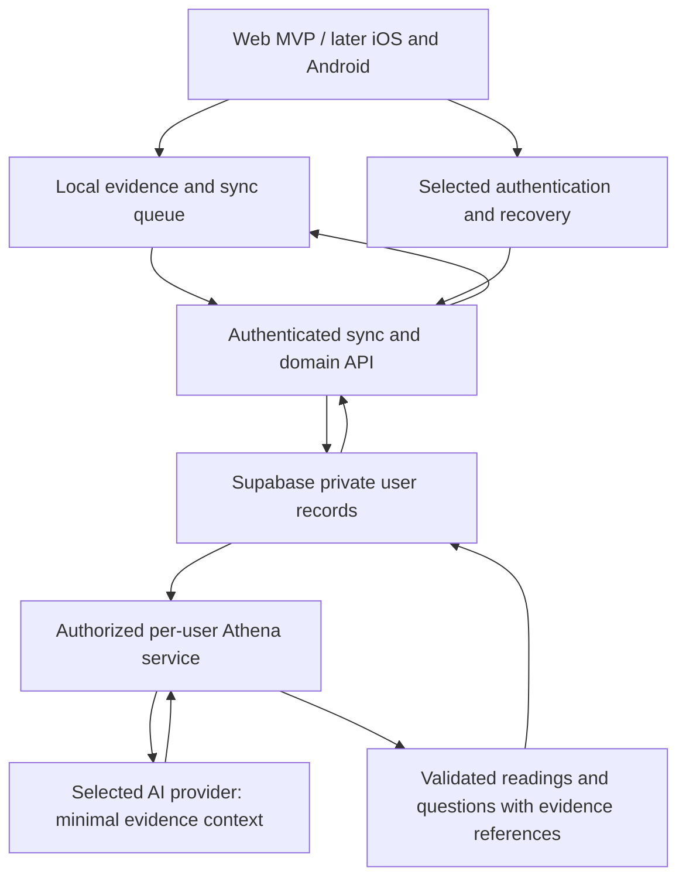

# Circle OS architecture

Updated: 2026-10-31. Read [product](PRODUCT.md), [roadmap](ROADMAP.md), and
[decisions](DECISION_LOG.md) alongside this document. Target designs below need
reviewed implementation and verification under the current web beta sequence.

## Current prototype

```text
Browser: Today / Reflect / chapter player / authoring
  |
  +-- IndexedDB + localStorage copy (circle-os-state-v2)
  +-- immutable chapter cache + local progress
  +-- evidence revisions + sync outbox
  |
  v
File-based profile server (local-ai/server.mjs)
  |
  +-- profile and day records in vault files
  +-- private profile keys stored outside the vault
  +-- profile recovery / authorized device attachment
  +-- prepared readings, memory, and chapter publications
```

- `app/os/circle-os-store.ts` saves local state and reads the newest local copy.
- `CircleStateProvider` in `circle-os-shell.tsx` owns state, startup, and sync.
- `app/os/circle-os-ai.ts` is the current profile-server client despite its name.
- `local-ai/server.mjs` stores/merges evidence. External Athena preparation is
  described in `local-ai/README.md`; operation of that scheduler is not certified
  by the presence of the server code.
- The current app has a default profile-server address and can upload records.
  It is not accurately described as a device-only app.
- `db/schema.ts` is empty scaffolding and `db/index.ts` is a D1 adapter. Neither
  is an implemented Supabase lifestyle database.
- Current prepared-content behavior must stay distinct from planned live or
  scheduled AI inference. There is no configured model integration implied here.

Runtime files may still reference the vault. Replacing missing product-document
authorities does not remove these integrations or migrate personal data.

### Supabase account entry implementation - 2026-10-31

The reviewed login slice adds `app/os/auth/` in front of the existing state
provider. It uses the official Supabase browser client; no lifestyle database,
evidence sync, membership, or live Athena service is connected by this slice.
The developer approved invitations only, continued offline use after a prior
online sign-in, and preserving the owner's legacy profile until a separate
migration review. Authentication IDs select the existing account-scoped stores.
Alias is editable Supabase user metadata, never an authorization role. Account
mode bypasses the old real-name/age entry requirement, without inventing either.

Online entry checks the user with Supabase and requires confirmed email.
Invitation and recovery links lead to password entry before personal state can
mount. Reload retains that step. A new account chooses an alias before entry.
The saved browser scope marker alone cannot open a different account. Session
and attempt guards reject late results after logout or switching.

A successful online check saves an offline proof containing the signed token
and public verification keys. Offline entry verifies its signature, issuer,
audience, role and owner, deliberately accepting expiry for local use only.
Local records remain usable until logout; server access still needs a current
session. Reconnection/foreground checks detect rejection and close access.
Remote revocation cannot be detected while disconnected. Local storage and
cached keys are not encryption or protection against device/browser-script
access. Offline logout removes the offline proof and persisted SDK credentials;
it cannot revoke a remote session while the network is unavailable.

Existing-profile mode remains the default while migration is unreviewed.
Enable Supabase mode explicitly at build time; never treat that default as a
multi-user beta configuration. Invalid Supabase configuration fails closed.

For local onboarding tests, the developer approved a development-only `test`
mode on 2026-10-31. Set this in the ignored `.env.local`, restart the development
server (`npm run dev`), and fully reload the browser:

```text
NEXT_PUBLIC_CIRCLE_AUTH_MODE=test
```

This opens the account-style Day One flow without login, real name, or age.
Reload resumes the current test. **New test session** creates a fresh synthetic
account and empty state through the existing storage engine; it never deletes
or migrates old records. The test selection uses
`circle-os-development-test-scope-v1`, separate from the real account marker.
Only generated `dev-test-<uuid>` accounts can open in this mode. Their state,
private chapter cache and pins use the existing account-specific keys/databases.
Neither Supabase auth nor the legacy profile server is contacted.

Use `legacy` for the original profile flow, `supabase` for actual invited-account
login, and `test` for development onboarding. Mode changes need a server restart
and full page reload; production changes need a rebuild. Production with `test`
configured fails closed, and the development namespace helper also rejects
production calls. No test switch exists in the released login UI. The actual
`.env.local` was not edited by implementation or verification.

Only public project configuration belongs in frontend environment variables:

```text
NEXT_PUBLIC_CIRCLE_AUTH_MODE=supabase
NEXT_PUBLIC_SUPABASE_URL=https://<project>.supabase.co
NEXT_PUBLIC_SUPABASE_PUBLISHABLE_KEY=<publishable key>
```

Before hosted verification, create the reviewed Singapore project, disable
public signup, require email confirmation, configure an asymmetric JWT signing
key (ES256 or RS256), and set up custom SMTP. No administrator/service-role key
is used by this browser implementation. Configure the app origin and allow
`<app-origin>/os/auth/confirm` as a redirect. Use these email template link
targets, substituting the actual app origin for `<app-origin>`:

```text
Invite: <app-origin>/os/auth/confirm#token_hash={{ .TokenHash }}&type=invite
Reset:  <app-origin>/os/auth/confirm#token_hash={{ .TokenHash }}&type=recovery
```

Hash links keep one-use secrets out of HTTP requests and navigation caches;
the boundary removes them from browser history before exchanging them. The
app intentionally does not accept default implicit-token or arbitrary query
redirect flows. Admin sends/reissues invitations through Supabase; users can
request password resets. Disable email link tracking and test links on a
different browser/device as well as the originating device. See official
[email templates](https://supabase.com/docs/guides/auth/auth-email-templates),
[SMTP requirements](https://supabase.com/docs/guides/auth/auth-smtp), and
[session behavior](https://supabase.com/docs/guides/auth/sessions).

The worker covers `/os` as well as nested routes and primes already-loaded
static code after first sign-in. It does not cache Supabase auth responses.
Actual hosted configuration, mail delivery, project access policies, physical
phones, and owner migration need separate verification; local fixtures do not
certify them. Current evidence belongs in the
[journey record](USER_JOURNEY_TESTING.md#supabase-account-entry---2026-10-31).

## Target across later web iterations and mobile clients

The [approved launch plan](WEB_BETA_LAUNCH_PLAN.md) now includes Supabase
accounts, safe sync, manual paid membership, and a bounded personalized Athena
integration in the first invited beta. This supersedes the earlier core-first
sequence; none of those target services is implemented by this plan.
Existing prepared readings remain part of current-feature verification.



Supabase is the chosen backend direction. Email/password with a separate alias
is confirmed. API/worker runtime and AI provider remain open; native delivery
is deferred. The AI service is an
application boundary we must implement; Supabase selection alone does not
create it. Keep domain rules and data contracts independent of web UI details.

## Identity and recovery

Confirmed intent: keep personal records private and use email/password with a
separate display alias. On 2026-10-31 the developer accepted email, superseding
the earlier username-only preference. Recovery and email-delivery configuration
are described in the account-entry implementation above; hosted setup remains
unverified and manual lost-email recovery still needs a reviewed design.

Technical findings checked against official documentation on 2026-10-30:

- Supabase password authentication uses an email address or phone number.
  Username-only password login is not the documented built-in flow.
  [Password authentication](https://supabase.com/docs/guides/auth/passwords).
- Anonymous signup does not collect an identity, but a signed-out user cannot
  sign back into that account through anonymous signup alone.
  [Anonymous sign-ins](https://supabase.com/docs/guides/auth/auth-anonymous).
- Supabase supports compatible third-party authentication, so database choice
  does not by itself settle the login provider.
  [Third-party authentication](https://supabase.com/docs/guides/auth/third-party/overview).

Use supported managed authentication with private contact/recovery details.
Confirmed 2026-10-31: new users must verify their email before using their
account. The optional Supabase-mode browser gate and link handling are now
implemented and locally tested; actual email delivery and hosted enforcement
remain unverified.
Confirmed 2026-10-31: password recovery uses a reset link sent to the account's
verified email address. Manual recovery will also be offered when the person
loses access to that email (confirmed 2026-10-31). Ownership checks and the
manual process require review before implementation. Browser reset-link and
session handling are implemented in the optional mode above. Hosted delivery,
real session revocation, and lost-device operations remain unverified.
Login should persist until logout; local records may remain stored. Session
renewal and local logout now have browser handling and synthetic checks;
hosted revocation/lost-device behavior still needs verification. Retained local records must stay account-scoped
and inaccessible to another account or a signed-out person.
Do not build custom password verification or synthetic-email
workarounds. The browser store now has account-specific keys, private chapter
caches, pins, and safe switching. Supabase mode must be enabled and its
authentication configuration verified before multi-user operation.
Signing in must not silently claim a previous person's local evidence.

Use an internal account ID for ownership. Keep a display alias separate from
private authentication information. Real name and exact age must not remain
required by habit; review what information the product actually needs.

## Private evidence and authorization

Proposed requirements, not claims that the current prototype meets them:

- Each private record has an owner. Access is enforced on the server/database,
  including reads, writes, storage objects, functions, and background jobs.
- Separate authentication/contact information from lifestyle evidence and any
  intentionally public alias or aggregate score.
- Enable appropriate database grants and row-level policies. Test allowed own
  access, denied other-user access, and unauthenticated requests. Supabase's
  privileged secret/service-role access can bypass RLS, so server jobs using it
  require their own verified user scoping.
  [Row Level Security](https://supabase.com/docs/guides/database/postgres/row-level-security).
- Keep privileged credentials on the server. Validate ownership from a verified
  session or authorized job, not an arbitrary user ID in a request or prompt.
- Admin has always-available read-only access to personal writing, without
  support-case approval. Verify protected admin access and denied user access;
  read-access audit details remain open. Admin's separate power to delete an
  account and its data on request is allowed; direct writing edits are not.
- Error logs are admin-only and may contain personal writing. Log retention
  and implementation details remain open; do not claim logs are writing-free.
- Account/data deletion is manual on request. Deleted data may remain in backups
  for at most 30 days. Deletion turnaround, retained local/log/provider copies,
  and prevention of deleted-data restoration require a reviewed design.
- No user download/export is offered in beta. Operational backup/restore and
  deletion/backup expiration remain verification gates.
- Use protected transport and storage, and review encryption/key requirements.
  Do not claim end-to-end encryption against the backend or AI provider while
  they can read the plaintext needed for server-side analysis.
- Pseudonyms do not guarantee anonymity. Free writing, aliases reused elsewhere,
  and operational metadata may identify someone.

## Athena access boundary

Confirmed beta request flow (2026-10-31): requesting an Athena reading has no
separate AI opt-in prompt. The person requests the reading directly. How AI
processing is explained is confirmed: the developer will explain it manually
on the website or social pages and warn users not to enter sensitive information.
Exact wording/publication remain pending. The developer accepts processing Athena
needs without additional provider privacy restrictions at this planning stage.
Actual retention, training use, and processing locations must be documented at
integration. This does not remove authentication, membership, or usage checks.
No request flow or provider integration is implemented by this decision.

Confirmed reading evidence (2026-10-31): relevant notes, reflections, goals,
habits, and activity records belonging to the requesting person may be used.
Login and payment details stay out of the AI context. Exact evidence selection
and exclusion checks require implementation review and verification; these
boundaries are not yet implemented.
Relevant evidence may come from the person's whole history. Requested replies
may use all evidence available to Athena for that person within these boundaries;
whole-history access is not a requirement to send every record on every call.

Confirmed beta reply rule (2026-10-31): saving a reflection and requesting an
Athena reply are separate actions. A save persists dated user evidence without
starting generation. Only an explicit request starts a reply, subject to
authorization, membership, and usage controls. Saving reflections stays free.
Keep the reply rule in one place so later behavior changes do not require
rewriting saved reflections or immutable reading history. Exact controls and
limits remain open; this separation is not yet implemented.
There is no fixed follow-up-question count beyond usage allowance. This
supersedes the earlier bounded-follow-up proposal; automatic replies remain
outside scope. Readings are short, direct, calm, and advisory. Exact tone and
language guidance will be configured later in a skill or similar instruction
file. No instruction file or new philosophy is authored by this decision.

Confirmed beta reading location (2026-10-31): Athena readings live in the
existing Reflect experience. Exact Page layout and controls remain open;
this decision does not create a separate app or select a delivery mechanism.

Confirmed reading format (2026-10-31): each reading includes one optional
reflection question. The person may leave it unanswered. An answer is saved
as dated personal evidence through the reflection-save action, without
triggering a reply. A reply still requires a separate explicit request.

Confirmed beta reading flow (2026-10-31): a person requests a reading and the
requested result appears automatically when ready, without a second reveal
request. Authorization and usage checks apply to the initiating request.
This does not authorize automatic preparation of unrequested readings or
settle a queue, polling, notification, or delivery implementation. Existing
prepared-content behavior remains distinct from this planned generation flow.

Recommended design:

1. For beta readings and replies, the application authorizes the person's
   explicit request. A worker may finish that requested work asynchronously;
   scheduled preparation of unrequested readings is not approved by this flow.
2. A constrained service selects the necessary evidence and records its IDs
   and revision within the allowed reading evidence. Login and payment details
   are excluded from the AI context.
3. The model receives that context and approved tool capabilities. Database
   administrator credentials and unrestricted SQL access are never in prompts.
4. Validate the result and its source references. Store readings, questions, or
   inferred memory separately from the person's original words and actions.
5. Deliver the result with freshness, uncertainty, and correction behavior.

User writing is evidence, not authority to change tool permissions. Reject
cross-user requests and unapproved actions regardless of model instructions.
Error logs may contain personal writing and are accessible only to admin;
retention and logging details require implementation review.

Provider retention/training facts and processing locations, published data-use
wording, budget, and correction propagation require review before using real
tester evidence with a model. The developer's processing flexibility is not a
claim about an unselected provider's actual terms or capabilities.
The app remains usable when inference fails or the budget is exhausted.

## Membership and usage boundary

Planned membership is server-owned prepaid access. The developer confirms
payment and grants a duration or expiry; admin can extend/revoke with an audit
trail. The browser and Home Screen app share the same account entitlement.
Users cannot edit their own membership or limits. Check live expiry and
revocation for every generation request rather than trusting cached paid flags.
No billing integration or membership service currently exists.

Confirmed renewal starting point (2026-10-31): use the current expiry while
membership is active, or the grant time after expiry. This preserves unused
paid time. Standard access durations are fixed 30, 90, 180, or 365 days
(confirmed 2026-10-31). Use explicit day counts rather than calendar months or
years; do not convert 365 days to twelve 30-day periods. Month-end adjustments
do not apply. Access expires at the same time of day after the selected duration,
measured from the agreed renewal starting point. Display expiry in the person's
local timezone (confirmed 2026-10-31). Timestamp storage and date-calculation
details require implementation review.
These rules are not yet implemented.

Enforce per-user allowances, input/output limits, total spending controls, and
pause switches on the server. Reserve quota atomically to prevent concurrent
requests exceeding it. Failed requests consume no user allowance: release or
settle reservations accordingly and account for provider costs separately.
Daily resets use Myanmar time (`Asia/Yangon`); unused daily allowance carries
within the person's membership cycle and disappears at that cycle's monthly
reset. Monthly allowance does not carry forward. Exact amounts/counting units,
reset hour, monthly-cycle calculation for 30/90/180/365-day grants, expiry/renewal
effects, retries/no-change outcomes, total budget, and pause/alert thresholds
remain open. Prices/payment details are deferred. Expiry
does not delete personal evidence. Confirmed 2026-10-31: previously received
readings remain readable after paid access expires. Gate new Athena generation
on current entitlement; do not apply that paid gate to reading existing editions.
Core tools, personal records, and sync remain available. This access rule does
is separate from the manual deletion and 30-day backup rules above. None of
these target membership or privacy behaviors is implemented by this plan.

## Beta infrastructure and content delivery

There is no Supabase project or AI API account yet according to the developer.
Singapore is the chosen database region for the 10-20 Myanmar/Thailand beta
users (confirmed 2026-10-31). Setup availability and actual connections from
both Myanmar and Thailand must be checked before launch; no project is
provisioned or connectivity verified by this decision. Database location does not
settle AI processing location or actual provider terms. Admin access, logs,
manual deletion, and maximum backup retention are defined above; their
implementation and remaining details still require review and verification.
The developer will monitor the beta. Feedback and recovery/rollback procedures
remain open.

Retain existing web installation support and verify Home Screen installation,
session behavior, offline reload, and updates on real phones. Native apps and
app-store distribution are outside this beta.

Live admin chapter updates without compilation are deferred until after beta
as confirmed by the developer on 2026-10-31. A future authenticated content service must validate
supported schemas, publish immutable versions, preserve in-progress runs, and
support caching and rollback. New actions/page types still require code; do not
treat content publishing as permission to execute arbitrary instructions.

## Data and sync design to preserve

- Versioned migrations from existing browser/profile-server records, with a
  backup and validated recovery path before migration is exercised on real data.
- Local durable writes followed by idempotent sync and revision acknowledgement.
- Explicit clearing edits/tombstones so stale server data cannot restore a value.
- The person chooses between conflicting device edits. The exact resolution
  UI and preservation of unresolved revisions need review. One profile per
  account remains the ownership rule across devices.
- Separate user evidence, derived observations, immutable chapter definitions,
  chapter runs, current app projections, and reading editions.
- Consistent domain actions for a chapter completed through any entry point.
- The Circle day starts at 06:00 and its timezone follows the person. Exact
  travel handling and preservation of dated evidence need implementation review.

The future schema should represent those ownership and lifecycle boundaries.
Actual tables and indexes follow the stabilization/data-model audit; no schema
or migration was implemented by writing this plan.

## Rewards and sharing

Streaks, points, and leaderboards are an unresolved product track. Proposed
architecture uses a separate server-validated score/event projection with
defined correction semantics. A public summary never grants access to private
evidence or Athena's interpretation. Participation and visible fields need an
explicit product choice. Do not add public scores during current stabilization.

## Required proof before a wider tester release

- Own-user access succeeds; other-user access fails through every exposed path.
- Local input, retry, edits, clearing values, reload, and restore preserve data.
- Authentication, session expiry, recovery, and device loss behave as promised.
- AI context and responses are isolated to the correct user and evidence.
- Manual account/data deletion, backup expiration within 30 days, operational
  restore, migrations, and app updates are exercised. No user export/download
  is offered in beta. Verify admin read-only writing access/admin-only logs,
  retained-local-data isolation, person-chosen conflicts, travelling timezones,
  membership-cycle carry-over/reset, and failed-request allowance release.
- The chosen hosting runtime and real-phone journeys are checked in the release
  environment. A successful local build is not a deployment or security audit.

