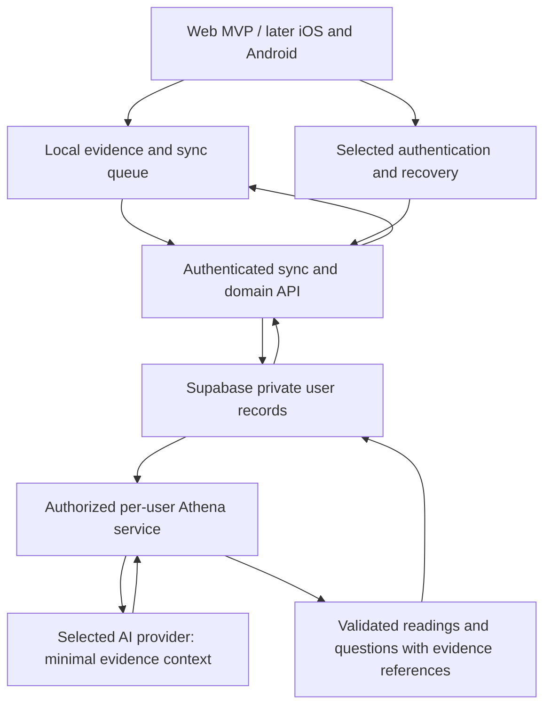

# Circle OS architecture

Updated: 2026-10-30. Read [product](PRODUCT.md), [roadmap](ROADMAP.md), and
[decisions](DECISION_LOG.md) alongside this document. Target designs below are
proposals to implement and verify after existing-feature stabilization.

## Current prototype

```text
Browser: Today / Reflect / chapter player / authoring
  |
  +-- IndexedDB + localStorage copy (circle-os-state-v2)
  +-- immutable chapter cache + local progress
  +-- evidence revisions + sync outbox
  |
  v
File-based profile server (local-ai/server.mjs)
  |
  +-- profile and day records in vault files
  +-- private profile keys stored outside the vault
  +-- profile recovery / authorized device attachment
  +-- prepared readings, memory, and chapter publications
```

- `app/os/circle-os-store.ts` saves local state and reads the newest local copy.
- `CircleStateProvider` in `circle-os-shell.tsx` owns state, startup, and sync.
- `app/os/circle-os-ai.ts` is the current profile-server client despite its name.
- `local-ai/server.mjs` stores/merges evidence. External Athena preparation is
  described in `local-ai/README.md`; operation of that scheduler is not certified
  by the presence of the server code.
- The current app has a default profile-server address and can upload records.
  It is not accurately described as a device-only app.
- `db/schema.ts` is empty scaffolding and `db/index.ts` is a D1 adapter. Neither
  is an implemented Supabase lifestyle database.
- Current prepared-content behavior must stay distinct from planned live or
  scheduled AI inference. There is no configured model integration implied here.

Runtime files may still reference the vault. Replacing missing product-document
authorities does not remove these integrations or migrate personal data.

## Target across later web iterations and mobile clients

The first friends-and-family release tests the stabilized core. The Athena
service below is a subsequent integration, not a prerequisite for that test.
Existing prepared readings remain part of current-feature verification.



Supabase is the chosen backend direction. Authentication method, API/worker
runtime, AI provider, and native framework remain open. The AI service is an
application boundary we must implement; Supabase selection alone does not
create it. Keep domain rules and data contracts independent of web UI details.

## Identity and recovery

Confirmed intent: use pseudonyms and keep personal records private. The
developer prefers username/password and has not decided whether to collect
email. Do not silently turn that preference into an email requirement.

Technical findings checked against official documentation on 2026-10-30:

- Supabase password authentication uses an email address or phone number.
  Username-only password login is not the documented built-in flow.
  [Password authentication](https://supabase.com/docs/guides/auth/passwords).
- Anonymous signup does not collect an identity, but a signed-out user cannot
  sign back into that account through anonymous signup alone.
  [Anonymous sign-ins](https://supabase.com/docs/guides/auth/auth-anonymous).
- Supabase supports compatible third-party authentication, so database choice
  does not by itself settle the login provider.
  [Third-party authentication](https://supabase.com/docs/guides/auth/third-party/overview).

Before implementation, compare a managed login with private contact/recovery
details against an approach supporting the required email-free identity and
recovery. Decide forgotten-password and lost-device behavior at the same time.
Do not build password verification or a synthetic-email workaround casually.

Use an internal account ID for ownership. Keep a display alias separate from
private authentication information. Real name and exact age must not remain
required by habit; review what information the product actually needs.

## Private evidence and authorization

Proposed requirements, not claims that the current prototype meets them:

- Each private record has an owner. Access is enforced on the server/database,
  including reads, writes, storage objects, functions, and background jobs.
- Separate authentication/contact information from lifestyle evidence and any
  intentionally public alias or aggregate score.
- Enable appropriate database grants and row-level policies. Test allowed own
  access, denied other-user access, and unauthenticated requests. Supabase's
  privileged secret/service-role access can bypass RLS, so server jobs using it
  require their own verified user scoping.
  [Row Level Security](https://supabase.com/docs/guides/database/postgres/row-level-security).
- Keep privileged credentials on the server. Validate ownership from a verified
  session or authorized job, not an arbitrary user ID in a request or prompt.
- Define processing consent, retention, operator access, and deletion for raw
  evidence, derived memory, readings, logs, and backups. Export and restore need
  real verification; record deletion and backup expiration must be explained.
- Use protected transport and storage, and review encryption/key requirements.
  Do not claim end-to-end encryption against the backend or AI provider while
  they can read the plaintext needed for server-side analysis.
- Pseudonyms do not guarantee anonymity. Free writing, aliases reused elsewhere,
  and operational metadata may identify someone.

## Athena access boundary

Recommended design:

1. The application authorizes a user request or a scheduled per-user job.
2. A constrained service selects the necessary evidence and records its IDs
   and revision. Identity/contact details are omitted unless actually needed.
3. The model receives that context and approved tool capabilities. Database
   administrator credentials and unrestricted SQL access are never in prompts.
4. Validate the result and its source references. Store readings, questions, or
   inferred memory separately from the person's original words and actions.
5. Deliver the result with freshness, uncertainty, and correction behavior.

User writing is evidence, not authority to change tool permissions. Reject
cross-user requests and unapproved actions regardless of model instructions.
Logging should support diagnostics without copying personal prompts by default.

Provider retention/training choices, consent, budget, cadence, and correction
propagation must be decided before using real tester evidence with a model.
The app remains usable when inference fails or the budget is exhausted.

## Data and sync design to preserve

- Versioned migrations from existing browser/profile-server records, with a
  backup and validated recovery path before migration is exercised on real data.
- Local durable writes followed by idempotent sync and revision acknowledgement.
- Explicit clearing edits/tombstones so stale server data cannot restore a value.
- A defined conflict policy and one profile per account across devices.
- Separate user evidence, derived observations, immutable chapter definitions,
  chapter runs, current app projections, and reading editions.
- Consistent domain actions for a chapter completed through any entry point.
- Circle day boundary at 06:00, with explicit timezone/travel rules.

The future schema should represent those ownership and lifecycle boundaries.
Actual tables and indexes follow the stabilization/data-model audit; no schema
or migration was implemented by writing this plan.

## Rewards and sharing

Streaks, points, and leaderboards are an unresolved product track. Proposed
architecture uses a separate server-validated score/event projection with
defined correction semantics. A public summary never grants access to private
evidence or Athena's interpretation. Participation and visible fields need an
explicit product choice. Do not add public scores during current stabilization.

## Required proof before a wider tester release

- Own-user access succeeds; other-user access fails through every exposed path.
- Local input, retry, edits, clearing values, reload, and restore preserve data.
- Authentication, session expiry, recovery, and device loss behave as promised.
- AI context and responses are isolated to the correct user and evidence.
- Export, deletion, backup/restore, migrations, and app updates are exercised.
- The chosen hosting runtime and real-phone journeys are checked in the release
  environment. A successful local build is not a deployment or security audit.

